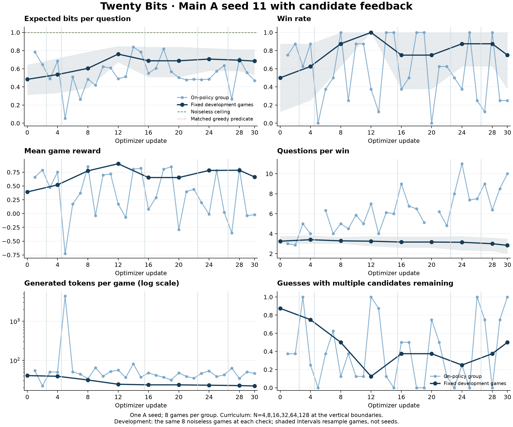
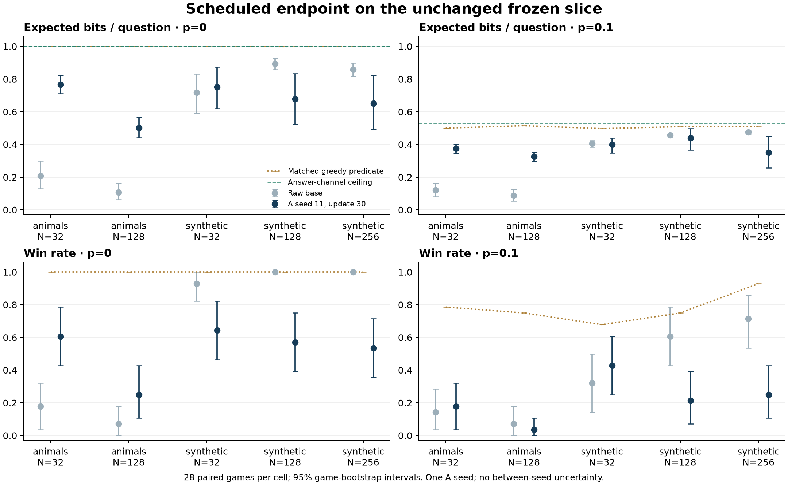

# Main A seed 11 gate

Completed the scheduled **30 updates and 240 training games**, with **64 new development games**, **280 new matched raw-base frozen games** and **280 endpoint frozen games**. Eight raw development games are reused from the matched pre-RL control. A seed 23, B seed 41 and hard-mode evaluation have not started. Work stops at this gate.

**Animal question quality improves; end-to-end synthetic transfer regresses.** The declared noiseless animal comparison rises from 0.158 to 0.634 EIG/question (equal weight over N=32 and 128), a paired change of +0.476 [95% CI +0.413, +0.539]. Wins rise from 7/56 to 24/56. At N=128 alone, EIG rises 0.109 → 0.501, around half the 1-bit ceiling, and wins rise 2/28 → 7/28. [Frozen endpoint chart](results/main_A11/charts/frozen-endpoint.png).

On noiseless relabeled synthetic, equal-size EIG falls 0.823 → 0.693, change -0.129 [95% CI -0.214, -0.038], and wins fall 82/84 → 49/84. Across all ten cells, mean EIG rises 0.433 → 0.524 while wins fall 141/280 → 104/280. The overall EIG average alone would hide the transfer regression.

The fixed development curve moves mainly by update 12, then fluctuates: wins 4, 5, 7, 8, 6, 6, 7, 7, 6 at updates 0/4/8/12/16/20/24/28/30. EIG is 0.483 at raw base, 0.761 at update 12 and 0.684 at the scheduled endpoint. Final paired EIG change is +0.201 [95% CI +0.055, +0.341]; the paired win change remains uncertain [-12.5, +62.5 percentage points]. No best-checkpoint selection occurred. [Full learning curve](results/main_A11/charts/main-learning.png).

## Fixed setup and curriculum

Raw Qwen3-8B, no SFT or pilot adapter loaded; rank-32 LoRA seed 11, learning rate 4e-5 and unchanged cookbook Adam parameters. One eight-game group per update, with one table and target shared by its independently seeded rollouts. Group returns are standardized with population standard deviation; constant returns give zero advantage. Loss is the cookbook importance-sampling objective on generated tokens only. Reward remains +1 win, -0.03/question and -0.1/INVALID. EIG is measured, never rewarded.

| N | Updates | Training games |
| ---: | --- | ---: |
| 4 | 1–2 | 16 |
| 8 | 3–4 | 16 |
| 16 | 5–15 | 88 |
| 32 | 16–22 | 56 |
| 64 | 23–26 | 32 |
| 128 | 27–30 | 32 |

**The curriculum reaches N=32 and N=128**, matching the frozen animal cells. N=256 remains size transfer on relabeled synthetic. Every gradient uses only the fixed 200-row animal training pool; development, held-out profiles and frozen games never enter gradients.

Prompt candidate-set-v1, exact attribute aliases, 2,048 output tokens with thinking disabled, 32K context and original-N question budgets stayed fixed. The provided state means the main question is question selection, rather than maintaining state from history. Checkpoints were not selected on frozen scores: only the scheduled update-30 endpoint was retained and evaluated. [Frozen config](experiments/main_A11.json), [cases](experiments/main_A11_games.json.gz), [preflight](research/main_A11_preflight.json).

## All 30 training updates

Rows contain eight games sampled before that optimizer update. Each group has a different start state, so the raw training curve mixes learning, difficulty and curriculum. The fixed development curve below supplies a paired comparison. Q/win is conditional on winning; EIG includes every counted question, including INVALID and losses. Undefined values remain undefined.

The log2(N) reference describes uniform-prior search that identifies every target. Individual wins and win-conditioned means can fall below it after lucky unbalanced splits or uncertain guesses; that does not exceed the one-bit EIG ceiling.

| Update | N | Reward | Wins/8 | EIG/Q | Q/win | Enum % | Invalid % | Nonzero group / cumulative % | Output tokens/game |
| ---: | ---: | ---: | ---: | ---: | ---: | ---: | ---: | --- | ---: |
| 1 | 4 | 0.660 | 6/8 | 0.785 | 3.00 | 0.0 | 0.0 | 100.0 / 100.0 | 54.50 |
| 2 | 4 | 0.789 | 7/8 | 0.645 | 2.86 | 0.0 | 0.0 | 100.0 / 100.0 | 22.25 |
| 3 | 8 | 0.475 | 5/8 | 0.488 | 5.00 | 0.0 | 0.0 | 100.0 / 100.0 | 50.75 |
| 4 | 8 | 0.751 | 7/8 | 0.685 | 4.00 | 0.0 | 0.0 | 100.0 / 100.0 | 49.75 |
| 5 | 16 | -0.728 | 0/8 | 0.053 | — | 0.0 | 60.9 | 100.0 / 100.0 | 4403.25 |
| 6 | 16 | 0.172 | 3/8 | 0.511 | 6.33 | 0.0 | 0.0 | 100.0 / 100.0 | 50.75 |
| 7 | 16 | 0.369 | 4/8 | 0.261 | 4.00 | 0.0 | 0.0 | 100.0 / 100.0 | 44.38 |
| 8 | 16 | 0.850 | 8/8 | 0.485 | 5.00 | 0.0 | 0.0 | 100.0 / 100.0 | 33.50 |
| 9 | 16 | -0.038 | 2/8 | 0.419 | 4.50 | 0.0 | 16.0 | 100.0 / 100.0 | 64.62 |
| 10 | 16 | 0.699 | 7/8 | 0.622 | 5.86 | 0.0 | 0.0 | 100.0 / 100.0 | 39.25 |
| 11 | 16 | 0.718 | 7/8 | 0.609 | 5.00 | 0.0 | 0.0 | 100.0 / 100.0 | 51.88 |
| 12 | 16 | 0.173 | 3/8 | 0.490 | 7.00 | 0.0 | 0.0 | 100.0 / 100.0 | 56.25 |
| 13 | 16 | -0.070 | 1/8 | 0.512 | 4.00 | 0.0 | 0.0 | 100.0 / 100.0 | 36.50 |
| 14 | 16 | 0.804 | 8/8 | 0.839 | 6.12 | 0.0 | 2.0 | 100.0 / 100.0 | 81.12 |
| 15 | 16 | 0.820 | 8/8 | 0.785 | 6.00 | 0.0 | 0.0 | 0.0 / 93.3 | 37.00 |
| 16 | 32 | 0.077 | 3/8 | 0.550 | 9.00 | 0.0 | 1.3 | 100.0 / 93.8 | 47.88 |
| 17 | 32 | 0.290 | 4/8 | 0.606 | 6.75 | 0.0 | 0.0 | 100.0 / 94.1 | 41.25 |
| 18 | 32 | 0.805 | 8/8 | 0.819 | 6.50 | 0.0 | 0.0 | 100.0 / 94.4 | 37.00 |
| 19 | 32 | 0.846 | 8/8 | 0.568 | 5.12 | 0.0 | 0.0 | 100.0 / 94.7 | 31.50 |
| 20 | 32 | -0.293 | 0/8 | 0.503 | — | 0.0 | 0.0 | 100.0 / 95.0 | 47.50 |
| 21 | 32 | 0.396 | 5/8 | 0.477 | 6.20 | 0.0 | 0.0 | 100.0 / 95.2 | 38.88 |
| 22 | 32 | 0.441 | 5/8 | 0.484 | 4.80 | 0.0 | 0.0 | 100.0 / 95.5 | 35.00 |
| 23 | 64 | 0.200 | 4/8 | 0.480 | 8.00 | 0.0 | 0.0 | 100.0 / 95.7 | 46.50 |
| 24 | 64 | -0.013 | 3/8 | 0.484 | 11.00 | 0.0 | 4.4 | 100.0 / 95.8 | 53.62 |
| 25 | 64 | 0.779 | 8/8 | 0.572 | 7.38 | 0.0 | 0.0 | 100.0 / 96.0 | 38.50 |
| 26 | 64 | 0.021 | 2/8 | 0.635 | 7.50 | 0.0 | 0.0 | 100.0 / 96.2 | 42.50 |
| 27 | 128 | -0.350 | 1/8 | 0.266 | 9.00 | 0.0 | 8.0 | 100.0 / 96.3 | 63.25 |
| 28 | 128 | 0.809 | 8/8 | 0.708 | 6.38 | 0.0 | 0.0 | 100.0 / 96.4 | 34.50 |
| 29 | 128 | -0.039 | 2/8 | 0.556 | 8.50 | 0.0 | 0.0 | 100.0 / 96.6 | 50.38 |
| 30 | 128 | -0.020 | 2/8 | 0.469 | 10.00 | 0.0 | 0.0 | 100.0 / 96.7 | 46.50 |

Return variance occurred in 29/30 groups and win variance in 21/30. Zero-win groups with cost-only return variance: [5, 20]. Variance alone does not establish a useful win signal.

## Fixed four-update development checks

The same four N=4 and four N=8 training-pool cases use the same requested generation seeds at every check. They never enter gradients, but they are not held-out items or the frozen test bank. The raw control is reused without another sampling charge. Intervals resample complete games; there is one main training seed, with no between-seed uncertainty estimate.

| Update | Reward | Wins/8 | EIG/Q [95% CI] | Q/win | Output tokens/game |
| ---: | ---: | ---: | --- | ---: | ---: |
| 0 | 0.391 | 4/8 | 0.483 [0.312, 0.644] | 3.25 | 40.75 |
| 4 | 0.520 | 5/8 | 0.536 [0.332, 0.715] | 3.40 | 39.12 |
| 8 | 0.774 | 7/8 | 0.604 [0.386, 0.786] | 3.29 | 31.50 |
| 12 | 0.903 | 8/8 | 0.761 [0.671, 0.849] | 3.25 | 24.50 |
| 16 | 0.653 | 6/8 | 0.687 [0.506, 0.841] | 3.17 | 23.62 |
| 20 | 0.653 | 6/8 | 0.687 [0.506, 0.841] | 3.17 | 23.62 |
| 24 | 0.781 | 7/8 | 0.706 [0.577, 0.827] | 3.14 | 23.12 |
| 28 | 0.785 | 7/8 | 0.694 [0.573, 0.813] | 3.00 | 22.62 |
| 30 | 0.664 | 6/8 | 0.684 [0.530, 0.813] | 2.83 | 22.12 |

Raw → update 30: reward 0.391 → 0.664, EIG/Q 0.483 → 0.684, and Q/win 3.25 → 2.83. Paired EIG change: 0.201 [0.055, 0.341]; exact paired win p=0.625. Small-case intervals and tests are descriptive; the frozen endpoints test larger sizes and transfer.

## Guessing with k candidates remaining

Each entry below is **wins / guesses**. k is measured immediately before GUESS: exact consistent support with truthful answers; the existing >0.001 plus MAP displayed list under noise. Full positive posterior support and guess confidence are also saved, since a noisy displayed singleton is not certainty. No-guess games stay in all-game denominators; no-guess is separate from k. This metric changes no reward, prompt or action restriction.

| Development update | k=1 W/G | k=2 W/G | k=3 W/G | k=4+ W/G | No guess / 8 |
| ---: | --- | --- | --- | --- | ---: |
| 0 | 1/1 | 2/3 | 0/3 | 1/1 | 0 |
| 4 | 2/2 | 2/2 | 0/3 | 1/1 | 0 |
| 8 | 4/4 | 2/2 | 0/1 | 1/1 | 0 |
| 12 | 7/7 | 1/1 | 0/0 | 0/0 | 0 |
| 16 | 5/5 | 1/2 | 0/1 | 0/0 | 0 |
| 20 | 5/5 | 1/2 | 0/1 | 0/0 | 0 |
| 24 | 6/6 | 1/2 | 0/0 | 0/0 | 0 |
| 28 | 5/5 | 2/3 | 0/0 | 0/0 | 0 |
| 30 | 4/4 | 2/3 | 0/1 | 0/0 | 0 |

| Training update | k=1 W/G | k=2 W/G | k=3 W/G | k=4+ W/G | No guess / 8 |
| ---: | --- | --- | --- | --- | ---: |
| 1 | 5/5 | 1/3 | 0/0 | 0/0 | 0 |
| 2 | 5/5 | 2/3 | 0/0 | 0/0 | 0 |
| 3 | 0/0 | 0/1 | 4/5 | 1/2 | 0 |
| 4 | 6/6 | 1/1 | 0/0 | 0/1 | 0 |
| 5 | 0/0 | 0/0 | 0/0 | 0/0 | 8 |
| 6 | 3/3 | 0/3 | 0/0 | 0/0 | 2 |
| 7 | 3/3 | 1/5 | 0/0 | 0/0 | 0 |
| 8 | 7/7 | 0/0 | 1/1 | 0/0 | 0 |
| 9 | 2/2 | 0/3 | 0/0 | 0/0 | 3 |
| 10 | 7/7 | 0/0 | 0/0 | 0/1 | 0 |
| 11 | 7/7 | 0/0 | 0/0 | 0/1 | 0 |
| 12 | 0/0 | 0/0 | 1/2 | 2/6 | 0 |
| 13 | 1/1 | 0/1 | 0/0 | 0/6 | 0 |
| 14 | 7/7 | 1/1 | 0/0 | 0/0 | 0 |
| 15 | 8/8 | 0/0 | 0/0 | 0/0 | 0 |
| 16 | 2/2 | 1/2 | 0/1 | 0/1 | 2 |
| 17 | 4/4 | 0/4 | 0/0 | 0/0 | 0 |
| 18 | 8/8 | 0/0 | 0/0 | 0/0 | 0 |
| 19 | 8/8 | 0/0 | 0/0 | 0/0 | 0 |
| 20 | 0/0 | 0/2 | 0/3 | 0/1 | 2 |
| 21 | 1/1 | 4/4 | 0/0 | 0/0 | 3 |
| 22 | 5/5 | 0/1 | 0/0 | 0/0 | 2 |
| 23 | 4/4 | 0/0 | 0/0 | 0/0 | 4 |
| 24 | 3/3 | 0/0 | 0/0 | 0/2 | 3 |
| 25 | 8/8 | 0/0 | 0/0 | 0/0 | 0 |
| 26 | 0/0 | 1/7 | 1/1 | 0/0 | 0 |
| 27 | 1/1 | 0/0 | 0/0 | 0/6 | 1 |
| 28 | 8/8 | 0/0 | 0/0 | 0/0 | 0 |
| 29 | 2/2 | 0/0 | 0/0 | 0/6 | 0 |
| 30 | 0/0 | 0/0 | 0/0 | 2/8 | 0 |

## Paired frozen raw-base versus endpoint evaluation

All ten cells use exactly the original indices 0–27, unchanged targets, tables and noise seeds, with separately recorded candidate-set prompt hashes. Raw base and endpoint have identical sampling settings and requested generation seeds. Every cell is reported. Bootstrap intervals use 10,000 whole-game draws, preserving policy and noise pairing; zero/all-win bootstrap intervals are supplemented by Wilson intervals in summary.json. One A seed cannot measure training-seed variation.

| Domain | N | p | Policy | Wins/28 | EIG/Q [95% CI] | Q/win [95% CI] |
| --- | ---: | ---: | --- | ---: | --- | --- |
| animals | 32 | 0 | base | 5/28 | 0.207 [0.131, 0.299] | 7.400 [6.500, 8.500] |
| animals | 32 | 0 | endpoint | 17/28 | 0.767 [0.712, 0.824] | 4.765 [4.211, 5.333] |
| animals | 32 | 0.1 | base | 4/28 | 0.121 [0.082, 0.163] | 8.250 [7.000, 9.000] |
| animals | 32 | 0.1 | endpoint | 5/28 | 0.374 [0.345, 0.402] | 6.400 [6.000, 7.000] |
| animals | 128 | 0 | base | 2/28 | 0.109 [0.062, 0.163] | 8.500 [7.000, 10.000] |
| animals | 128 | 0 | endpoint | 7/28 | 0.501 [0.443, 0.567] | 7.857 [6.167, 10.250] |
| animals | 128 | 0.1 | base | 2/28 | 0.087 [0.053, 0.124] | 10.000 [9.000, 11.000] |
| animals | 128 | 0.1 | endpoint | 1/28 | 0.325 [0.298, 0.352] | 5.000 [5.000, 5.000] |
| synthetic | 32 | 0 | base | 26/28 | 0.717 [0.590, 0.832] | 6.115 [5.423, 6.815] |
| synthetic | 32 | 0 | endpoint | 18/28 | 0.750 [0.619, 0.873] | 5.278 [4.833, 5.722] |
| synthetic | 32 | 0.1 | base | 9/28 | 0.405 [0.383, 0.425] | 9.333 [8.857, 9.778] |
| synthetic | 32 | 0.1 | endpoint | 12/28 | 0.400 [0.348, 0.440] | 7.333 [6.889, 7.750] |
| synthetic | 128 | 0 | base | 28/28 | 0.893 [0.857, 0.928] | 7.786 [7.286, 8.287] |
| synthetic | 128 | 0 | endpoint | 16/28 | 0.678 [0.525, 0.835] | 7.250 [6.857, 7.688] |
| synthetic | 128 | 0.1 | base | 17/28 | 0.458 [0.445, 0.470] | 11.882 [11.312, 12.429] |
| synthetic | 128 | 0.1 | endpoint | 6/28 | 0.440 [0.366, 0.498] | 7.833 [7.000, 8.667] |
| synthetic | 256 | 0 | base | 28/28 | 0.858 [0.815, 0.899] | 9.214 [8.607, 9.821] |
| synthetic | 256 | 0 | endpoint | 15/28 | 0.651 [0.493, 0.822] | 8.133 [7.471, 8.800] |
| synthetic | 256 | 0.1 | base | 20/28 | 0.476 [0.464, 0.487] | 12.250 [11.737, 12.786] |
| synthetic | 256 | 0.1 | endpoint | 7/28 | 0.350 [0.258, 0.451] | 8.286 [8.000, 8.667] |

The declared noiseless animal comparison and noiseless synthetic transfer comparison are also pooled separately with equal weight per size. These implement NUMBERS.md comparisons 1 and 3; they are distinct from the all-cell descriptive headline below.

| Declared subset | Metric | Raw base | Endpoint | Paired change [95% CI] |
| --- | --- | ---: | ---: | --- |
| noiseless_animals | win_rate | 0.125 | 0.429 | 0.304 [0.161, 0.446] |
| noiseless_animals | eig_per_question | 0.158 | 0.634 | 0.476 [0.413, 0.539] |
| noiseless_synthetic | win_rate | 0.976 | 0.583 | -0.393 [-0.500, -0.298] |
| noiseless_synthetic | eig_per_question | 0.823 | 0.693 | -0.129 [-0.214, -0.038] |

The equal-cell EIG and win comparisons pool the declared cells with equal weight; they do not estimate an effect across training seeds.

- win_rate: 0.504 → 0.371; paired change -0.132 [-0.193, -0.071].
- eig_per_question: 0.433 → 0.524; paired change 0.091 [0.057, 0.128].

| Domain | N | p | Policy | k=1 W/G | k=2 W/G | k=3 W/G | k=4+ W/G | No guess / 28 |
| --- | ---: | ---: | --- | --- | --- | --- | --- | ---: |
| animals | 32 | 0 | base | 4/4 | 1/1 | 0/0 | 0/8 | 15 |
| animals | 32 | 0 | endpoint | 7/7 | 4/7 | 2/7 | 4/7 | 0 |
| animals | 32 | 0.1 | base | 0/0 | 0/0 | 0/0 | 4/13 | 15 |
| animals | 32 | 0.1 | endpoint | 0/0 | 0/0 | 0/0 | 5/28 | 0 |
| animals | 128 | 0 | base | 1/1 | 1/2 | 0/0 | 0/6 | 19 |
| animals | 128 | 0 | endpoint | 1/1 | 2/3 | 2/4 | 2/20 | 0 |
| animals | 128 | 0.1 | base | 0/0 | 0/0 | 0/0 | 2/20 | 8 |
| animals | 128 | 0.1 | endpoint | 0/0 | 0/0 | 0/0 | 1/28 | 0 |
| synthetic | 32 | 0 | base | 26/26 | 0/0 | 0/0 | 0/0 | 2 |
| synthetic | 32 | 0 | endpoint | 14/14 | 4/10 | 0/2 | 0/0 | 2 |
| synthetic | 32 | 0.1 | base | 0/0 | 0/0 | 0/0 | 9/17 | 11 |
| synthetic | 32 | 0.1 | endpoint | 0/0 | 0/0 | 0/0 | 12/26 | 2 |
| synthetic | 128 | 0 | base | 28/28 | 0/0 | 0/0 | 0/0 | 0 |
| synthetic | 128 | 0 | endpoint | 14/14 | 2/7 | 0/2 | 0/2 | 3 |
| synthetic | 128 | 0.1 | base | 0/0 | 0/0 | 0/0 | 17/28 | 0 |
| synthetic | 128 | 0.1 | endpoint | 0/0 | 0/0 | 0/0 | 6/26 | 2 |
| synthetic | 256 | 0 | base | 27/27 | 1/1 | 0/0 | 0/0 | 0 |
| synthetic | 256 | 0 | endpoint | 9/9 | 3/8 | 2/4 | 1/7 | 0 |
| synthetic | 256 | 0.1 | base | 0/0 | 0/0 | 0/0 | 20/28 | 0 |
| synthetic | 256 | 0.1 | endpoint | 0/0 | 0/0 | 0/0 | 7/28 | 0 |

Full per-cell format, invalid, truncation, enumeration, predicate-token, re-ask and cost metrics, confidence intervals and all secondary unadjusted paired p-values are in [summary.json](results/main_A11/summary.json). The noiseless ceiling is 1 bit; the p=0.10 ceiling is 0.531004 bits. The greedy baseline uses the same 28 frozen cases.

## Behavior audit and limitations

**Attribute questions improve, while stopping remains unreliable.** Training has 1,327 single-attribute questions, one negated single-attribute question and 269 compound attribute questions among 1,597 valid questions. Neither policy uses legal item-name enumeration in any frozen cell; RL did not introduce the attribute-only strategy. Question quality improves beyond grammar repair: noiseless animal N=128 EIG conditional on valid questions rises 0.158 → 0.503 (a diagnostic, distinct from primary EIG).

Of 56 noiseless animal endpoint games, 48 guess with multiple candidates remaining, winning 16 of those guesses; 8 isolate a singleton and win. Raw base has 17 ambiguous guesses (2 wins), 5 singleton guesses (5 wins) and 34 no-guess endings. At N=128, the endpoint has 27 ambiguous guesses and only one singleton. Thus increased completion and useful questions coexist with risky guesses. The all-game denominator prevents raw base's many no-guess losses from disappearing.

**The synthetic transfer failure includes a systematic identifier error.** All 276 endpoint synthetic INVALID questions replace the leading letter of a real attribute name; 266 use that column's table code as the replacement prefix. Raw base has only 3 synthetic INVALID questions, none of this form. For paid-v1/synthetic/128/0/p0, the header gives code `b` for full name `a_600029`, while the model emits `ASK: b_600029`. Both `ASK: b` and `ASK: a_600029` are valid under the fixed grammar; the emitted hybrid is invalid. No question was repaired or rescored. On valid noiseless synthetic N=128 questions, EIG is 0.897 → 0.895, and at N=256 it is 0.858 → 0.897. This conditional diagnostic has selection effects and does not estimate a repaired policy's win rate. End-to-end transfer fails; these data do not establish loss of balanced-split ability alone. [Identifier audit](results/main_A11/summary.json).

**No robustness result is established.** Noisy animal wins total 6/56 for both raw base and A11. Next-action re-asks after low-probability replies are 22/45 for raw base and 1/14 for A11 on animals, with different opportunity frequencies. Repeated uninformative predicates can inflate raw re-asks; a lower rate is not by itself a robustness failure. B training has not run. Per-cell denominators, confidence intervals and full posterior support remain in summary.json.

There are no zero-question guesses in training. Of 12 logged early guesses, 10 follow a singleton and 2 still have multiple candidates. The 30 post-budget ASK attempts receive no extra answer and end in loss. Repeated splits (177), valid zero-EIG questions (494), invalids (61) and 16 truncated training turns remain in the audit. No accepted predicate escaped the safe parser or exact evaluation; no action restriction was added.

Native prompt and action token sequences match exactly. Training and sampling log probabilities differ: update-mean differences range from -0.0186 to +0.0049 nats, with a maximum absolute token difference of 2.704 nats. The backend cause is unestablished; the unchanged importance-sampling objective uses recorded rollout log probabilities. This is a disclosed implementation diagnostic, not a demonstrated explanation of the transfer regression.

Training had 61/1658 INVALID questions, 0 item-equality questions, 0 name lists, 494 valid zero-EIG questions and 30 extra ASK actions rejected after budget exhaustion. No legal enumeration form was banned. All accepted predicates, answers, posteriors, EIG and rewards were replayed exactly. Malformed outputs stayed in the results; parsing exploits were audited. [Two preselected paired development games](results/main_A11/EXAMPLE_GAMES.md) include all actions and the shared tables.

This is question selection with supplied state, finite authored tables and a structured grammar. Animal held-out rows share underlying animal types with training profiles. The development slice is small and easy; frozen cases were not used to select checkpoints. Only one A seed is available; B training, seed replication and hard mode are pending the next gate decision. Thinking was disabled in rendering. Visible reasoning, action and control tokens are counted separately; visible token counts do not measure internal computation.

## Cost and collection

Stage usage: **$4.389417**, plus **$0.104721 retained holds**. The forecast was $10.245707 before margin or $15.368560 with 1.5x margin. Recorded charges use observed tokens at the verified [provider rates](https://tinker-docs.thinkingmachines.ai/tinker/models.json), not reconciled invoices. Budget cap remains $50.

| Component | Recorded usage USD |
| --- | ---: |
| train sampling | 0.270359 |
| dev sampling | 0.017684 |
| eval_base sampling | 1.199043 |
| eval_endpoint sampling | 0.764246 |
| Gradients | 2.138085 |

| Sampling scope | Calls | Prompt tokens | Cache-hit tokens | Cache-hit % | Generated tokens |
| --- | ---: | ---: | ---: | ---: | ---: |
| train | 1,898 | 4,815,305 | 4,468,224 | 92.8 | 45,844 |
| dev | 269 | 216,998 | 165,248 | 76.2 | 1,682 |
| eval_base | 3,019 | 18,542,171 | 16,483,840 | 88.9 | 255,504 |
| eval_endpoint | 2,375 | 13,282,151 | 11,786,624 | 88.7 | 19,594 |

These token totals cover the newly sampled games; the eight reused raw development games have no new charge. Cache hits are observed response fields, while the remaining-run forecast gives training no cache credit. Thinking remains disabled; generated-token changes describe visible output length.

Project usage is **$11.015850**, holds **$0.467534**, available **$38.516616**. The nine permanently excluded historical attempts retain $0.012813; old SFT/pilot checkpoint holds remain intact. The new native endpoint and external export retain their storage holds pending billing. The adapter is downloaded locally with hashes; hosted TTL is two hours, while the downloaded export can be uploaded again for the deferred hard-mode evaluation.

Execution parallelism changed from 4 to 16 after draining all 83 existing sampling requests, before any training update. Those exact outputs were reused, with no sampling resubmission. Configuration, native prompt hashes, requested seeds, sampling parameters and experiment caps did not change. Original preflight and exact prior runner source are preserved in the [execution amendment](research/main_A11_execution_amendment.json). Network recovery retains each request ID and hold; 408 means pending. All sampling and training IDs were saved before dispatch and matched to receipts or recovered results.

[Validation](results/main_A11/validation.json) checks prior ledger preservation, frozen hashes, all new sampling requests and every gradient batch. [Archive-only reproduction](results/main_A11/reproduction.json) proves saved analysis works without local run caches or service calls. Source, settings, cases and optimizer parameters are pinned. No frozen game entered gradients.

## Resume and unavailable requests

The user paused before any main gradient or optimizer update and explicitly resumed with AC power and an open lid. The audit verified seed 11, all 627 original journals, the unchanged data/configuration hashes, raw sampler counter 627 and the same hosted rank-32 model. No initialization or optimizer state was recreated. Cached results stayed unchanged. [Resume audit](research/main_A11_resume_audit.json).

The resume point was update 0 with no main checkpoint, $6.819365 recorded project usage, $0.367534 held and $42.813101 available. Every known unavailable pre-pause ID was checked: the two A11 originals still returned 404; four older probe originals remained expired or unavailable. Five older Phase 2 originals have no known IDs and cannot be queried. Previously completed storage futures retain billing holds despite their collected results. Only the two eligible A11 turns needed replacements for this run. At completion, the runner exited successfully and all active HTTP work was drained.

The standing rule supplied 2 exact sampling replacements. Every original stayed permanently excluded and held; no original output entered an action, score, example or gradient. Replacement prompt/token/seed/parameter signatures matched before dispatch. A 408 always kept its existing ID; a second loss or aggregate lost-original exposure reaching $0.50 requires approval. New original holds are $0.004721; new checkpoint storage holds are $0.100000.

IDs below show sampler index and request sequence within this run; full IDs, logical keys and ledger entries are in [the replacement registry](research/main_A11_replacements.json).

| Logical request | Original sample | Replacement sample | Original hold USD |
| --- | --- | --- | ---: |
| eval_base/paid-v1/animals/128/10/p0/turn-2 | 0:624 | 0:641 | 0.002056 |
| eval_base/paid-v1/animals/128/2/p0/turn-6 | 0:625 | 0:633 | 0.002665 |

Reproduce offline with `python3 scripts/analyze_main_seed.py`, `python3 scripts/verify_main_seed.py`, `python3 scripts/plot_main_seed.py`, `python3 scripts/reprice_remaining_main.py`, then `python3 scripts/write_main_seed_gate.py`. No credentials or service calls are needed. The compressed case file restores the same manifest bytes. The factual assessment is saved in research/main_A11_assessment.json.

## Next decision

**Recommendation: do not add updates on the strength of this seed.** Animal EIG improves substantially, but late small-game checks plateau and synthetic performance regresses. If continuing U, keep A23 and B41 at their declared 30 updates to test whether the trade-off repeats and whether noisy training helps. That produces interpretable replication and the pending noise comparison; it does not assume the transfer issue is solved.

The unchanged remainder forecasts **$17.634728 before margin**, **$26.452092 including 1.5x margin** (round upward to **$26.46**), against **$38.516616 available**. A23 training: $5.35; B41 training: $6.33; both endpoint evaluations: $4.25; development: $0.10; hard mode: $1.37; checkpoint and possible reupload holds: $0.25. Each seed has 240 training games and 64 development games. No new raw frozen control is needed. [Forecast assumptions](research/main_A11_remaining_forecast.json).

Training receives no cache credit in this forecast, per-size costs use original floors plus measured mean/upper-quartile costs, and endpoint cache credit is capped at 60%. B behavior is still unobserved. The user must decide whether to continue unchanged or approve a separate protocol amendment for identifier handling. Nothing is changed or started automatically; the original scores and frozen cases remain intact.

**Stopped after A seed 11. Do not start A seed 23 or B seed 41 until the user decides.**
