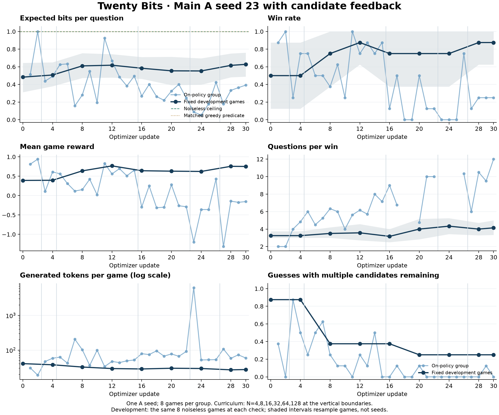
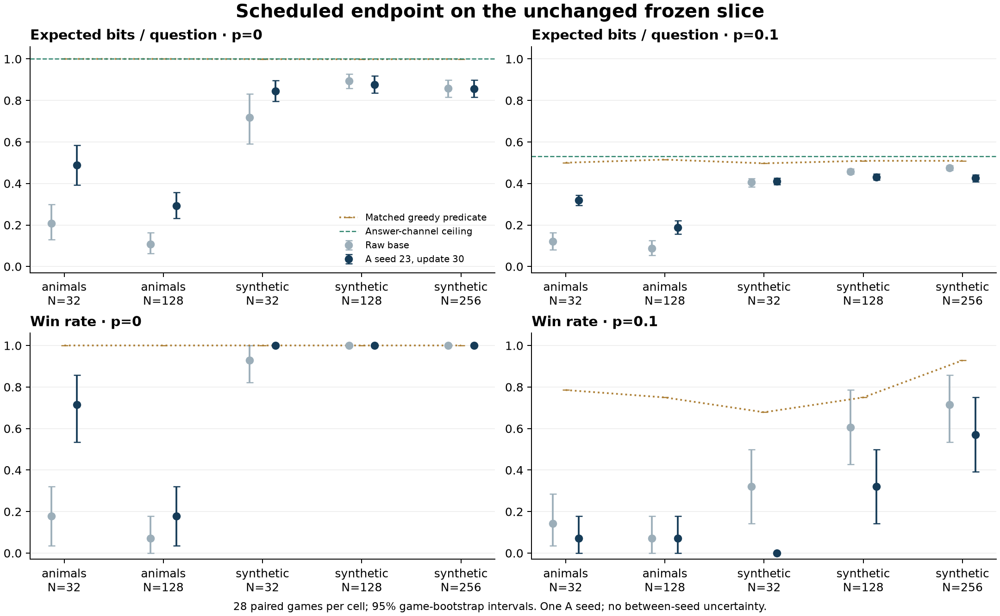
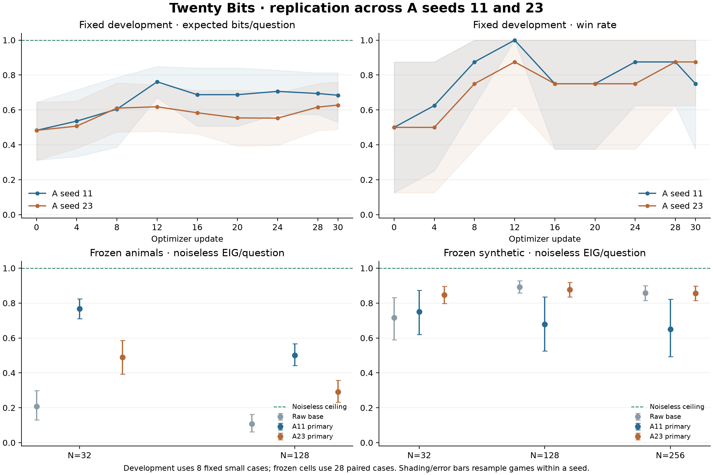
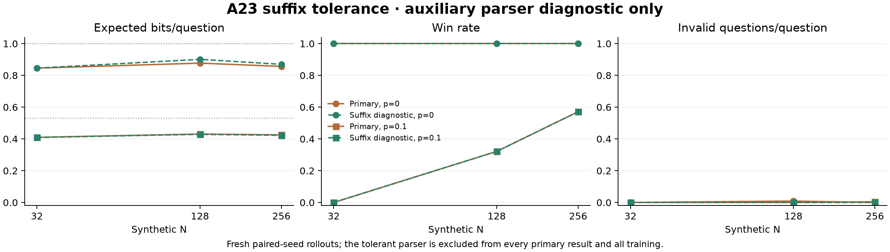

# Main A seed 23 gate

Completed 30 updates, 240 training games, 64 new development games and the scheduled 280-game frozen endpoint. The matched raw frozen control (280 games) and raw development control (8 games) are reused from their unchanged archives. Immediate endpoint evaluations also completed: 168 labelled suffix-diagnostic games and 40 hard-mode games (20 raw base, 20 A23). **B41 has not started; work stops at this gate.**

A23 improves question selection on noiseless animals, but the two A seeds learn different policies. Equal-weight N=32/128 EIG rises from raw base 0.157926 to A23 0.390438 bits/question: paired change +0.232512 [95% CI 0.164689, 0.301556]. Wins rise from 7/56 to 25/56. Relative to A11, A23 EIG is lower by 0.243887 [paired-game CI -0.312328, -0.174519], while wins differ by only +1/56 [rate-change CI -0.107143, 0.142857]. These intervals condition on the fitted endpoints; they do not estimate a population of training seeds.

The eight fixed development games improve from 4/8 wins and 0.483030 EIG to 7/8 and 0.627811. The early gain is followed by fluctuating checks, rather than a sustained rise across all 30 updates. The paired EIG-change interval [-0.039543, 0.345632] includes zero. Raw training slopes also reflect new group targets and the changing curriculum; they cannot isolate learning speed.

Noiseless synthetic transfer is strong for A23: 84/84 wins versus raw base 82/84 and A11 49/84. Equal-size EIG is 0.859849 versus raw 0.822504, a change of +0.037345 [CI -0.001150, 0.083204]. The base model already searches these random tables well. A23 preserves that ability; these results do not establish that RL created a new search algorithm. A11's transfer regression is not reproduced by A23.

Stopping remains a failure. At noiseless animal N=128, A11 made 27/28 ambiguous guesses; A23 makes none, but 23/28 games finish without a guess and only 5/28 win. Across noisy primary cells A23 wins 29/140 versus base 52/140. In the small no-list hard-mode slice, both raw base and A23 win 0/20. Question selection with supplied state improves in some cells; reliable stopping, noisy play and independent state tracking remain unsolved.

## Fixed setup

Provider-base Qwen3-8B, no project SFT or pilot adapter; rank-32 LoRA seed 23; learning rate 4e-5 and unchanged Adam parameters. One eight-game group from one start state per update; group-standardized outcome-only returns. Reward: +1 win, -0.03/question, -0.1/INVALID. EIG is measured, never rewarded. Thinking is disabled, output cap 2,048, context cap 32K. Candidate feedback, grammar, aliases, generation settings and original-N question budgets are unchanged.

| N | Updates | Training games |
| ---: | --- | ---: |
| 4 | 1–2 | 16 |
| 8 | 3–4 | 16 |
| 16 | 5–15 | 88 |
| 32 | 16–22 | 56 |
| 64 | 23–26 | 32 |
| 128 | 27–30 | 32 |

The curriculum reaches **N=32 and N=128**, matching the frozen animal cells. All gradients use only the fixed 200-row animal training pool. Frozen cases, development cases, held-out rows and synthetic tables never enter gradients. Only the scheduled endpoint is retained; no selection uses frozen scores.

## All 30 training updates

Groups are sampled before their corresponding optimizer step. Different group targets and curriculum stages confound raw training slopes; the fixed development checks provide a matched curve. EIG includes losses and INVALID. Questions/win is conditional and can fall below log2(N) after uncertain or lucky guesses.

| Update | N | Reward | Wins/8 | EIG/Q | Q/win | Enum % | Invalid % | Nonzero group / cumulative % | Output tokens/game |
| ---: | ---: | ---: | ---: | ---: | ---: | ---: | ---: | --- | ---: |
| 1 | 4 | 0.811 | 7/8 | 0.512 | 2.00 | 0.0 | 0.0 | 100.0 / 100.0 | 30.62 |
| 2 | 4 | 0.940 | 8/8 | 1.000 | 2.00 | 0.0 | 0.0 | 0.0 / 50.0 | 19.00 |
| 3 | 8 | 0.107 | 2/8 | 0.438 | 4.00 | 0.0 | 0.0 | 100.0 / 66.7 | 46.88 |
| 4 | 8 | 0.611 | 6/8 | 0.491 | 4.83 | 0.0 | 0.0 | 100.0 / 75.0 | 58.38 |
| 5 | 16 | 0.562 | 6/8 | 0.626 | 6.00 | 0.0 | 0.0 | 100.0 / 80.0 | 62.75 |
| 6 | 16 | 0.311 | 4/8 | 0.633 | 4.50 | 0.0 | 2.1 | 100.0 / 83.3 | 42.12 |
| 7 | 16 | 0.117 | 4/8 | 0.157 | 5.25 | 0.0 | 28.8 | 100.0 / 85.7 | 206.00 |
| 8 | 16 | 0.154 | 3/8 | 0.281 | 6.33 | 0.0 | 0.0 | 100.0 / 87.5 | 102.62 |
| 9 | 16 | 0.422 | 5/8 | 0.549 | 6.00 | 0.0 | 0.0 | 100.0 / 88.9 | 36.25 |
| 10 | 16 | 0.019 | 2/8 | 0.194 | 4.00 | 0.0 | 3.6 | 100.0 / 90.0 | 99.62 |
| 11 | 16 | 0.831 | 8/8 | 0.926 | 5.62 | 0.0 | 0.0 | 100.0 / 90.9 | 33.50 |
| 12 | 16 | 0.559 | 6/8 | 0.666 | 6.17 | 0.0 | 0.0 | 100.0 / 91.7 | 47.25 |
| 13 | 16 | 0.695 | 7/8 | 0.484 | 5.71 | 0.0 | 0.0 | 100.0 / 92.3 | 43.62 |
| 14 | 16 | 0.510 | 6/8 | 0.383 | 8.00 | 0.0 | 0.0 | 100.0 / 92.9 | 49.12 |
| 15 | 16 | 0.657 | 7/8 | 0.495 | 7.14 | 0.0 | 0.0 | 100.0 / 93.3 | 51.88 |
| 16 | 32 | -0.296 | 1/8 | 0.269 | 9.00 | 0.0 | 12.7 | 100.0 / 93.8 | 78.88 |
| 17 | 32 | 0.249 | 4/8 | 0.400 | 6.75 | 0.0 | 0.0 | 100.0 / 94.1 | 74.38 |
| 18 | 32 | -0.313 | 0/8 | 0.263 | — | 0.0 | 1.2 | 100.0 / 94.4 | 95.25 |
| 19 | 32 | -0.300 | 0/8 | 0.221 | — | 0.0 | 0.0 | 0.0 / 89.5 | 67.00 |
| 20 | 32 | 0.279 | 4/8 | 0.325 | 4.75 | 0.0 | 0.0 | 100.0 / 90.0 | 77.62 |
| 21 | 32 | -0.263 | 1/8 | 0.402 | 10.00 | 0.0 | 8.8 | 100.0 / 90.5 | 66.25 |
| 22 | 32 | -0.288 | 1/8 | 0.247 | 10.00 | 0.0 | 11.2 | 100.0 / 90.9 | 91.50 |
| 23 | 64 | -1.198 | 0/8 | 0.089 | — | 0.0 | 69.8 | 100.0 / 91.3 | 6312.75 |
| 24 | 64 | -0.360 | 0/8 | 0.052 | — | 0.0 | 0.0 | 0.0 / 87.5 | 52.00 |
| 25 | 64 | -0.360 | 0/8 | 0.178 | — | 0.0 | 0.0 | 0.0 / 84.0 | 52.62 |
| 26 | 64 | 0.427 | 6/8 | 0.425 | 10.33 | 0.0 | 0.0 | 100.0 / 84.6 | 53.00 |
| 27 | 128 | -1.315 | 1/8 | 0.178 | 6.00 | 0.0 | 80.8 | 100.0 / 85.2 | 107.50 |
| 28 | 128 | -0.144 | 2/8 | 0.332 | 10.50 | 0.0 | 0.0 | 100.0 / 85.7 | 58.00 |
| 29 | 128 | -0.174 | 2/8 | 0.363 | 9.50 | 0.0 | 2.9 | 100.0 / 86.2 | 73.25 |
| 30 | 128 | -0.155 | 2/8 | 0.392 | 12.00 | 0.0 | 0.0 | 100.0 / 86.7 | 59.25 |

Nonconstant returns: 26/30 groups. Win variance: 23/30. Zero-win groups with cost-only variance: [18, 23].

## Fixed development curve: A11 versus A23

Each check uses the same four N=4 and four N=8 cases and requested generation seeds. None enters gradients. Raw development is reused; no new raw-control charge occurs. EIG intervals resample eight complete games and remain descriptive.

| Update | Seed | Reward | Wins/8 | EIG/Q [95% CI] | Q/win | Output tokens/game |
| ---: | --- | ---: | ---: | --- | ---: | ---: |
| 0 | A11 | 0.391 | 4/8 | 0.483 [0.312, 0.644] | 3.25 | 40.75 |
| 0 | A23 | 0.391 | 4/8 | 0.483 [0.312, 0.644] | 3.25 | 40.75 |
| 4 | A11 | 0.520 | 5/8 | 0.536 [0.332, 0.715] | 3.40 | 39.12 |
| 4 | A23 | 0.395 | 4/8 | 0.507 [0.379, 0.651] | 3.25 | 37.75 |
| 8 | A11 | 0.774 | 7/8 | 0.604 [0.386, 0.786] | 3.29 | 31.50 |
| 8 | A23 | 0.638 | 6/8 | 0.610 [0.473, 0.755] | 3.50 | 32.50 |
| 12 | A11 | 0.903 | 8/8 | 0.761 [0.671, 0.849] | 3.25 | 24.50 |
| 12 | A23 | 0.766 | 7/8 | 0.618 [0.478, 0.744] | 3.57 | 29.38 |
| 16 | A11 | 0.653 | 6/8 | 0.687 [0.506, 0.841] | 3.17 | 23.62 |
| 16 | A23 | 0.641 | 6/8 | 0.584 [0.463, 0.711] | 3.17 | 28.62 |
| 20 | A11 | 0.653 | 6/8 | 0.687 [0.506, 0.841] | 3.17 | 23.62 |
| 20 | A23 | 0.630 | 6/8 | 0.554 [0.392, 0.713] | 4.00 | 30.00 |
| 24 | A11 | 0.781 | 7/8 | 0.706 [0.577, 0.827] | 3.14 | 23.12 |
| 24 | A23 | 0.623 | 6/8 | 0.553 [0.397, 0.696] | 4.33 | 29.50 |
| 28 | A11 | 0.785 | 7/8 | 0.694 [0.573, 0.813] | 3.00 | 22.62 |
| 28 | A23 | 0.755 | 7/8 | 0.616 [0.481, 0.751] | 4.00 | 27.00 |
| 30 | A11 | 0.664 | 6/8 | 0.684 [0.530, 0.813] | 2.83 | 22.12 |
| 30 | A23 | 0.751 | 7/8 | 0.628 [0.489, 0.760] | 4.14 | 27.50 |

## Guess with k remaining

Entries are wins/guesses. Noiseless k is exact support; noisy k is the fixed >0.001 plus MAP candidate list. Full positive support is also saved, since a noisy displayed singleton is not certainty. All-game denominators include no-guess endings. This measurement changes no reward or action restriction.

| Development update | k=1 W/G | k=2 W/G | k=3 W/G | k=4+ W/G | No guess / 8 |
| ---: | --- | --- | --- | --- | ---: |
| 0 | 1/1 | 2/3 | 0/3 | 1/1 | 0 |
| 4 | 1/1 | 3/4 | 0/2 | 0/1 | 0 |
| 8 | 5/5 | 1/2 | 0/1 | 0/0 | 0 |
| 12 | 5/5 | 2/3 | 0/0 | 0/0 | 0 |
| 16 | 4/4 | 2/3 | 0/0 | 0/0 | 1 |
| 20 | 5/5 | 1/2 | 0/0 | 0/0 | 1 |
| 24 | 5/5 | 1/2 | 0/0 | 0/0 | 1 |
| 28 | 6/6 | 1/2 | 0/0 | 0/0 | 0 |
| 30 | 6/6 | 1/2 | 0/0 | 0/0 | 0 |

| Training update | k=1 W/G | k=2 W/G | k=3 W/G | k=4+ W/G | No guess / 8 |
| ---: | --- | --- | --- | --- | ---: |
| 1 | 5/5 | 1/2 | 1/1 | 0/0 | 0 |
| 2 | 8/8 | 0/0 | 0/0 | 0/0 | 0 |
| 3 | 1/1 | 0/0 | 1/2 | 0/5 | 0 |
| 4 | 4/4 | 0/0 | 2/2 | 0/2 | 0 |
| 5 | 6/6 | 0/0 | 0/0 | 0/2 | 0 |
| 6 | 4/4 | 0/1 | 0/0 | 0/3 | 0 |
| 7 | 0/0 | 3/4 | 0/0 | 1/1 | 3 |
| 8 | 2/2 | 0/0 | 0/0 | 1/2 | 4 |
| 9 | 5/5 | 0/0 | 0/1 | 0/0 | 2 |
| 10 | 2/2 | 0/0 | 0/1 | 0/0 | 5 |
| 11 | 8/8 | 0/0 | 0/0 | 0/0 | 0 |
| 12 | 6/6 | 0/2 | 0/0 | 0/0 | 0 |
| 13 | 6/6 | 0/0 | 0/0 | 1/1 | 1 |
| 14 | 2/2 | 4/4 | 0/0 | 0/0 | 2 |
| 15 | 7/7 | 0/0 | 0/0 | 0/0 | 1 |
| 16 | 1/1 | 0/0 | 0/0 | 0/0 | 7 |
| 17 | 3/3 | 1/1 | 0/0 | 0/0 | 4 |
| 18 | 0/0 | 0/0 | 0/0 | 0/0 | 8 |
| 19 | 0/0 | 0/0 | 0/0 | 0/0 | 8 |
| 20 | 4/4 | 0/1 | 0/0 | 0/0 | 3 |
| 21 | 1/1 | 0/0 | 0/0 | 0/0 | 7 |
| 22 | 1/1 | 0/0 | 0/0 | 0/0 | 7 |
| 23 | 0/0 | 0/0 | 0/0 | 0/0 | 8 |
| 24 | 0/0 | 0/0 | 0/0 | 0/0 | 8 |
| 25 | 0/0 | 0/0 | 0/0 | 0/0 | 8 |
| 26 | 6/6 | 0/0 | 0/0 | 0/0 | 2 |
| 27 | 1/1 | 0/0 | 0/0 | 0/0 | 7 |
| 28 | 2/2 | 0/0 | 0/0 | 0/0 | 6 |
| 29 | 2/2 | 0/1 | 0/0 | 0/0 | 5 |
| 30 | 2/2 | 0/0 | 0/0 | 0/0 | 6 |

## Paired frozen evaluation

All cells use indices 0–27, with original targets, tables and noise seeds. Raw base, A11 and A23 use the same primary rendering, grammar, sampling settings and requested generation seeds. There are 10,000 paired whole-game bootstrap draws; Wilson win intervals and unadjusted paired tests are in the JSON summaries. The p=0 ceiling is 1 bit/question; p=0.10 has ceiling 0.531004 bits/question.

| Domain | N | p | Policy | Wins/28 | EIG/Q [95% CI] | Q/win [95% CI] |
| --- | ---: | ---: | --- | ---: | --- | --- |
| animals | 32 | 0 | Raw base | 5/28 | 0.207 [0.131, 0.299] | 7.400 [6.500, 8.500] |
| animals | 32 | 0 | A11 | 17/28 | 0.767 [0.712, 0.824] | 4.765 [4.211, 5.333] |
| animals | 32 | 0 | A23 | 20/28 | 0.489 [0.392, 0.585] | 7.000 [6.158, 7.789] |
| animals | 32 | 0.1 | Raw base | 4/28 | 0.121 [0.082, 0.163] | 8.250 [7.000, 9.000] |
| animals | 32 | 0.1 | A11 | 5/28 | 0.374 [0.345, 0.402] | 6.400 [6.000, 7.000] |
| animals | 32 | 0.1 | A23 | 2/28 | 0.320 [0.294, 0.343] | 9.000 [8.000, 10.000] |
| animals | 128 | 0 | Raw base | 2/28 | 0.109 [0.062, 0.163] | 8.500 [7.000, 10.000] |
| animals | 128 | 0 | A11 | 7/28 | 0.501 [0.443, 0.567] | 7.857 [6.167, 10.250] |
| animals | 128 | 0 | A23 | 5/28 | 0.291 [0.232, 0.356] | 10.800 [9.500, 12.000] |
| animals | 128 | 0.1 | Raw base | 2/28 | 0.087 [0.053, 0.124] | 10.000 [9.000, 11.000] |
| animals | 128 | 0.1 | A11 | 1/28 | 0.325 [0.298, 0.352] | 5.000 [5.000, 5.000] |
| animals | 128 | 0.1 | A23 | 2/28 | 0.189 [0.156, 0.222] | 14.000 [14.000, 14.000] |
| synthetic | 32 | 0 | Raw base | 26/28 | 0.717 [0.590, 0.832] | 6.115 [5.423, 6.815] |
| synthetic | 32 | 0 | A11 | 18/28 | 0.750 [0.619, 0.873] | 5.278 [4.833, 5.722] |
| synthetic | 32 | 0 | A23 | 28/28 | 0.846 [0.797, 0.895] | 5.750 [5.179, 6.358] |
| synthetic | 32 | 0.1 | Raw base | 9/28 | 0.405 [0.383, 0.425] | 9.333 [8.857, 9.778] |
| synthetic | 32 | 0.1 | A11 | 12/28 | 0.400 [0.348, 0.440] | 7.333 [6.889, 7.750] |
| synthetic | 32 | 0.1 | A23 | 0/28 | 0.410 [0.394, 0.426] | — |
| synthetic | 128 | 0 | Raw base | 28/28 | 0.893 [0.857, 0.928] | 7.786 [7.286, 8.287] |
| synthetic | 128 | 0 | A11 | 16/28 | 0.678 [0.525, 0.835] | 7.250 [6.857, 7.688] |
| synthetic | 128 | 0 | A23 | 28/28 | 0.877 [0.835, 0.918] | 8.036 [7.500, 8.607] |
| synthetic | 128 | 0.1 | Raw base | 17/28 | 0.458 [0.445, 0.470] | 11.882 [11.312, 12.429] |
| synthetic | 128 | 0.1 | A11 | 6/28 | 0.440 [0.366, 0.498] | 7.833 [7.000, 8.667] |
| synthetic | 128 | 0.1 | A23 | 9/28 | 0.431 [0.417, 0.445] | 13.444 [13.000, 13.875] |
| synthetic | 256 | 0 | Raw base | 28/28 | 0.858 [0.815, 0.899] | 9.214 [8.607, 9.821] |
| synthetic | 256 | 0 | A11 | 15/28 | 0.651 [0.493, 0.822] | 8.133 [7.471, 8.800] |
| synthetic | 256 | 0 | A23 | 28/28 | 0.857 [0.815, 0.898] | 9.429 [8.821, 10.071] |
| synthetic | 256 | 0.1 | Raw base | 20/28 | 0.476 [0.464, 0.487] | 12.250 [11.737, 12.786] |
| synthetic | 256 | 0.1 | A11 | 7/28 | 0.350 [0.258, 0.451] | 8.286 [8.000, 8.667] |
| synthetic | 256 | 0.1 | A23 | 16/28 | 0.426 [0.408, 0.442] | 14.875 [14.500, 15.267] |

| A23 declared subset | Metric | Raw base | A23 | Paired change [95% CI] |
| --- | --- | ---: | ---: | --- |
| noiseless_animals | win_rate | 0.125 | 0.446 | 0.321 [0.196, 0.446] |
| noiseless_animals | eig_per_question | 0.158 | 0.390 | 0.233 [0.165, 0.302] |
| noiseless_synthetic | win_rate | 0.976 | 1.000 | 0.024 [0.000, 0.060] |
| noiseless_synthetic | eig_per_question | 0.823 | 0.860 | 0.037 [-0.001, 0.083] |

### Explicit A11 versus A23 comparison

| Noiseless animals, equal size weights | A11 | A23 | A23 minus A11 [paired-game 95% CI] |
| --- | ---: | ---: | --- |
| win_rate | 0.429 | 0.446 | 0.018 [-0.107, 0.143] |
| eig_per_question | 0.634 | 0.390 | -0.244 [-0.312, -0.175] |

Intervals above condition on the two fitted endpoints. A separate hierarchical bootstrap resamples A seeds 11/23 before paired games, preserving policy/noise pairing. With only two A seeds, training-seed uncertainty remains unstable. The following intervals describe the mean A endpoint change relative to the shared raw control; they do not select a seed. [All seed-and-game intervals](results/main_A23/replication_summary.json).

| Equal-cell subset | Metric | Hierarchical seed-and-game 95% change interval |
| --- | --- | --- |
| equal_cell_all | win_rate | [-0.172, 0.021] |
| equal_cell_all | eig_per_question | [0.061, 0.117] |
| noiseless_animals | win_rate | [0.179, 0.446] |
| noiseless_animals | eig_per_question | [0.187, 0.518] |
| noiseless_synthetic | win_rate | [-0.464, 0.048] |
| noiseless_synthetic | eig_per_question | [-0.185, 0.065] |

| Frozen cell | Policy | k=1 W/G | k=2 W/G | k=3 W/G | k=4+ W/G | No guess / 28 |
| --- | --- | --- | --- | --- | --- | ---: |
| animals N=32 p=0 | Raw base | 4/4 | 1/1 | 0/0 | 0/8 | 15 |
| animals N=32 p=0 | A11 | 7/7 | 4/7 | 2/7 | 4/7 | 0 |
| animals N=32 p=0 | A23 | 20/20 | 0/0 | 0/0 | 0/0 | 8 |
| animals N=32 p=0.1 | Raw base | 0/0 | 0/0 | 0/0 | 4/13 | 15 |
| animals N=32 p=0.1 | A11 | 0/0 | 0/0 | 0/0 | 5/28 | 0 |
| animals N=32 p=0.1 | A23 | 0/0 | 0/0 | 2/2 | 0/1 | 25 |
| animals N=128 p=0 | Raw base | 1/1 | 1/2 | 0/0 | 0/6 | 19 |
| animals N=128 p=0 | A11 | 1/1 | 2/3 | 2/4 | 2/20 | 0 |
| animals N=128 p=0 | A23 | 5/5 | 0/0 | 0/0 | 0/0 | 23 |
| animals N=128 p=0.1 | Raw base | 0/0 | 0/0 | 0/0 | 2/20 | 8 |
| animals N=128 p=0.1 | A11 | 0/0 | 0/0 | 0/0 | 1/28 | 0 |
| animals N=128 p=0.1 | A23 | 0/0 | 0/0 | 0/0 | 2/3 | 25 |
| synthetic N=32 p=0 | Raw base | 26/26 | 0/0 | 0/0 | 0/0 | 2 |
| synthetic N=32 p=0 | A11 | 14/14 | 4/10 | 0/2 | 0/0 | 2 |
| synthetic N=32 p=0 | A23 | 28/28 | 0/0 | 0/0 | 0/0 | 0 |
| synthetic N=32 p=0.1 | Raw base | 0/0 | 0/0 | 0/0 | 9/17 | 11 |
| synthetic N=32 p=0.1 | A11 | 0/0 | 0/0 | 0/0 | 12/26 | 2 |
| synthetic N=32 p=0.1 | A23 | 0/0 | 0/0 | 0/0 | 0/0 | 28 |
| synthetic N=128 p=0 | Raw base | 28/28 | 0/0 | 0/0 | 0/0 | 0 |
| synthetic N=128 p=0 | A11 | 14/14 | 2/7 | 0/2 | 0/2 | 3 |
| synthetic N=128 p=0 | A23 | 28/28 | 0/0 | 0/0 | 0/0 | 0 |
| synthetic N=128 p=0.1 | Raw base | 0/0 | 0/0 | 0/0 | 17/28 | 0 |
| synthetic N=128 p=0.1 | A11 | 0/0 | 0/0 | 0/0 | 6/26 | 2 |
| synthetic N=128 p=0.1 | A23 | 0/0 | 0/0 | 0/0 | 9/10 | 18 |
| synthetic N=256 p=0 | Raw base | 27/27 | 1/1 | 0/0 | 0/0 | 0 |
| synthetic N=256 p=0 | A11 | 9/9 | 3/8 | 2/4 | 1/7 | 0 |
| synthetic N=256 p=0 | A23 | 28/28 | 0/0 | 0/0 | 0/0 | 0 |
| synthetic N=256 p=0.1 | Raw base | 0/0 | 0/0 | 0/0 | 20/28 | 0 |
| synthetic N=256 p=0.1 | A11 | 0/0 | 0/0 | 0/0 | 7/28 | 0 |
| synthetic N=256 p=0.1 | A23 | 0/0 | 0/0 | 1/1 | 15/18 | 9 |

Invalid and enumeration rates use counted questions; format and truncation rates use generated actions. A non-GUESS at the final-guess opportunity is a format/rule error but adds no counted question. Re-check counts use the next-action opportunities after replies with predictive probability below 0.20. This semantic re-ask measure does not capture every possible cross-check.

| Cell | A23 invalid % | Format % | Truncation % | Enum % | Predicate tokens/Q | Re-check/opportunities |
| --- | ---: | ---: | ---: | ---: | ---: | --- |
| animals N=32 p=0 | 0.5 | 3.2 | 0.0 | 0.0 | 1.37 | 0/2 |
| animals N=32 p=0.1 | 1.8 | 8.2 | 0.0 | 0.0 | 1.45 | 2/14 |
| animals N=128 p=0 | 8.5 | 5.7 | 0.0 | 0.0 | 1.52 | 0/4 |
| animals N=128 p=0.1 | 8.7 | 6.0 | 0.0 | 0.0 | 1.84 | 16/31 |
| synthetic N=32 p=0 | 0.0 | 0.0 | 0.0 | 0.0 | 6.57 | 0/1 |
| synthetic N=32 p=0.1 | 0.0 | 9.1 | 0.0 | 0.0 | 6.78 | 0/15 |
| synthetic N=128 p=0 | 0.9 | 0.0 | 0.0 | 0.0 | 7.41 | 0/0 |
| synthetic N=128 p=0.1 | 0.0 | 4.4 | 0.0 | 0.0 | 7.76 | 0/7 |
| synthetic N=256 p=0 | 0.0 | 0.0 | 0.0 | 0.0 | 7.52 | 0/1 |
| synthetic N=256 p=0.1 | 0.5 | 2.0 | 0.0 | 0.0 | 7.49 | 0/7 |

## Strategy, stopping and implementation audit

All 240 A23 training games use only the animal training pool. The 26/30 groups with nonconstant returns include two zero-win groups whose variance comes solely from penalties (updates 18 and 23). Win variance occurs in 23/30 groups. Updates 19, 24 and 25 have no wins and constant returns; update 2 also has constant returns. No pilot-only stop rule was added to the approved main schedule.

No zero-question guesses occur in A23 training. All seven logged early guesses follow singleton support and win. On noisy animal frozen games, next-action re-asks after unlikely replies are 22/45 for raw base, 1/14 for A11 and 18/45 for A23; the opportunities differ by policy. Repeated uninformative questions can inflate this narrow measure, so the count alone does not establish a robustness improvement. B training remains untested.

The unchanged legal-enumeration metric is zero in training and the primary endpoint. Accepted questions use attributes: 1,093 single-attribute and 718 compound questions in training. However, a post-hoc raw-text audit finds 142 invalid questions referencing candidate names, including 78 bare-name questions and 25 name lists; 24 lists contain at least one quarter of the original N. There are 66 consecutive different bare-name pairs. These malformed attempts remain INVALID with zero EIG and their original penalties. Zero legal enumeration does not mean zero attempted identity search.

Training has 199/2,010 INVALID questions, 931 valid zero-EIG questions, 630 repeated questions, 24 truncated turns and 110 extra ASK actions at the final-guess opportunity. At update 23 (N=64), 67/96 counted questions are invalid and mean generation reaches about 6,312 tokens/game. Strict replay found no accepted parser exploit, altered posterior, reward manipulation, target leak or question-budget overrun. Post-budget ASK is rejected and logged, not treated as another allowed question.

Synthetic primary invalid questions fall from A11's 276 to A23's four. Three A23 questions combine a header code with a numeric suffix from a real full attribute name, such as b_638326 where the real name is a_638326; one is another unknown attribute. The auxiliary suffix parser maps 27 identifiers in 27 fresh questions, removes diagnostic invalids and leaves synthetic wins at 109/168, equal to the strict primary total. It is never used for primary results or training.

Requested sampling parameters and native prompt tokens match before the initial primary/auxiliary divergence, yet 13/168 suffix pairs diverge before any identifier mapping. Complete action sequences match in 152/168 pairs. The backend/restore cause is unknown; small EIG differences cannot all be attributed to parser tolerance. The saved-response audit checks the supplied parameters without assuming deterministic backend replay.

The sampler/trainer logprob diagnostic persists: A23 maximum absolute token gap is 1.621001 nats, versus A11 2.703809. A23 update-mean differences range from -0.011956 to +0.001789 nats. Native token sequences match and the declared objective uses recorded rollout log probabilities. The backend cause remains unestablished. Sparse exposure at N=128 (four start states, 32 games) is a possible contributor to stopping failures, not an established cause.

Training: 199/2010 INVALID questions; 0 item-equality questions; 0 name lists; 931 valid zero-EIG questions; 110 extra ASK actions rejected at the final-guess opportunity. There are 0 zero-question guesses; all 7 logged early guesses follow singleton support and win. Enumeration stays legal. Accepted predicates, answers, posteriors, EIG, rewards, token signatures and gradient batches are replayed exactly. [Two preselected paired examples](results/main_A23/EXAMPLE_GAMES.md).

| Synthetic primary error count/form | A11 | A23 |
| --- | ---: | ---: |
| invalid_questions | 276 | 4 |
| wrong_prefix_on_real_attribute_suffix | 276 | 3 |
| Prefix equals the matching attribute's header code | 266 | 3 |
| other_invalid_questions | 0 | 1 |

### Malformed identity-query attempts — post-hoc diagnostic

The unchanged enumeration metric counts legal item-equality predicates. A second, read-only lexical audit counts exact candidate-name references in raw ASK bodies, including invalid bare names and name lists. It neither repairs an action nor changes its EIG or reward. A raw reference alone does not prove intent, but consecutive different bare names expose attempted item-by-item questioning that legal-enumeration counts can miss.

| Seed / scope | Counted questions | Invalid name-reference questions | Bare-name questions | Raw name lists | Lists ≥ N/4 names | Consecutive different bare names |
| --- | ---: | ---: | ---: | ---: | ---: | ---: |
| A11 / train | 1658 | 0 | 0 | 0 | 0 | 0 |
| A11 / eval_endpoint | 2095 | 0 | 0 | 0 | 0 | 0 |
| A23 / train | 2010 | 142 | 78 | 25 | 24 | 66 |
| A23 / eval_endpoint | 3007 | 23 | 23 | 0 | 0 | 13 |

A11 sampler/trainer logprob diagnostic: update-mean range [-0.018562581116929516, 0.00486046878214805], max absolute token gap 2.703809 nats. Native token sequences match; the backend cause is unestablished. The unchanged importance-sampling objective uses recorded rollout log probabilities.

A23 sampler/trainer logprob diagnostic: update-mean range [-0.011955972905381546, 0.0017891189608953537], max absolute token gap 1.621001 nats. Native token sequences match; the backend cause is unestablished. The unchanged importance-sampling objective uses recorded rollout log probabilities.

The gambling pattern means ambiguous guesses with question budget left. Sparse curriculum exposure at N=128 is a possible cause, stated only as a hypothesis; no causal test or protocol change occurred. [Write-up notes](WRITEUP_NOTES.md).

## Suffix-tolerant synthetic diagnostic — auxiliary only

Fresh A23 rollouts use the same frozen games, seeds, prompts and sampling settings. Only this auxiliary environment accepts a non-real `<code>_<suffix>` identifier when the suffix uniquely matches one real single-letter-prefixed attribute name. Primary and training parsing remain strict. This changes subsequent answers and histories, so these are fresh games rather than repaired primary scores.

| N | p | Primary wins/28 | Diagnostic wins/28 | Primary EIG/Q | Diagnostic EIG/Q | Primary invalid % | Diagnostic invalid % | Identifiers mapped | Questions mapped |
| ---: | ---: | ---: | ---: | ---: | ---: | ---: | ---: | ---: | ---: |
| 32 | 0 | 28 | 28 | 0.846 | 0.846 | 0.0 | 0.0 | 0 | 0 |
| 32 | 0.1 | 0 | 0 | 0.410 | 0.410 | 0.0 | 0.0 | 0 | 0 |
| 128 | 0 | 28 | 28 | 0.877 | 0.901 | 0.9 | 0.0 | 12 | 12 |
| 128 | 0.1 | 9 | 9 | 0.431 | 0.429 | 0.0 | 0.0 | 0 | 0 |
| 256 | 0 | 28 | 28 | 0.857 | 0.870 | 0.0 | 0.0 | 0 | 0 |
| 256 | 0.1 | 16 | 16 | 0.426 | 0.423 | 0.5 | 0.0 | 15 | 15 |

Requested sampling parameters match on every shared turn, including seeds. However, 13/168 pairs produced a different action before any suffix mapping despite identical native prompt tokens and supplied parameters; 152/168 complete action sequences match. The backend/restore cause is unestablished. This session reproduction variation limits attribution of small diagnostic differences to the parser alone. [Saved-response audit](results/A23_suffix/session_variation.json).

## Hard mode — descriptive only

Raw base and A23 play the fixed two games per cell without candidate feedback. Neither model has project SFT exposure; neither was trained in hard mode. Requested generation seeds are paired. With two cases per cell, these are descriptive outcomes with wide uncertainty, not a substitute for the primary evaluation.

| Domain | N | p | Raw wins/2 | A23 wins/2 | Raw EIG/Q | A23 EIG/Q |
| --- | ---: | ---: | ---: | ---: | ---: | ---: |
| animals | 32 | 0 | 0 | 0 | 0.235 | 0.445 |
| animals | 32 | 0.1 | 0 | 0 | 0.259 | 0.288 |
| animals | 128 | 0 | 0 | 0 | 0.039 | 0.413 |
| animals | 128 | 0.1 | 0 | 0 | 0.119 | 0.182 |
| synthetic | 32 | 0 | 0 | 0 | 0.578 | 0.491 |
| synthetic | 32 | 0.1 | 0 | 0 | 0.421 | 0.420 |
| synthetic | 128 | 0 | 0 | 0 | 0.704 | 0.581 |
| synthetic | 128 | 0.1 | 0 | 0 | 0.451 | 0.440 |
| synthetic | 256 | 0 | 0 | 0 | 0.598 | 0.571 |
| synthetic | 256 | 0.1 | 0 | 0 | 0.452 | 0.367 |

A11 suffix diagnostic and A11 hard mode: **not run: A11 checkpoint wasn't persisted, external uploads unavailable**. Its local adapter/hashes remain an archive. The 16 failed A11 diagnostic requests produced no usable game and retain $0.023700 in original holds. Both A23 endpoint file types are native and permanent; no external upload is used.

## Native checkpoint persistence and cost

The user confirmed both smoke files displayed Never expiry. Both smoke files were then deleted; the API returned zero remaining checkpoints for the test run. Pixel Miser checkpoints were not mutated. Test-storage holds remain until billing reconciliation. [Verification and deletion](research/native_persistence_deletion.json).

- training: `tinker://19a7c48f-02fe-556c-8cc5-404284b8da40:train:0/weights/main-A-seed23-step-30`; 1,107,556,469 bytes; API expires_at=`null`; paid-plan monthly estimate $0.11075564690.
- sampler: `tinker://19a7c48f-02fe-556c-8cc5-404284b8da40:train:0/sampler_weights/main-A-seed23-step-30`; 369,266,765 bytes; API expires_at=`null`; paid-plan monthly estimate $0.03692667650.

Permanent-file storage reserves cover 30 days using twice measured smoke sizes plus the usual 1.5x reservation margin. Native API sizes and paths are in the ledger. No expiry is set; future storage still requires reconciliation within the project cap. Recorded usage is token-metered at pinned provider rates, pending invoice reconciliation.

| A23 component | Usage USD | Held USD |
| --- | ---: | ---: |
| Primary training/dev/endpoint | 4.361613 | 0.505576 |
| Suffix diagnostic | 0.671128 | 0.003320 |
| Hard mode | 0.077171 | 0 |

Primary sampling usage: training $0.363933, development $0.020179, frozen endpoint $1.054695. Forward/backward usage is $2.922806; storage remains held rather than settled. The matched raw controls add no new charge.

The pre-run primary-only forecast was $7.816614 before margin, or $11.724921 with 1.5x margin, covering training, development, the primary endpoint and native storage. Primary usage plus retained holds is $4.867189. The suffix diagnostic and hard mode are separate additions in the table; total A23-stage usage plus new holds is $5.618808. These figures have different scopes from the primary-only forecast.

Project usage **$16.125774**, holds **$1.640132**, available **$32.234094** under the unchanged $50 cap. All older lost-original and storage holds remain. The suffix diagnostic is capped at $1.50 including its holds.

| Newly sampled primary scope | Calls | Prompt tokens | Cache-hit tokens | Generated tokens |
| --- | ---: | ---: | ---: | ---: |
| train | 2,248 | 6,578,961 | 6,151,808 | 65,991 |
| dev | 311 | 258,070 | 201,728 | 1,938 |
| eval_base | 0 | 0 | 0 | 0 |
| eval_endpoint | 3,287 | 19,877,339 | 18,198,016 | 26,457 |

## Collection, validation and limits

Validation: 158 unit tests; 5846 primary sampling IDs/receipts; 93 mutation IDs; 30 reconstructed outcome-only gradient batches; all frozen hashes unchanged; no frozen game in gradients. Completed runners return without service access. [Validation](results/main_A23/validation.json), [archive reproduction](results/main_A23/reproduction.json).

Every sampling and training mutation saves its deterministic request ID before dispatch and verifies the receipt. Metadata operations also pass through the ledger. A 408 keeps the same ID and hold. Recovery drains HTTP and collects pending futures before new submissions; eligible lost sampling requests get at most one exact replacement, with retained original holds and permanent original-output exclusion. All cases from this stage are listed below.

A transient network interruption occurred after optimizer update 30 had completed. Snapshot request `19a7c48f-02fe-556c-8cc5-404284b8da40:train:0:90` was saved at 2026-11-18T23:08:47.264328+00:00 and collected at 2026-11-18T23:10:43.093920+00:00 (115.830 seconds from local ID save to collection). The runner drained HTTP work, reconnected and collected that same request; no sampling, gradient or optimizer request was resubmitted. A subsequent checkpoint retrieval returned 408 and was also re-polled under its original ID. These timestamps measure local collection latency, not server retention time. [Recovery evidence](research/main_A23_network_recovery.json).

During endpoint collection, synchronous guard work on the 39,163-entry ledger blocked the same event loop used for HTTP. Five runs on a disposable copy measured 8.912 seconds median per complete guarded operation (range 8.608–9.860); a separate profile identified JSON serialization as the main cost. This is a local diagnostic, not an end-to-end speedup estimate or proof that every connection error had this cause. After all active HTTP work drained and no recoverable future remained pending, execution parallelism changed from 16 to 2 games. All 93 mutations were already complete. Ledger code, 45-second HTTP timeout, reservations, holds, 408 behavior, model settings, reward and question/output caps stayed unchanged. [Diagnostic](research/A23_ledger_io_diagnostic.json), [execution record](research/A23_execution_concurrency.json).

| Stage | Lost originals / exact replacements | Original held USD | Local ID-save → loss observed (seconds) |
| --- | --- | ---: | ---: |
| primary | 22 / 22 | 0.062527 | — |
| eval_endpoint/Qwen/Qwen3-8B/paid-v1/synthetic/128/19/p0.1/turn-11 | `19a7c48f-02fe-556c-8cc5-404284b8da40:sample:30:2533` → `19a7c48f-02fe-556c-8cc5-404284b8da40:sample:30:2538` | 0.002951 | 66.415 |
| eval_endpoint/Qwen/Qwen3-8B/paid-v1/synthetic/128/27/p0.1/turn-5 | `19a7c48f-02fe-556c-8cc5-404284b8da40:sample:30:2527` → `19a7c48f-02fe-556c-8cc5-404284b8da40:sample:30:2546` | 0.002602 | 86.976 |
| eval_endpoint/Qwen/Qwen3-8B/paid-v1/synthetic/128/25/p0.1/turn-7 | `19a7c48f-02fe-556c-8cc5-404284b8da40:sample:30:2529` → `19a7c48f-02fe-556c-8cc5-404284b8da40:sample:30:2544` | 0.002728 | 80.112 |
| eval_endpoint/Qwen/Qwen3-8B/paid-v1/synthetic/128/17/p0.1/turn-12 | `19a7c48f-02fe-556c-8cc5-404284b8da40:sample:30:2532` → `19a7c48f-02fe-556c-8cc5-404284b8da40:sample:30:2536` | 0.003090 | 72.360 |
| eval_endpoint/Qwen/Qwen3-8B/paid-v1/synthetic/128/20/p0.1/turn-10 | `19a7c48f-02fe-556c-8cc5-404284b8da40:sample:30:2530` → `19a7c48f-02fe-556c-8cc5-404284b8da40:sample:30:2539` | 0.003093 | 78.023 |
| eval_endpoint/Qwen/Qwen3-8B/paid-v1/synthetic/256/1/p0/turn-2 | `19a7c48f-02fe-556c-8cc5-404284b8da40:sample:30:2525` → `19a7c48f-02fe-556c-8cc5-404284b8da40:sample:30:2548` | 0.002612 | 98.974 |
| eval_endpoint/Qwen/Qwen3-8B/paid-v1/synthetic/128/23/p0.1/turn-9 | `19a7c48f-02fe-556c-8cc5-404284b8da40:sample:30:2528` → `19a7c48f-02fe-556c-8cc5-404284b8da40:sample:30:2542` | 0.002844 | 86.213 |
| eval_endpoint/Qwen/Qwen3-8B/paid-v1/synthetic/128/22/p0.1/turn-9 | `19a7c48f-02fe-556c-8cc5-404284b8da40:sample:30:2526` → `19a7c48f-02fe-556c-8cc5-404284b8da40:sample:30:2541` | 0.002929 | 96.887 |
| eval_endpoint/Qwen/Qwen3-8B/paid-v1/synthetic/128/21/p0.1/turn-10 | `19a7c48f-02fe-556c-8cc5-404284b8da40:sample:30:2531` → `19a7c48f-02fe-556c-8cc5-404284b8da40:sample:30:2540` | 0.002883 | 79.390 |
| eval_endpoint/Qwen/Qwen3-8B/paid-v1/synthetic/128/18/p0.1/turn-11 | `19a7c48f-02fe-556c-8cc5-404284b8da40:sample:30:2534` → `19a7c48f-02fe-556c-8cc5-404284b8da40:sample:30:2537` | 0.002988 | 71.714 |
| eval_endpoint/Qwen/Qwen3-8B/paid-v1/synthetic/256/4/p0/turn-5 | `19a7c48f-02fe-556c-8cc5-404284b8da40:sample:30:2654` → `19a7c48f-02fe-556c-8cc5-404284b8da40:sample:30:2669` | 0.002770 | 140.724 |
| eval_endpoint/Qwen/Qwen3-8B/paid-v1/synthetic/128/26/p0.1/turn-13 | `19a7c48f-02fe-556c-8cc5-404284b8da40:sample:30:2650` → `19a7c48f-02fe-556c-8cc5-404284b8da40:sample:30:2663` | 0.002979 | 152.719 |
| eval_endpoint/Qwen/Qwen3-8B/paid-v1/synthetic/128/27/p0.1/turn-12 | `19a7c48f-02fe-556c-8cc5-404284b8da40:sample:30:2658` → `19a7c48f-02fe-556c-8cc5-404284b8da40:sample:30:2664` | 0.003066 | 133.099 |
| eval_endpoint/Qwen/Qwen3-8B/paid-v1/synthetic/256/7/p0/turn-3 | `19a7c48f-02fe-556c-8cc5-404284b8da40:sample:30:2656` → `19a7c48f-02fe-556c-8cc5-404284b8da40:sample:30:2672` | 0.002752 | 140.851 |
| eval_endpoint/Qwen/Qwen3-8B/paid-v1/synthetic/256/3/p0/turn-8 | `19a7c48f-02fe-556c-8cc5-404284b8da40:sample:30:2657` → `19a7c48f-02fe-556c-8cc5-404284b8da40:sample:30:2668` | 0.002782 | 138.300 |
| eval_endpoint/Qwen/Qwen3-8B/paid-v1/synthetic/256/10/p0/turn-1 | `19a7c48f-02fe-556c-8cc5-404284b8da40:sample:30:2659` → `19a7c48f-02fe-556c-8cc5-404284b8da40:sample:30:2675` | 0.002516 | 133.026 |
| eval_endpoint/Qwen/Qwen3-8B/paid-v1/synthetic/256/6/p0/turn-4 | `19a7c48f-02fe-556c-8cc5-404284b8da40:sample:30:2661` → `19a7c48f-02fe-556c-8cc5-404284b8da40:sample:30:2671` | 0.002767 | 128.748 |
| eval_endpoint/Qwen/Qwen3-8B/paid-v1/synthetic/128/25/p0.1/turn-14 | `19a7c48f-02fe-556c-8cc5-404284b8da40:sample:30:2653` → `19a7c48f-02fe-556c-8cc5-404284b8da40:sample:30:2662` | 0.003093 | 153.065 |
| eval_endpoint/Qwen/Qwen3-8B/paid-v1/synthetic/256/2/p0/turn-9 | `19a7c48f-02fe-556c-8cc5-404284b8da40:sample:30:2655` → `19a7c48f-02fe-556c-8cc5-404284b8da40:sample:30:2667` | 0.002874 | 148.920 |
| eval_endpoint/Qwen/Qwen3-8B/paid-v1/synthetic/256/0/p0/turn-11 | `19a7c48f-02fe-556c-8cc5-404284b8da40:sample:30:2660` → `19a7c48f-02fe-556c-8cc5-404284b8da40:sample:30:2665` | 0.002769 | 134.146 |
| eval_endpoint/Qwen/Qwen3-8B/paid-v1/synthetic/256/1/p0/turn-9 | `19a7c48f-02fe-556c-8cc5-404284b8da40:sample:30:2652` → `19a7c48f-02fe-556c-8cc5-404284b8da40:sample:30:2666` | 0.002831 | 158.378 |
| eval_endpoint/Qwen/Qwen3-8B/paid-v1/synthetic/256/8/p0/turn-3 | `19a7c48f-02fe-556c-8cc5-404284b8da40:sample:30:2651` → `19a7c48f-02fe-556c-8cc5-404284b8da40:sample:30:2673` | 0.002608 | 161.891 |
| suffix | 2 / 2 | 0.003320 | — |
| suffix/A23_suffix_DIAGNOSTIC_ONLY/Qwen/Qwen3-8B/paid-v1/synthetic/32/17/p0.1/turn-1 | `f1e19e95-72a2-578c-8dd3-f1f140efa552:sample:1:372` → `f1e19e95-72a2-578c-8dd3-f1f140efa552:sample:1:375` | 0.001547 | 110.638 |
| suffix/A23_suffix_DIAGNOSTIC_ONLY/Qwen/Qwen3-8B/paid-v1/synthetic/32/16/p0.1/turn-6 | `f1e19e95-72a2-578c-8dd3-f1f140efa552:sample:1:373` → `f1e19e95-72a2-578c-8dd3-f1f140efa552:sample:1:374` | 0.001773 | 101.959 |
| hard | 0 / 0 | 0 | — |

Lost originals are labelled **orphaned, possibly billed**, remain held and are permanently excluded. The local intervals above run from durable ID save to observed unavailability; they do not establish whether a server accepted the request, completed it, billed it or removed a result. The archived cases include connection/timeout errors and observed loss status. No request gets a second replacement without approval.

This study measures question selection with supplied state, authored tables and structured grammar. Held-out animal profiles share underlying types with training. Two A seeds give limited seed uncertainty; B41 has not run, so noisy-training claims remain untested. Hard mode has only 20 games per policy. Disabled visible reasoning does not measure internal computation. Checkpoints, seeds and examples were not selected on frozen scores.

Reproduce offline with `python3 scripts/analyze_main_A23.py`, `python3 scripts/analyze_A23_replication.py`, `python3 scripts/plot_main_A23.py`, `python3 scripts/verify_main_A23.py`, then `python3 scripts/write_main_A23_gate.py`.

## Next decision

B41 has not started. The unchanged noisy condition would use 30 updates, 240 training games, 64 development games and the common 280-game frozen endpoint, starting from fresh provider base with permanent native training and sampler saves. The measured forecast is $9.089482 before margin or $13.634222 with 1.5x margin (round upward to $13.64), within the $32.234094 currently available. Its cache-free reference is $11.155978 before an extra margin; noisy RL behavior is still unobserved, so per-call admission remains binding.

The recommendation is to complete unchanged B41 if the user confirms: it answers whether noisy training changes re-checking, while another A seed would not answer that question. No extra diagnostic, hard-mode repeat, tools/foods evaluation or protocol change is included. Wait at this gate before any further Tinker operation.

Limits: only two A training seeds and one proposed B seed, 28 games per primary cell, eight small development cases, authored animal profiles with shared underlying types, a fixed structured grammar and supplied candidate state. Bootstrap seed uncertainty is unstable with two seeds. Thinking is disabled, so zero visible reasoning tokens does not measure internal computation. Usage charges are computed from observed tokens at pinned rates, pending invoice reconciliation; all unresolved originals and storage remain held.

**Stopped at the A23 gate. Do not start B41 without the user's confirmation.**
