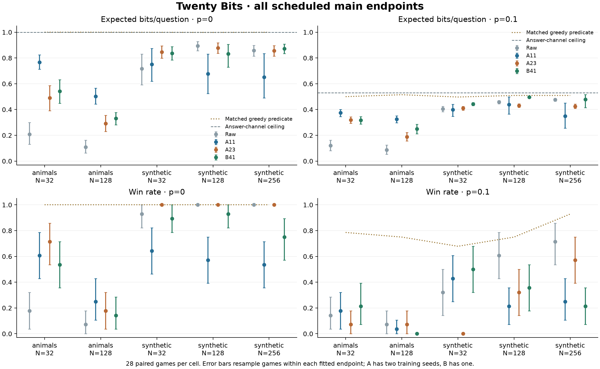
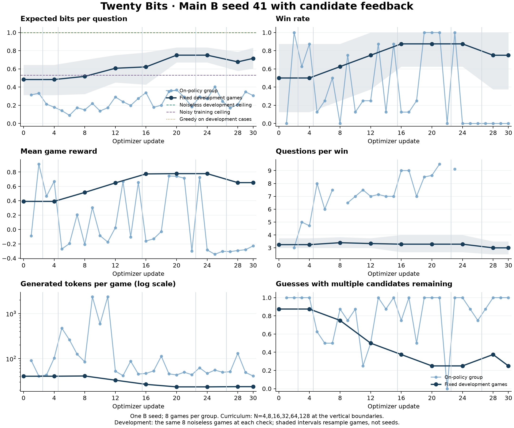
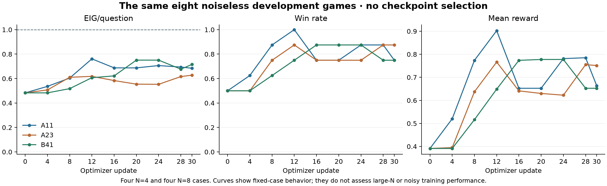
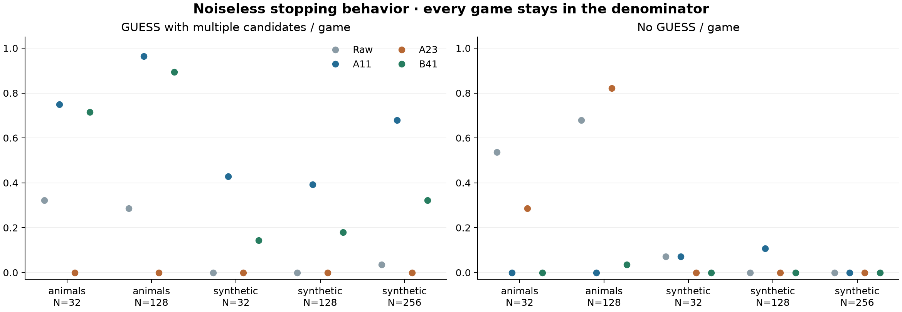
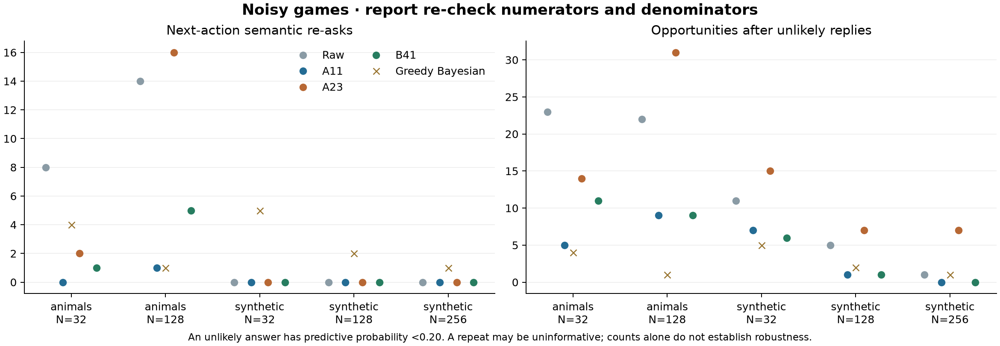

# Main B seed 41 gate

Completed the declared 30 updates and 240 noisy training games, 64 development games and immediate 280-game frozen endpoint. Raw frozen control (280 games) and raw development control (eight games) are reused unchanged. Both native endpoint file types have no expiry. **All three approved main seeds are complete; stop here before any further paid work.**

B41 improves noiseless animal question selection over raw base: equal-size EIG is 0.436842 versus 0.157926 bits/question, paired change +0.278916 [95% CI 0.207435, 0.348426]. Wins are 19/56 versus base 7/56, A11 24/56 and A23 25/56. Better splits do not yield consistently reliable stopping: all three fitted endpoints remain far below the greedy reference on animals.

The fixed eight-case noiseless development check moves from 4/8 wins and 0.483030 EIG to 6/8 and 0.715503. It peaks at 0.750823 at updates 20/24, then fluctuates. The paired final EIG-change interval is [0.001312, 0.452957], while its paired per-game permutation p-value is 0.109375 and win-change CI is [-0.375, 0.750]. The different estimands and eight cases do not support a precise learning-speed claim. All four N=128 training groups have zero wins.

Noisy endpoint wins are raw 52/140, A11 31/140, A23 29/140 and B41 36/140. B41 minus the mean A endpoint is +0.042857 [hierarchical A-seed/paired-game CI -0.017857, 0.107143]. Its equal-cell noisy EIG change is +0.030584 [0.001093, 0.053188]. This shows more informative noisy questions among these fitted policies, without a clear win-rate gain. The interval conditions on B41: one B seed cannot estimate noisy-training seed variability.

Noiseless synthetic wins are raw 82/84, A11 49/84, A23 84/84 and B41 72/84. B41 EIG is 0.846530 versus raw 0.822504, paired change +0.024026 [CI -0.028663, 0.076813]. Its win-rate change relative to raw is -0.119048 [CI -0.202381, -0.047321]. Thus strong attribute splitting can coexist with a transfer win regression. A11's severe identifier failure did not replicate in A23; B41 has a smaller, mixed syntax/copying failure.



## Fixed setup

Fresh provider Qwen3-8B, no project SFT or pilot adapter; rank-32 LoRA seed 41; training answers flip independently across question positions within each game with p=0.10. The eight members of a group share its table, target and seeded question-index flip schedule; action-generation seeds differ. One eight-game group per update, unchanged group-standardized outcome-only returns and importance-sampling objective. Reward is +1 win, -0.03/question and -0.1/INVALID. EIG is measured, never rewarded. Thinking is disabled; output cap 2,048, context cap 32K, temperature 0.7, top-p 1 and top-k disabled. Prompts, grammar, aliases, question caps and frozen cases stayed unchanged.

| N | Updates | Training games |
| ---: | --- | ---: |
| 4 | 1–2 | 16 |
| 8 | 3–4 | 16 |
| 16 | 5–15 | 88 |
| 32 | 16–22 | 56 |
| 64 | 23–26 | 32 |
| 128 | 27–30 | 32 |

N=32 and N=128 match the frozen animal cells. All gradients use animals from the fixed 200-row training pool; development, held-out rows and synthetic tables never enter gradients. B changes training noise to p=0.10; the same eight noiseless N=4/8 development cases remain a small common check. Only the scheduled endpoint is retained. No model, seed or checkpoint was selected on frozen scores.

## Every training update

Groups are sampled before the corresponding optimizer step. Changing targets and N confound raw training slopes; the fixed development curve measures matched behavior. Nonconstant returns can reflect question/invalid costs without any wins.

| Update | N | Reward | Wins/8 | EIG/Q | Q/win | Legal enum % | Invalid % | Nonconstant / cumulative % | Output tokens/game |
| ---: | ---: | ---: | ---: | ---: | ---: | ---: | ---: | --- | ---: |
| 1 | 4 | -0.090 | 0/8 | 0.315 | — | 0.0 | 0.0 | 0.0 / 0.0 | 91.50 |
| 2 | 4 | 0.910 | 8/8 | 0.332 | 3.00 | 0.0 | 0.0 | 0.0 / 0.0 | 41.00 |
| 3 | 8 | 0.462 | 5/8 | 0.213 | 5.00 | 0.0 | 2.5 | 100.0 / 33.3 | 43.38 |
| 4 | 8 | 0.670 | 7/8 | 0.179 | 4.71 | 0.0 | 13.2 | 100.0 / 50.0 | 102.50 |
| 5 | 16 | -0.271 | 1/8 | 0.141 | 8.00 | 0.0 | 23.7 | 100.0 / 60.0 | 477.12 |
| 6 | 16 | -0.196 | 2/8 | 0.090 | 6.00 | 0.0 | 30.5 | 100.0 / 66.7 | 261.38 |
| 7 | 16 | 0.205 | 4/8 | 0.173 | 7.50 | 0.0 | 8.1 | 100.0 / 71.4 | 125.88 |
| 8 | 16 | -0.208 | 0/8 | 0.150 | — | 0.0 | 1.9 | 100.0 / 75.0 | 85.25 |
| 9 | 16 | 0.306 | 6/8 | 0.220 | 6.50 | 0.0 | 34.5 | 100.0 / 77.8 | 2363.88 |
| 10 | 16 | -0.086 | 1/8 | 0.138 | 7.00 | 0.0 | 1.9 | 100.0 / 80.0 | 589.75 |
| 11 | 16 | -0.174 | 2/8 | 0.173 | 7.50 | 0.0 | 23.8 | 100.0 / 81.8 | 2377.62 |
| 12 | 16 | 0.025 | 2/8 | 0.291 | 7.00 | 0.0 | 0.0 | 100.0 / 83.3 | 53.00 |
| 13 | 16 | 0.669 | 7/8 | 0.239 | 7.14 | 0.0 | 0.0 | 100.0 / 84.6 | 41.88 |
| 14 | 16 | -0.104 | 1/8 | 0.198 | 7.00 | 0.0 | 0.0 | 100.0 / 85.7 | 87.75 |
| 15 | 16 | 0.656 | 7/8 | 0.276 | 7.00 | 0.0 | 1.8 | 100.0 / 86.7 | 45.50 |
| 16 | 32 | -0.160 | 1/8 | 0.339 | 9.00 | 0.0 | 0.0 | 100.0 / 87.5 | 47.00 |
| 17 | 32 | -0.130 | 1/8 | 0.178 | 9.00 | 0.0 | 0.0 | 100.0 / 88.2 | 53.50 |
| 18 | 32 | -0.028 | 2/8 | 0.200 | 7.00 | 0.0 | 0.0 | 100.0 / 88.9 | 113.38 |
| 19 | 32 | 0.745 | 8/8 | 0.351 | 8.50 | 0.0 | 0.0 | 100.0 / 89.5 | 46.00 |
| 20 | 32 | 0.741 | 8/8 | 0.369 | 8.62 | 0.0 | 0.0 | 100.0 / 90.0 | 43.50 |
| 21 | 32 | 0.715 | 8/8 | 0.290 | 9.50 | 0.0 | 0.0 | 100.0 / 90.5 | 50.00 |
| 22 | 32 | -0.300 | 0/8 | 0.183 | — | 0.0 | 0.0 | 0.0 / 86.4 | 44.00 |
| 23 | 64 | 0.726 | 8/8 | 0.294 | 9.12 | 0.0 | 0.0 | 100.0 / 87.0 | 62.75 |
| 24 | 64 | -0.285 | 0/8 | 0.271 | — | 0.0 | 0.0 | 100.0 / 87.5 | 47.00 |
| 25 | 64 | -0.345 | 0/8 | 0.404 | — | 0.0 | 0.0 | 100.0 / 88.0 | 55.75 |
| 26 | 64 | -0.304 | 0/8 | 0.243 | — | 0.0 | 0.0 | 100.0 / 88.5 | 50.00 |
| 27 | 128 | -0.308 | 0/8 | 0.171 | — | 0.0 | 0.0 | 100.0 / 88.9 | 51.25 |
| 28 | 128 | -0.293 | 0/8 | 0.210 | — | 0.0 | 0.0 | 100.0 / 89.3 | 131.25 |
| 29 | 128 | -0.281 | 0/8 | 0.348 | — | 0.0 | 0.0 | 100.0 / 89.7 | 49.50 |
| 30 | 128 | -0.229 | 0/8 | 0.307 | — | 0.0 | 0.0 | 100.0 / 90.0 | 41.25 |

Nonconstant-return groups: 27/30; win variance: 15/30. Zero-win groups: [1, 8, 22, 24, 25, 26, 27, 28, 29, 30]; cost-only variance among zero-win groups: [8, 24, 25, 26, 27, 28, 29, 30]. The pilot-only variance stop was not added to main training.



## Fixed development checks

| Update | Reward | Wins/8 | EIG/Q [95% CI] | Q/win | Output tokens/game |
| ---: | ---: | ---: | --- | ---: | ---: |
| 0 | 0.391 | 4/8 | 0.483 [0.312, 0.644] | 3.25 | 40.75 |
| 4 | 0.391 | 4/8 | 0.483 [0.312, 0.644] | 3.25 | 40.75 |
| 8 | 0.516 | 5/8 | 0.518 [0.324, 0.699] | 3.40 | 41.25 |
| 12 | 0.649 | 6/8 | 0.607 [0.450, 0.752] | 3.33 | 33.25 |
| 16 | 0.774 | 7/8 | 0.622 [0.427, 0.781] | 3.29 | 26.88 |
| 20 | 0.778 | 7/8 | 0.751 [0.671, 0.836] | 3.29 | 23.62 |
| 24 | 0.778 | 7/8 | 0.751 [0.671, 0.836] | 3.29 | 23.62 |
| 28 | 0.653 | 6/8 | 0.677 [0.577, 0.788] | 3.00 | 23.88 |
| 30 | 0.653 | 6/8 | 0.716 [0.604, 0.832] | 3.00 | 23.88 |

These eight cases never enter gradients. Their intervals resample games and do not measure B training-seed variability.



## All three seeds on every frozen cell

Every policy uses the same 28 frozen cases per cell and requested evaluation seeds. EIG is question-weighted within a cell, including losses and INVALID. Ambiguous and no-guess percentages use all games, not only guesses. Noiseless ambiguous means k>1 in exact support; noisy ambiguous uses the fixed threshold-plus-MAP display. Full positive support stays in the archives.

Early W/G counts correct guesses / attempts with fewer than ceil(log2(N)) questions. Lucky sub-floor guesses do not break the 1-bit expected-information ceiling (0.531004 at p=0.10). Win intervals are supplementary Wilson intervals; EIG intervals are 10,000 whole-game bootstrap intervals.

| Domain | N | p | Policy | Wins/28 [Wilson CI] | EIG/Q [95% CI] | Q/win [95% CI] | Ambiguous guesses / 28 (%) | No guess / 28 (%) | Early W/G |
| --- | ---: | ---: | --- | --- | --- | --- | --- | --- | --- |
| animals | 32 | 0 | Raw | 5/28 [7.9%, 35.6%] | 0.207 [0.130, 0.299] | 7.400 [6.500, 8.500] | 9 (32.1%) | 15 (53.6%) | 0/0 |
| animals | 32 | 0 | A11 | 17/28 [42.4%, 76.4%] | 0.767 [0.712, 0.824] | 4.765 [4.222, 5.333] | 21 (75.0%) | 0 (0.0%) | 8/12 |
| animals | 32 | 0 | A23 | 20/28 [52.9%, 84.7%] | 0.489 [0.392, 0.587] | 7.000 [6.188, 7.778] | 0 (0.0%) | 8 (28.6%) | 3/3 |
| animals | 32 | 0 | B41 | 15/28 [35.8%, 70.5%] | 0.542 [0.448, 0.632] | 5.733 [4.786, 6.667] | 20 (71.4%) | 0 (0.0%) | 4/4 |
| animals | 32 | 0.1 | Raw | 4/28 [5.7%, 31.5%] | 0.121 [0.082, 0.162] | 8.250 [7.000, 9.000] | 13 (46.4%) | 15 (53.6%) | 0/0 |
| animals | 32 | 0.1 | A11 | 5/28 [7.9%, 35.6%] | 0.374 [0.346, 0.401] | 6.400 [6.000, 7.000] | 28 (100.0%) | 0 (0.0%) | 0/2 |
| animals | 32 | 0.1 | A23 | 2/28 [2.0%, 22.6%] | 0.320 [0.294, 0.342] | 9.000 [8.000, 10.000] | 3 (10.7%) | 25 (89.3%) | 0/0 |
| animals | 32 | 0.1 | B41 | 6/28 [10.2%, 39.5%] | 0.317 [0.288, 0.346] | 6.500 [5.667, 7.333] | 28 (100.0%) | 0 (0.0%) | 0/1 |
| animals | 128 | 0 | Raw | 2/28 [2.0%, 22.6%] | 0.109 [0.063, 0.163] | 8.500 [7.000, 10.000] | 8 (28.6%) | 19 (67.9%) | 0/0 |
| animals | 128 | 0 | A11 | 7/28 [12.7%, 43.4%] | 0.501 [0.442, 0.566] | 7.857 [6.124, 10.333] | 27 (96.4%) | 0 (0.0%) | 2/6 |
| animals | 128 | 0 | A23 | 5/28 [7.9%, 35.6%] | 0.291 [0.229, 0.356] | 10.800 [9.500, 12.200] | 0 (0.0%) | 23 (82.1%) | 0/0 |
| animals | 128 | 0 | B41 | 4/28 [5.7%, 31.5%] | 0.332 [0.281, 0.377] | 9.750 [8.000, 11.000] | 25 (89.3%) | 1 (3.6%) | 0/1 |
| animals | 128 | 0.1 | Raw | 2/28 [2.0%, 22.6%] | 0.087 [0.053, 0.124] | 10.000 [9.000, 11.000] | 20 (71.4%) | 8 (28.6%) | 0/2 |
| animals | 128 | 0.1 | A11 | 1/28 [0.6%, 17.7%] | 0.325 [0.298, 0.352] | 5.000 [5.000, 5.000] | 28 (100.0%) | 0 (0.0%) | 1/20 |
| animals | 128 | 0.1 | A23 | 2/28 [2.0%, 22.6%] | 0.189 [0.156, 0.222] | 14.000 [14.000, 14.000] | 3 (10.7%) | 25 (89.3%) | 0/0 |
| animals | 128 | 0.1 | B41 | 0/28 [0.0%, 12.1%] | 0.250 [0.212, 0.286] | — | 28 (100.0%) | 0 (0.0%) | 0/15 |
| synthetic | 32 | 0 | Raw | 26/28 [77.4%, 98.0%] | 0.717 [0.591, 0.831] | 6.115 [5.440, 6.846] | 0 (0.0%) | 2 (7.1%) | 3/3 |
| synthetic | 32 | 0 | A11 | 18/28 [45.8%, 79.3%] | 0.750 [0.621, 0.873] | 5.278 [4.833, 5.706] | 12 (42.9%) | 2 (7.1%) | 2/6 |
| synthetic | 32 | 0 | A23 | 28/28 [87.9%, 100.0%] | 0.846 [0.798, 0.894] | 5.750 [5.179, 6.357] | 0 (0.0%) | 0 (0.0%) | 5/5 |
| synthetic | 32 | 0 | B41 | 25/28 [72.8%, 96.3%] | 0.837 [0.785, 0.889] | 5.360 [4.958, 5.808] | 4 (14.3%) | 0 (0.0%) | 5/5 |
| synthetic | 32 | 0.1 | Raw | 9/28 [17.9%, 50.7%] | 0.405 [0.383, 0.424] | 9.333 [8.857, 9.778] | 17 (60.7%) | 11 (39.3%) | 0/1 |
| synthetic | 32 | 0.1 | A11 | 12/28 [26.5%, 60.9%] | 0.400 [0.348, 0.440] | 7.333 [6.889, 7.750] | 26 (92.9%) | 2 (7.1%) | 0/0 |
| synthetic | 32 | 0.1 | A23 | 0/28 [0.0%, 12.1%] | 0.410 [0.394, 0.425] | — | 0 (0.0%) | 28 (100.0%) | 0/0 |
| synthetic | 32 | 0.1 | B41 | 14/28 [32.6%, 67.4%] | 0.443 [0.430, 0.454] | 7.286 [6.900, 7.643] | 28 (100.0%) | 0 (0.0%) | 0/0 |
| synthetic | 128 | 0 | Raw | 28/28 [87.9%, 100.0%] | 0.893 [0.857, 0.927] | 7.786 [7.286, 8.321] | 0 (0.0%) | 0 (0.0%) | 4/4 |
| synthetic | 128 | 0 | A11 | 16/28 [39.1%, 73.5%] | 0.678 [0.524, 0.830] | 7.250 [6.867, 7.684] | 11 (39.3%) | 3 (10.7%) | 2/2 |
| synthetic | 128 | 0 | A23 | 28/28 [87.9%, 100.0%] | 0.877 [0.836, 0.919] | 8.036 [7.500, 8.571] | 0 (0.0%) | 0 (0.0%) | 3/3 |
| synthetic | 128 | 0 | B41 | 26/28 [77.4%, 98.0%] | 0.832 [0.728, 0.906] | 7.654 [7.192, 8.115] | 5 (17.9%) | 0 (0.0%) | 3/3 |
| synthetic | 128 | 0.1 | Raw | 17/28 [42.4%, 76.4%] | 0.458 [0.446, 0.470] | 11.882 [11.316, 12.412] | 28 (100.0%) | 0 (0.0%) | 0/0 |
| synthetic | 128 | 0.1 | A11 | 6/28 [10.2%, 39.5%] | 0.440 [0.366, 0.498] | 7.833 [7.000, 8.667] | 26 (92.9%) | 2 (7.1%) | 0/2 |
| synthetic | 128 | 0.1 | A23 | 9/28 [17.9%, 50.7%] | 0.431 [0.417, 0.445] | 13.444 [13.000, 13.875] | 10 (35.7%) | 18 (64.3%) | 0/0 |
| synthetic | 128 | 0.1 | B41 | 10/28 [20.7%, 54.2%] | 0.496 [0.489, 0.503] | 8.200 [7.714, 8.667] | 28 (100.0%) | 0 (0.0%) | 0/0 |
| synthetic | 256 | 0 | Raw | 28/28 [87.9%, 100.0%] | 0.858 [0.815, 0.898] | 9.214 [8.643, 9.821] | 1 (3.6%) | 0 (0.0%) | 5/5 |
| synthetic | 256 | 0 | A11 | 15/28 [35.8%, 70.5%] | 0.651 [0.491, 0.834] | 8.133 [7.470, 8.833] | 19 (67.9%) | 0 (0.0%) | 6/8 |
| synthetic | 256 | 0 | A23 | 28/28 [87.9%, 100.0%] | 0.857 [0.815, 0.897] | 9.429 [8.821, 10.036] | 0 (0.0%) | 0 (0.0%) | 4/4 |
| synthetic | 256 | 0 | B41 | 21/28 [56.6%, 87.3%] | 0.871 [0.833, 0.907] | 8.571 [8.000, 9.158] | 9 (32.1%) | 0 (0.0%) | 6/7 |
| synthetic | 256 | 0.1 | Raw | 20/28 [52.9%, 84.7%] | 0.476 [0.464, 0.486] | 12.250 [11.733, 12.789] | 28 (100.0%) | 0 (0.0%) | 0/0 |
| synthetic | 256 | 0.1 | A11 | 7/28 [12.7%, 43.4%] | 0.350 [0.256, 0.451] | 8.286 [8.000, 8.667] | 28 (100.0%) | 0 (0.0%) | 0/5 |
| synthetic | 256 | 0.1 | A23 | 16/28 [39.1%, 73.5%] | 0.426 [0.409, 0.442] | 14.875 [14.500, 15.267] | 19 (67.9%) | 9 (32.1%) | 0/0 |
| synthetic | 256 | 0.1 | B41 | 6/28 [10.2%, 39.5%] | 0.479 [0.415, 0.515] | 8.500 [8.000, 9.000] | 28 (100.0%) | 0 (0.0%) | 0/6 |

### Dominant failure mode by seed

**A11 — gambling plus an identifier regression:** 167 wrong ambiguous guesses and nine no-guess endings across 280 games; 276 synthetic invalid questions. On noiseless animal N=128, 27/28 guesses are ambiguous, including 26 with budget left.

**A23 — stalling:** 136/280 games end without a guess, versus six wrong guesses. On noiseless animal N=128, ambiguous guesses disappear but 23/28 games never guess. Its 25/56 noiseless animal wins are only one more than A11's 24/56.

**B41 — gambling despite informative questions:** 152 wrong ambiguous guesses, 203 ambiguous guesses in total and only one no-guess ending across 280 games. Every noisy game guesses with multiple displayed candidates. Noisy animal N=128 has 0/28 wins; noiseless N=128 has 25/28 ambiguous guesses and 4/28 wins. Of its 203 ambiguous guesses, 202 leave question budget unused; this describes behavior without establishing intent or reward suboptimality. [Budget audit](research/B41_stopping_budget_audit.json).



### Paired B41 versus raw base

| Declared noiseless subset | Metric | Raw | B41 | Paired change [95% CI] |
| --- | --- | ---: | ---: | --- |
| noiseless_animals | win_rate | 0.125 | 0.339 | 0.214 [0.089, 0.339] |
| noiseless_animals | eig_per_question | 0.158 | 0.437 | 0.279 [0.207, 0.348] |
| noiseless_synthetic | win_rate | 0.976 | 0.857 | -0.119 [-0.202, -0.047] |
| noiseless_synthetic | eig_per_question | 0.823 | 0.847 | 0.024 [-0.029, 0.077] |

### B41 versus the mean A endpoint

The following changes give equal weight to cells and the two A seeds. Bootstrap draws resample A seeds, then paired complete games with shared draws between noise variants. **B has only one training seed**, so these intervals condition on B41 and cannot estimate B training-seed variability. Undefined re-check ratios stay undefined; differing opportunity counts can change their interpretation.

| Subset | Metric | B41 minus mean A [95% CI] | Defined draws/10,000 |
| --- | --- | --- | ---: |
| all_cells | win_rate | 0.021 [-0.075, 0.121] | 10000 |
| all_cells | eig_per_question | 0.021 [-0.011, 0.046] | 10000 |
| all_cells | questions_per_win | — | 0 |
| all_cells | recheck_rate | — | 0 |
| all_cells | ambiguous_guess_rate | 0.259 [-0.111, 0.629] | 10000 |
| all_cells | no_guess_rate | -0.255 [-0.507, -0.014] | 10000 |
| all_cells | early_guess_win_rate | 0.000 [-0.032, 0.021] | 10000 |
| noisy_all_domains | win_rate | 0.043 [-0.018, 0.107] | 10000 |
| noisy_all_domains | eig_per_question | 0.031 [0.001, 0.053] | 10000 |
| noisy_all_domains | questions_per_win | — | 0 |
| noisy_all_domains | recheck_rate | — | 0 |
| noisy_all_domains | ambiguous_guess_rate | 0.389 [0.014, 0.793] | 10000 |
| noisy_all_domains | no_guess_rate | -0.389 [-0.793, -0.014] | 10000 |
| noisy_all_domains | early_guess_win_rate | -0.004 [-0.014, 0.000] | 10000 |
| noisy_animals | win_rate | 0.018 [-0.062, 0.098] | 10000 |
| noisy_animals | eig_per_question | -0.018 [-0.084, 0.045] | 10000 |
| noisy_animals | questions_per_win | — | 0 |
| noisy_animals | recheck_rate | 0.131 [-0.131, 0.438] | 9959 |
| noisy_animals | ambiguous_guess_rate | 0.446 [0.000, 0.946] | 10000 |
| noisy_animals | no_guess_rate | -0.446 [-0.946, 0.000] | 10000 |
| noisy_animals | early_guess_win_rate | -0.009 [-0.036, 0.000] | 10000 |
| noisy_synthetic | win_rate | 0.060 [-0.030, 0.149] | 10000 |
| noisy_synthetic | eig_per_question | 0.063 [0.033, 0.104] | 10000 |
| noisy_synthetic | questions_per_win | — [-0.086, 0.468] | 2507 |
| noisy_synthetic | recheck_rate | — | 0 |
| noisy_synthetic | ambiguous_guess_rate | 0.351 [0.024, 0.702] | 10000 |
| noisy_synthetic | no_guess_rate | -0.351 [-0.702, -0.024] | 10000 |
| noisy_synthetic | early_guess_win_rate | 0.000 [0.000, 0.000] | 10000 |
| noiseless_animals | win_rate | -0.098 [-0.250, 0.054] | 10000 |
| noiseless_animals | eig_per_question | -0.076 [-0.239, 0.084] | 10000 |
| noiseless_animals | questions_per_win | 0.136 [-1.868, 2.055] | 9848 |
| noiseless_animals | recheck_rate | 0.000 [0.000, 0.000] | 8187 |
| noiseless_animals | ambiguous_guess_rate | 0.375 [-0.125, 0.875] | 10000 |
| noiseless_animals | no_guess_rate | -0.259 [-0.607, 0.036] | 10000 |
| noiseless_animals | early_guess_win_rate | -0.045 [-0.161, 0.036] | 10000 |
| noiseless_synthetic | win_rate | 0.065 [-0.190, 0.345] | 10000 |
| noiseless_synthetic | eig_per_question | 0.070 [-0.036, 0.215] | 10000 |
| noiseless_synthetic | questions_per_win | -0.117 [-0.745, 0.514] | 10000 |
| noiseless_synthetic | recheck_rate | — | 0 |
| noiseless_synthetic | ambiguous_guess_rate | -0.036 [-0.357, 0.274] | 10000 |
| noiseless_synthetic | no_guess_rate | -0.030 [-0.095, 0.000] | 10000 |
| noiseless_synthetic | early_guess_win_rate | 0.036 [-0.012, 0.095] | 10000 |

All conditional per-seed paired changes and unadjusted paired tests remain in [all_seeds.json](results/main_B41/all_seeds.json). With two A seeds and one B seed, inference about training conditions remains limited.

## Guess with k remaining

Entries are wins/guesses; all eight games remain in each row's denominator. Noisy display singleton does not imply full posterior certainty.

| Development update | k=1 W/G | k=2 W/G | k=3 W/G | k=4+ W/G | No guess/8 |
| ---: | --- | --- | --- | --- | ---: |
| 0 | 1/1 | 2/3 | 0/3 | 1/1 | 0 |
| 4 | 1/1 | 2/3 | 0/3 | 1/1 | 0 |
| 8 | 2/2 | 2/2 | 0/3 | 1/1 | 0 |
| 12 | 4/4 | 2/2 | 0/2 | 0/0 | 0 |
| 16 | 5/5 | 1/2 | 0/0 | 1/1 | 0 |
| 20 | 6/6 | 1/2 | 0/0 | 0/0 | 0 |
| 24 | 6/6 | 1/2 | 0/0 | 0/0 | 0 |
| 28 | 5/5 | 1/2 | 0/1 | 0/0 | 0 |
| 30 | 6/6 | 0/1 | 0/1 | 0/0 | 0 |

| Training update | k=1 W/G | k=2 W/G | k=3 W/G | k=4+ W/G | No guess/8 |
| ---: | --- | --- | --- | --- | ---: |
| 1 | 0/0 | 0/0 | 0/0 | 0/8 | 0 |
| 2 | 0/0 | 0/0 | 0/0 | 8/8 | 0 |
| 3 | 0/0 | 0/0 | 0/0 | 5/8 | 0 |
| 4 | 0/0 | 0/0 | 0/0 | 7/8 | 0 |
| 5 | 0/0 | 0/0 | 0/0 | 1/5 | 3 |
| 6 | 0/0 | 1/1 | 0/0 | 1/3 | 4 |
| 7 | 0/0 | 0/0 | 0/0 | 4/4 | 4 |
| 8 | 0/0 | 0/0 | 0/0 | 0/7 | 1 |
| 9 | 0/0 | 0/0 | 0/0 | 6/6 | 2 |
| 10 | 0/0 | 0/0 | 0/0 | 1/7 | 1 |
| 11 | 0/0 | 0/0 | 0/0 | 2/2 | 6 |
| 12 | 0/0 | 0/0 | 0/0 | 2/4 | 4 |
| 13 | 0/0 | 4/4 | 1/2 | 2/2 | 0 |
| 14 | 0/0 | 0/0 | 0/0 | 1/7 | 1 |
| 15 | 0/0 | 0/0 | 0/0 | 7/8 | 0 |
| 16 | 0/0 | 0/0 | 0/0 | 1/6 | 2 |
| 17 | 0/0 | 0/0 | 0/0 | 1/8 | 0 |
| 18 | 0/0 | 2/2 | 0/0 | 0/2 | 4 |
| 19 | 0/0 | 0/0 | 0/0 | 8/8 | 0 |
| 20 | 0/0 | 0/0 | 0/0 | 8/8 | 0 |
| 21 | 0/0 | 0/0 | 0/0 | 8/8 | 0 |
| 22 | 0/0 | 0/0 | 0/0 | 0/0 | 8 |
| 23 | 0/0 | 0/0 | 0/0 | 8/8 | 0 |
| 24 | 0/0 | 0/0 | 0/0 | 0/8 | 0 |
| 25 | 0/0 | 0/0 | 0/0 | 0/7 | 1 |
| 26 | 0/0 | 0/0 | 0/0 | 0/6 | 2 |
| 27 | 0/0 | 0/0 | 0/0 | 0/7 | 1 |
| 28 | 0/0 | 0/0 | 0/0 | 0/8 | 0 |
| 29 | 0/0 | 0/0 | 0/0 | 0/8 | 0 |
| 30 | 0/0 | 0/0 | 0/0 | 0/8 | 0 |

## Noisy re-checking and behavior

| Noisy cell | Policy | Re-asks / opportunities |
| --- | --- | --- |
| animals N=32 | Raw | 8/23 |
| animals N=32 | A11 | 0/5 |
| animals N=32 | A23 | 2/14 |
| animals N=32 | B41 | 1/11 |
| animals N=128 | Raw | 14/22 |
| animals N=128 | A11 | 1/9 |
| animals N=128 | A23 | 16/31 |
| animals N=128 | B41 | 5/9 |
| synthetic N=32 | Raw | 0/11 |
| synthetic N=32 | A11 | 0/7 |
| synthetic N=32 | A23 | 0/15 |
| synthetic N=32 | B41 | 0/6 |
| synthetic N=128 | Raw | 0/5 |
| synthetic N=128 | A11 | 0/1 |
| synthetic N=128 | A23 | 0/7 |
| synthetic N=128 | B41 | 0/1 |
| synthetic N=256 | Raw | 0/1 |
| synthetic N=256 | A11 | 0/0 |
| synthetic N=256 | A23 | 0/7 |
| synthetic N=256 | B41 | 0/0 |
| animals N=32 | Greedy Bayesian reference | 4/4 |
| animals N=128 | Greedy Bayesian reference | 1/1 |
| synthetic N=32 | Greedy Bayesian reference | 5/5 |
| synthetic N=128 | Greedy Bayesian reference | 2/2 |
| synthetic N=256 | Greedy Bayesian reference | 1/1 |

An opportunity follows an answer whose predictive probability is below 0.20. A next-action truth-vector repeat or complement counts as a re-ask. This narrow measure misses other cross-checks and can be inflated by uninformative repeats.



B41 training has 27/30 nonconstant-return groups but only 15/30 groups with win variance. Eight zero-win groups differ only through question/invalid costs. Updates 1 and 22 are zero-win constant-return groups; update 2 is an all-win constant-return group. The declared optimizer step still occurs on zero-advantage groups. No pilot stop was added.

Training uses 1,889 counted questions: 80 INVALID, 114 valid zero-EIG questions, 494 repeats and 44 ASK actions rejected after the question budget. There are no zero-question guesses. All three logged early guesses lose. Accepted questions contain 1,275 single-attribute and 534 compound-attribute predicates; legal item-equality and name-list enumeration remain zero. No accepted parsing exploit or change to the exact reward/posterior was found during replay.

The raw-name audit finds 15 invalid training questions referencing exact candidate names, with zero bare-name questions and zero raw name lists. The frozen B41 endpoint has zero candidate-name references in 2,107 counted questions. This audit does not repair outputs or prove intent. It keeps malformed identity attempts distinct from legal enumeration.

Synthetic B41 INVALID questions total 28: 13 in one noiseless N=128 game copy header pairs such as ASK: b=a_764093 (the equals sign is not legal there), and 15 in one noisy N=256 game use hybrids such as ASK: b_602777 instead of code b or full name a_602777. They remain INVALID, with zero EIG and the original penalty. No B41 suffix diagnostic was run or substituted for primary scores.

On noisy animals, next-action re-asks after unlikely answers are raw 22/45, A11 1/14, A23 18/45 and B41 6/20. On noisy synthetic they are raw 0/17, A11 0/8, A23 0/29 and B41 0/7. Opportunity frequencies differ, and repeated uninformative predicates can inflate the count. The B41-versus-mean-A noisy-animal recheck interval includes zero. There is no clear learned re-checking result.

The largest sampler/trainer generated-token logprob gap is 3.802663 nats at B41 update 26, versus A11 2.703809 and A23 1.621001. B41 update-mean gaps range from -0.018576 to +0.002337 nats. Native token sequences match and the unchanged importance-sampling objective uses saved rollout log probabilities. The backend cause remains unestablished; neither the ledger fix nor a behavioral effect is inferred from these gaps.

| Frozen cell | B41 format % | Invalid % | Truncation % | Legal enum % | Predicate tokens/Q |
| --- | ---: | ---: | ---: | ---: | ---: |
| animals N=32 p=0 | 0.0 | 0.0 | 0.0 | 0.0 | 1.00 |
| animals N=32 p=0.1 | 0.0 | 0.0 | 0.0 | 0.0 | 1.27 |
| animals N=128 p=0 | 0.3 | 0.4 | 0.0 | 0.0 | 1.07 |
| animals N=128 p=0.1 | 0.0 | 0.6 | 0.0 | 0.0 | 1.42 |
| synthetic N=32 p=0 | 0.0 | 0.0 | 0.0 | 0.0 | 6.63 |
| synthetic N=32 p=0.1 | 0.0 | 0.0 | 0.0 | 0.0 | 7.31 |
| synthetic N=128 p=0 | 0.0 | 5.9 | 0.0 | 0.0 | 7.84 |
| synthetic N=128 p=0.1 | 0.0 | 0.0 | 0.0 | 0.0 | 8.00 |
| synthetic N=256 p=0 | 0.0 | 0.0 | 0.0 | 0.0 | 7.20 |
| synthetic N=256 p=0.1 | 0.0 | 6.5 | 0.0 | 0.0 | 7.48 |

Format and truncation rates use generated actions; invalid and enumeration rates use counted questions. A non-GUESS after the allowed answers is a format/rule error that adds no question. [Two preselected paired development examples](results/main_B41/EXAMPLE_GAMES.md).

### Invalid candidate-name references, B41

This post-hoc lexical audit counts exact candidate-name references in raw ASK bodies, including malformed bare names and lists. It does not accept, repair or reward them. Legal item-equality enumeration is reported separately; no legal form was banned.

| Scope | Counted Q | Invalid name references | Bare names | Raw name lists | Lists ≥ N/4 | Consecutive different bare names |
| --- | ---: | ---: | ---: | ---: | ---: | ---: |
| training | 1889 | 15 | 0 | 0 | 0 | 0 |
| endpoint | 2107 | 0 | 0 | 0 | 0 | 0 |

### Sampler versus trainer log probabilities

| Seed | Update-mean gap range (nats) | Maximum absolute token gap (nats) |
| --- | --- | ---: |
| A11 | [-0.018562581116929516, 0.00486046878214805] | 2.703809 |
| A23 | [-0.011955972905381546, 0.0017891189608953537] | 1.621001 |
| B41 | [-0.018575789771299447, 0.0023371613216914976] | 3.802663 |

Native token sequences match; the backend cause of the gaps is unestablished. The declared importance-sampling loss uses recorded rollout log probabilities. No correction or experiment setting changed.

## Offline budget-visibility check

Every one of A23's 110 post-budget ASK inputs included the fixed maximum and final-guess rule in history. None included a per-turn remaining count or an explicit exhaustion notice. Usage had to be counted from the played action history. At N=128 the opening settings are exactly:

```text
Answer flip probability: 0.00, independently each question. Maximum questions: 14. After the last answer, make one final guess; another question loses. Begin.
```

Later environment messages contain YES/NO/INVALID and candidate feedback only. All 110 native token sequences matched their archived rollout inputs. B41 uses the same rendering, with the declared noise field appropriate to each game. Nothing was added to the prompt. [Exact audit](research/BUDGET_VISIBILITY.md), [all cases](research/A23_budget_visibility.json).

## Ledger migration and execution

Before B41, all 45,033 records and every approval/block were migrated without changing usage ($16.125774) or holds ($1.640132). The live SQLite ledger uses durable small transactions, indexed entries, integer microdollar totals and append-only change records. Sampling/training/metadata still pass through Ledger.call. Reservation multiplier, cap, unknown-cost holds, 408 behavior, request IDs and settlement rules are unchanged. ledger.json is an explicit offline audit export; it is not rewritten during collection.

The original budget contracts, migration failures and mocked SQLite SDK workflows passed 216 tests before sampling. Five alternating disposable-copy trials measured median 4.534 s for JSON versus 6.695 ms for SQLite. A 16-player simulation had zero errors and 86.8 ms maximum event-loop lag. Execution therefore returned to 16 games; the 45-second HTTP timeout and scientific caps stayed fixed. These are local bookkeeping measurements, not model/network throughput. [Storage and evidence](LEDGER.md).

## Native endpoints and cost

Both files were listed through the guarded API with nonzero sizes and expires_at=null. Pixel Miser files were untouched; no external upload was needed. The earlier two smoke files remain deleted, with their storage holds retained.

- training: `tinker://cc4809a4-91d9-5e85-8f72-025c25387c38:train:0/weights/main-B-seed41-step-30`; 1,107,556,469 bytes; API expires_at=`null`; paid-plan monthly estimate $0.11075564690.
- sampler: `tinker://cc4809a4-91d9-5e85-8f72-025c25387c38:train:0/sampler_weights/main-B-seed41-step-30`; 369,266,783 bytes; API expires_at=`null`; paid-plan monthly estimate $0.03692667830.

B41 recorded usage **$3.974884**, retained holds **$0.443049**, versus forecast **$9.089482 before margin / $13.634222 with 1.5x margin**. Training sampling cost $0.372437, development $0.018617, endpoint $0.692172, forward/backward $2.891658. Matched raw controls add no new charge.

Project recorded usage **$20.100658**, held **$2.083181**, available **$27.816161** under the unchanged $50 cap. Usage is metered at pinned rates, pending invoice reconciliation. All older lost-original and storage holds remain. Native no-expiry reserves cover 30 days with twice measured smoke sizes and the usual 1.5x margin; future months still require reconciliation within the cap.

| Newly sampled scope | Calls | Prompt tokens | Cache-hit tokens | Generated tokens |
| --- | ---: | ---: | ---: | ---: |
| train | 2,129 | 6,512,657 | 5,996,416 | 61,388 |
| dev | 280 | 229,010 | 175,104 | 1,897 |
| eval_base | 0 | 0 | 0 | 0 |
| eval_endpoint | 2,387 | 11,940,481 | 10,574,464 | 20,347 |

### Lost requests and collection

Every accepted sampling and training request ID was saved before HTTP dispatch and checked against its receipt. A 408 kept the same ID and hold. Network interruptions drain and recover saved futures before new work. Any eligible loss gets one exact replacement, with original output exclusion and its hold retained. Every new case is listed below.

| Logical request | Lost original ID | Replacement ID | Original hold USD |
| --- | --- | --- | ---: |
| None | — | — | 0.000000 |

Validation passed 220 tests and checked 4,796 sampling receipts, 93 mutations, 30 reconstructed gradient batches, every frozen hash and all prior ledger entries/holds. All HTTP work is drained. Completed runners return without service access. [Validation](results/main_B41/validation.json), [archive-only reproduction](results/main_B41/reproduction.json).

## Limits and next step

There are two A training seeds and one B seed, 28 games per primary cell and eight small noiseless development cases. Hierarchical intervals resample only the observed A seeds and games; they do not supply missing B seed variability. All conditional paired tests are unadjusted and every cell is retained. This is an exploratory side project, not evidence of a universal training-condition effect.

Eight rollouts in a training group share one record, including its question-index noise schedule; their action-generation seeds differ. Thus the 240 training games represent 30 start states, rather than 240 independent world/noise draws. Eval intervals resample held-out games, not the correlated training rollouts.

The main task supplies candidate state in a structured grammar. Noisy feedback supplies a thresholded list and MAP item, not numeric posterior probabilities; models still track the question budget from history. Authored held-out animal profiles share underlying types with training. The synthetic base policy already searches well. Disabled thinking means zero visible reasoning tokens by design, not reduced internal computation.

No-list hard mode ran only on raw base and A23 (0/20 each), as approved after A11's hosted checkpoint became unavailable. A11 suffix and hard mode remain not run: A11 checkpoint wasn't persisted, external uploads unavailable. B41 adds only its scheduled primary endpoint. Neither auxiliary parsing nor historical SFT enters any main policy.

The declared U main runs are complete. The next project phase is an offline final write-up, figure selection and model replay exports from saved games. Additional sampling, another noisy seed or any protocol amendment would be a separate decision. All paid activity stops at this gate; no remaining budget is allocated automatically.

Reproduce offline using scripts/analyze_main_B41.py, scripts/analyze_all_main_seeds.py, scripts/verify_main_B41.py, scripts/plot_main_B41.py, scripts/plot_all_main_seeds.py and scripts/write_main_B41_gate.py. These read committed archives and the completed JSON audit export, without credentials or the live database.

**Stopped at the B41 gate. No further Tinker work is authorized.**
