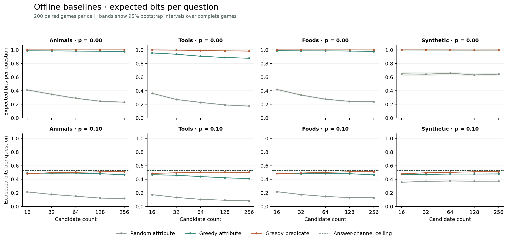

# Phase 1 gate report

Completed 2026-11-18. Work is stopped pending the user's paid-plan choice. No Tinker service calls, paid evaluation, or training occurred. Spend and holds are both $0, with the active $30 cap unchanged.

## Built and verified

- Four unique table worlds, a fixed 200-row animals training split, and separate held-out rows. Animals has 400 profiles across 100 types, tools and foods each have 320 profiles across 80 types, and synthetic has 512 random unique rows. Semantic tables use 90, 88, and 71 descriptive attributes; synthetic has 16. [Construction and inspected examples](data/WORLDS.md) explain the profile expansion and its limitations.
- A bounded parser, deterministic scripted answerer, seeded answer flips, exact posteriors, exact expected information gain, realized entropy changes, and the requested outcome-only reward. [PROTOCOL.md](PROTOCOL.md) records all grammar, budget, stopping, and behavior definitions.
- Three baselines across the full offline grid, 200 paired games per cell. The 120 policy/domain/size/noise cells contain 24,000 reported games. Another 6,000 baseline games cover the exact frozen paid bank. [Full-grid cells](results/baselines/BASELINES.md), [CIs](results/baselines/summary.json), and [matched frozen references](results/baselines/frozen/summary.json) are saved.
- A ten-cell bank of 2,000 games in evals/frozen/, with world, file, and public-prompt hashes. Paid animals candidates are disjoint from training rows. Both noise versions of an underlying case share its candidate table and target. Synthetic columns and names are relabeled per game.
- Real native-tokenizer measurements for Qwen3-8B, Qwen3.5-4B, and gpt-oss-120b, with pinned revisions. All 2,000 public prompts were counted per tokenizer. The table is a stable sparse prefix. Cost plans give caching no credit.
- An interactive HTML replay, two MP4s, and two GIFs showing random and greedy-predicate play on the same targets. [Truthful replay](replays/baseline-noiseless.mp4) and [noisy replay](replays/baseline-noisy.mp4) are each 22 seconds, 1600×1200, with 1000×750 GIFs. The games are disclosed illustrative selections, not performance samples. Model traces later use the same schema.
- Matplotlib baseline charts as PNG and SVG, NUMBERS.md comparisons, and an added LEARN.md section. The ledger and its guard implementation remain unchanged.

## Baseline results

The following EIG values are equal-weight averages over the twenty full-grid cells at each noise level. Win rates use the same 200 games per cell. Per-cell questions/win, predicate lengths, re-ask rates, and bootstrap CIs are available in the saved tables and JSON.

| Policy | Truthful win rate | Truthful EIG/question | Noisy win rate | Noisy EIG/question |
| --- | ---: | ---: | ---: | ---: |
| Random attribute | 44.40% | 0.3750 bits | 30.55% | 0.2006 bits |
| Greedy single attribute | 100.00% | 0.9696 bits | 79.75% | 0.4694 bits |
| Greedy predicate | 100.00% | 0.9976 bits | 81.925% | 0.4994 bits |

Greedy predicate is already near the noiseless 1-bit ceiling. The noisy ceiling is 0.5310 bits. Its higher EIG does not guarantee a win on every noisy game. All three baseline action sets have zero enumeration and zero invalid questions by construction; model behavior need not share those rates.

## Tests and artifact checks

The 60 offline unit tests pass. They cover malformed and malicious parser input, precedence, long flat predicates, exact answers and rewards, question-budget termination, seeded policy-independent noise, posterior hand cases, entropy, EIG, negative realized changes, world uniqueness, split boundaries, frozen-bank provenance, saved replay correctness, and budget guards. No test submits service work.

Ruff lint and formatting pass. Browser checks exercised controls, stepping, noise switching, and desktop/narrow layouts. The HyperFrames runtime, layout, and contrast checks pass. Dense labels and deliberate silence produce reviewed presentation warnings. Rendered MP4 frames were inspected, and FFprobe/GIF checks confirm duration, dimensions, and frame counts. The HyperFrames skill refresh stalled during its repository clone; the installed instructions and a pinned local CLI were used for local validation and rendering.

Bootstrap intervals resample complete games 2,000 times for offline cells. Perfect observed win rates give degenerate bootstrap intervals and do not prove a population win rate of one. Paid analysis will retain matched case pairs, use seed-level estimates, and report the limitations of small seed counts.

## Paid-plan choice

Both plans use the same recommended Qwen3-8B main policy, disable thinking, and retain a universal 2,048-token output cap. Both include a 50-game 4B zero-shot screen and a 20-game gpt-oss-120b reference slice. Task-specific model ability is not known without paid calls. The supported 4B alternative has higher Tinker rates than 8B on the checked rate card.

| Setting | Plan 30 | Plan 50 |
| --- | ---: | ---: |
| Games per cell per primary checkpoint | 24 | 28 |
| Main seeds A / B | 2 / 1 | 3 / 2 |
| Updates per main seed | 32 | 32 |
| Groups/update × games/group | 1 × 4 | 1 × 4 |
| Pilot updates A / B | 24 / 8 | 32 / 16 |
| Evaluated main endpoints | 3 | 5 |
| Base primary evaluation rounds | 1 | 1 |
| Forecast before margin | $19.52 | $32.34 |
| Forecast with 1.5 margin | **$29.28** | **$48.51** |
| Active authorization | None | None |

[PAID_PLANS.md](PAID_PLANS.md) gives phase costs, exact seeds, tokenizer counts, caching details, and the full CI forecast. Conservative per-cell win-rate interval widths are about 40.0 and 37.0 percentage points. Pooling the ten cells while preserving matched noise cases gives about 17.9 and 16.6 points, before between-training-seed uncertainty. Baseline-based EIG width proxies are below 0.019 bits, but LLM variance is unknown and can be much larger.

Unlikely-answer opportunities are scarce for the strong baseline, so forecast re-ask-rate intervals are roughly 65 and 60 points wide. Plan 30 has no estimate of between-seed variation for B. Plan 50 repeats B and uses three A seeds, but still supports modest conclusions. Recommend Plan 50 if that additional allowance is acceptable; Plan 30 is a smaller diagnostic with the same rules.

The forecasts assume no cache savings, full question budgets, and explicit output-length assumptions. Unusually long behavior can exhaust the allowance earlier. Per-call maxima, holds, and actual-cost reconciliation still control spending. A retrieve_future 408 keeps its original request ID and reservation. No schedule may silently lose games or change its settings to squeeze under the cap.

Next, after a plan is approved, is Phase 2: verify authenticated model availability, match cookbook rendering to the measured tokenization, wire every SDK operation through the existing guard, and run the declared zero-shot slice. Stop and report before any pilot training.
