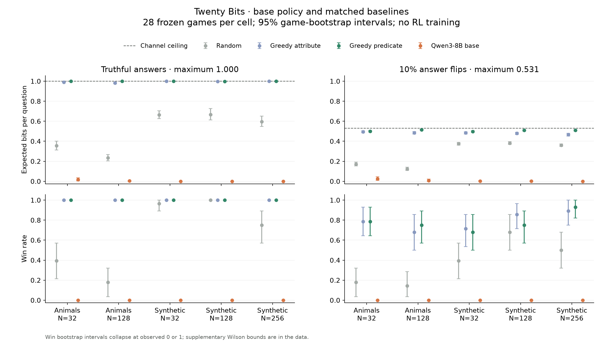

# Phase 2 gate

Completed 2026-11-18. Training has not started. Work stops at this gate until the user approves the condition A pilot.

The approved evaluation completed **280 Qwen3-8B games and 20 gpt-oss-120b games**. Recorded token-usage cost is **$5.793225**, versus **$2.95805922 forecast**, or **$4.437088830 with margin**. Another **$0.007195 is held** for the five original orphaned submissions. Available under the $50 cap is **$44.199580**. These are gross token-usage charges at the verified rate card, rounded upward per call; invoice reconciliation remains pending.

Qwen won 0/280 games; the capped reference won 0/20. Of 447 valid Qwen questions, 0 were attribute-only and 311 had zero current EIG. Every valid Qwen question used item-name enumeration; validity alone did not produce useful search. EIG includes losses and invalid questions. The chart's offline policies use the same 28 frozen cases in each cell. The reference has five cases per cell and only 512 generated tokens including analysis, so it is a limited sanity slice.

## Fixed settings and validation

Qwen3-8B uses thinking disabled, 2,048 output tokens, a 32K context window, temperature 0.7, top-p 1, top-k disabled, and a deterministic generation seed per game and turn. The reference uses medium reasoning with a 512-token cap. Games are indices 0 through 27 in each primary cell; reference games are indices 0 through 4 in the four N=32 cells. No 4B screen, tools/foods paid evaluation, or training was run.

Before paid sampling, cookbook/native rendering matched all 280 primary prompts, all 20 reference prompts, and 259 histories including long name lists. The reference's built-in system header, medium reasoning setting, and template date were pinned to match its native template. The frozen bank and public prompt hashes remain unchanged. [Rendering proof](research/phase2_rendering.json) and [sampling configuration](evals/phase2.json) record the check.

The exact engine replayed all 300 games and 3779 turns, including every posterior and EIG update. 132 context-limit losses were checked against the rendered context size. [Verification](results/phase2/verification.json) confirms the ledger matches all used sampling calls, no orphaned output entered a result, and no training operation occurred. All 76 tests passed in a fresh environment. The test command is `python3 -m unittest discover -s tests -v`.

## Per-cell performance

Brackets contain 95% percentile-bootstrap intervals from 10,000 whole-game resamples. Win percentages use the observed games, not only valid games. Questions/win is undefined without a win. All-loss or all-win bootstrap intervals collapse; supplementary Wilson win intervals in summary.json retain finite-sample uncertainty.

| Model | Domain | N | p | Wins/games | Win % [CI] | EIG/question [CI] | Questions/win [CI] |
| --- | --- | ---: | ---: | ---: | ---: | ---: | ---: |
| Qwen3-8B | animals | 32 | 0 | 0/28 | 0.000 [0.000, 0.000] | 0.018 [0.005, 0.036] | — |
| Qwen3-8B | animals | 32 | 0.1 | 0/28 | 0.000 [0.000, 0.000] | 0.025 [0.009, 0.045] | — |
| Qwen3-8B | animals | 128 | 0 | 0/28 | 0.000 [0.000, 0.000] | 0.003 [0.000, 0.008] | — |
| Qwen3-8B | animals | 128 | 0.1 | 0/28 | 0.000 [0.000, 0.000] | 0.008 [0.000, 0.022] | — |
| Qwen3-8B | synthetic | 32 | 0 | 0/28 | 0.000 [0.000, 0.000] | 0.000 [0.000, 0.000] | — |
| Qwen3-8B | synthetic | 32 | 0.1 | 0/28 | 0.000 [0.000, 0.000] | 0.003 [0.000, 0.008] | — |
| Qwen3-8B | synthetic | 128 | 0 | 0/28 | 0.000 [0.000, 0.000] | 0.000 [0.000, 0.001] | — |
| Qwen3-8B | synthetic | 128 | 0.1 | 0/28 | 0.000 [0.000, 0.000] | 0.001 [0.000, 0.004] | — |
| Qwen3-8B | synthetic | 256 | 0 | 0/28 | 0.000 [0.000, 0.000] | 0.000 [0.000, 0.000] | — |
| Qwen3-8B | synthetic | 256 | 0.1 | 0/28 | 0.000 [0.000, 0.000] | 0.000 [0.000, 0.000] | — |
| gpt-oss-120b | animals | 32 | 0 | 0/5 | 0.000 [0.000, 0.000] | 0.067 [0.032, 0.092] | — |
| gpt-oss-120b | animals | 32 | 0.1 | 0/5 | 0.000 [0.000, 0.000] | 0.008 [0.000, 0.023] | — |
| gpt-oss-120b | synthetic | 32 | 0 | 0/5 | 0.000 [0.000, 0.000] | 0.098 [0.052, 0.144] | — |
| gpt-oss-120b | synthetic | 32 | 0.1 | 0/5 | 0.000 [0.000, 0.000] | 0.057 [0.053, 0.066] | — |

## Behavior

Invalid and enumeration rates are per question. Format errors and truncation are per generated action. Legal enumeration requires a parsed predicate; the raw equality diagnostic also counts attempted item-name predicates that were invalid or truncated. Predicate length counts native tokens over counted questions, including malformed ASK expressions; an extra ASK rejected in the final-guess slot is not a question. Re-check is the next-action semantic re-ask count divided by opportunities following answers with predictive probability below 0.20. Repeating an uninformative predicate can raise this rate without helping search, so it does not establish robustness alone.

| Model | Domain | N | p | Format % | Invalid % | Truncation % | Context loss % | Legal enum % | Raw equality % | Predicate tokens/Q | Re-check/opportunities |
| --- | --- | ---: | ---: | ---: | ---: | ---: | ---: | ---: | ---: | ---: | ---: |
| Qwen3-8B | animals | 32 | 0 | 9.091 | 65.714 | 55.519 | 0.000 | 34.286 | 100.000 | 1297.621 | 0/0 |
| Qwen3-8B | animals | 32 | 0.1 | 8.824 | 50.719 | 37.255 | 0.000 | 49.281 | 100.000 | 975.615 | 14/18 |
| Qwen3-8B | animals | 128 | 0 | 6.234 | 83.938 | 56.608 | 46.429 | 16.062 | 68.135 | 1550.047 | 0/0 |
| Qwen3-8B | animals | 128 | 0.1 | 3.226 | 86.632 | 50.372 | 50.000 | 13.368 | 78.406 | 1445.625 | 5/8 |
| Qwen3-8B | synthetic | 32 | 0 | 9.091 | 96.429 | 3.571 | 0.000 | 3.571 | 78.571 | 649.850 | 0/0 |
| Qwen3-8B | synthetic | 32 | 0.1 | 9.091 | 92.857 | 0.000 | 0.000 | 7.143 | 85.714 | 582.768 | 2/4 |
| Qwen3-8B | synthetic | 128 | 0 | 1.010 | 85.714 | 74.747 | 85.714 | 14.286 | 67.857 | 2007.357 | 0/0 |
| Qwen3-8B | synthetic | 128 | 0.1 | 0.254 | 96.429 | 90.076 | 96.429 | 3.571 | 67.857 | 2016.464 | 0/0 |
| Qwen3-8B | synthetic | 256 | 0 | 0.272 | 100.000 | 95.380 | 96.429 | 0.000 | 36.240 | 1957.125 | 0/0 |
| Qwen3-8B | synthetic | 256 | 0.1 | 0.272 | 100.000 | 95.380 | 96.429 | 0.000 | 43.324 | 1956.542 | 0/0 |
| gpt-oss-120b | animals | 32 | 0 | 81.818 | 92.000 | 76.364 | 0.000 | 0.000 | 0.000 | 0.360 | 0/0 |
| gpt-oss-120b | animals | 32 | 0.1 | 70.909 | 98.000 | 61.818 | 0.000 | 0.000 | 0.000 | 0.460 | 0/0 |
| gpt-oss-120b | synthetic | 32 | 0 | 69.091 | 84.000 | 67.273 | 0.000 | 2.000 | 2.000 | 1.140 | 0/0 |
| gpt-oss-120b | synthetic | 32 | 0.1 | 80.000 | 88.000 | 80.000 | 0.000 | 0.000 | 0.000 | 0.580 | 0/0 |

## Tokens, caching, and cost

Caching applies in the live sampling sessions. The saved response field prompt_cache_hit_tokens supplies the hit count; no cache saving was credited in the forecast. Reasoning means visible generated analysis tokens. Qwen's disabled-thinking setting does not measure internal computation. Every full turn, including invalid or truncated output, contributes to token cost.

| Model | Domain | N | p | Generated tokens/game | Reasoning tokens/game | Cache hit tokens | Cache hit % | Actual USD | Forecast USD |
| --- | --- | ---: | ---: | ---: | ---: | ---: | ---: | ---: | ---: |
| Qwen3-8B | animals | 32 | 0 | 14334.500 | 0.000 | 1,959,680 | 82.591 | 0.397946 | 0.11044572 |
| Qwen3-8B | animals | 32 | 0.1 | 10661.143 | 0.000 | 1,544,064 | 83.878 | 0.297355 | 0.11044572 |
| Qwen3-8B | animals | 128 | 0 | 21910.500 | 0.000 | 4,769,920 | 87.441 | 0.687930 | 0.3336543 |
| Qwen3-8B | animals | 128 | 0.1 | 20429.857 | 0.000 | 4,619,776 | 89.066 | 0.634191 | 0.3336543 |
| Qwen3-8B | synthetic | 32 | 0 | 7191.500 | 0.000 | 1,087,488 | 82.747 | 0.207596 | 0.09903432 |
| Qwen3-8B | synthetic | 32 | 0.1 | 6458.643 | 0.000 | 1,028,352 | 84.997 | 0.184160 | 0.09903432 |
| Qwen3-8B | synthetic | 128 | 0 | 28404.214 | 0.000 | 5,479,936 | 86.732 | 0.854564 | 0.2955708 |
| Qwen3-8B | synthetic | 128 | 0.1 | 28318.929 | 0.000 | 5,482,496 | 87.715 | 0.839507 | 0.2955708 |
| Qwen3-8B | synthetic | 256 | 0 | 25693.286 | 0.000 | 5,365,376 | 86.652 | 0.802240 | 0.56183232 |
| Qwen3-8B | synthetic | 256 | 0.1 | 25685.286 | 0.000 | 5,496,832 | 88.802 | 0.781229 | 0.56183232 |
| gpt-oss-120b | animals | 32 | 0 | 5247.200 | 5187.000 | 57,600 | 86.326 | 0.028878 | 0.04295775 |
| gpt-oss-120b | animals | 32 | 0.1 | 4723.400 | 4646.200 | 62,464 | 93.456 | 0.025432 | 0.04295775 |
| gpt-oss-120b | synthetic | 32 | 0 | 4990.400 | 4913.200 | 40,704 | 85.009 | 0.026043 | 0.0355344 |
| gpt-oss-120b | synthetic | 32 | 0.1 | 5203.000 | 5144.400 | 43,392 | 91.043 | 0.026154 | 0.0355344 |

Total reported cache hits: 37,038,080 tokens. Total generated tokens: 5,395,280. Forecasting 64 Qwen output tokens per turn was too optimistic for long invalid outputs; caching offsets some input cost. Actual versus forecast is reported per cell rather than hiding the output-length miss inside the project cap.

## Adapter incident and recovery

The manually assembled sampling request omitted the stock SDK's sampling-backpressure header. Tinker returned an outdated-SDK error despite SDK 0.39.1 being current. Adding a version header alone did not fix it. Matching the native SDK wire body and X-Tinker-Sampling-Backpressure: 1 restored acceptance. A local HTTP test now compares the production adapter with the SDK's actual request builder.

Five originals have no saved receipts and remain **orphaned, possibly billed** in ledger.json and the report, with **$0.007195 held until billing resolves them**. Their output is permanently excluded, even if it becomes available later. The user approved five exact replacements. Their saved prompt-and-seed signatures match the originals. Four later explicit HTTP 422 rejections were reconciled at $0.

Every sampling request after the user's additional requirement now saves its deterministic sampler-ID/sequence request ID in the fsynced journal and ledger **before creating the HTTP task**, and checks the server receipt against it. This was verified for 3768 calls. Eleven accepted calls from the earlier completed game were made before the write-ahead ID change. Metadata and retrieval operations also persist a ledger operation ID before I/O. A retrieve_future 408 retains the sampling hold and re-polls the same saved request ID; sampling is not resubmitted.

A local restart recovered four acknowledged futures. One additional local task was interrupted before server acceptance: its saved ID returned 404 and was absent from the full completion inventory while later sequences were present. That unaccepted attempt was recorded at $0 and repeated with the same prompt and seed. Shutdown now stops new submissions and drains active HTTP tasks. [Incident record](research/phase2_incident.json), [restart evidence](research/phase2_restart_recovery.json), [usage journal](results/phase2/usage.jsonl), and [ledger reconciliation](results/phase2/ledger_reconciliation.json) preserve the details.

## Pilot proposal, not authorization

The noiseless animals N=32 base used 1303.1 generated tokens per call on average; the 95th percentile was 2048.0. The next forecasts use that observed mean as an explicit proxy, including for unmeasured N=16. They charge full per-turn contexts for training and give caching no credit. A $0.10 storage allowance bounds four sampler snapshots of at most 64 GB each for two hours at the published storage rate. Storage and all calls still need individual reservations before use.

| A-only pilot | Training games | Development games | Observed-output proxy USD | With 1.5× margin USD | Cap-output stress with margin USD |
| --- | ---: | ---: | ---: | ---: | ---: |
| 8 updates, groups of 8 | 64 | 32 | 4.63 | 6.94 | 10.37 |
| 16 updates, groups of 8 | 128 | 32 | 8.35 | 12.52 | 18.76 |
| 32 updates, groups of 8 | 256 | 32 | 15.78 | 23.67 | 35.53 |

Recommend the 16-update A pilot as a bounded diagnostic, with eight updates at N=16 then eight at N=32. Log reward, win rate, EIG, invalid rate, and group reward variance each update; evaluate the same eight development games at updates 0, 4, 8, and 16. The reward remains +1 win, −0.03/question, and −0.1/invalid. EIG never enters the reward. If all eight returns in a group are identical, standardized advantages are zero; report that rather than claiming a learning update occurred.

At that pilot gate, report learning speed and the early-guess, singleton search, large name-list, and parsing audit. Then price Option S (A: three seeds, B: two) and Option U (A: two, B: one) with the updates that fit remaining funds, training games per seed, evaluated checkpoints, and 1.5× margin. No main-run choice is made here. Legal enumeration will remain legal and will be reported as a result.

## Limits and reproduction

Animal rows are profiles with underlying types shared across the training and held-out pools. The worlds and structured grammar are deliberately limited. This gate measures a base policy, not an RL effect. A formatting failure and a low-information legal question have different causes but both reduce the primary EIG measure. The reference cap and small sample prevent a broad model-size claim. Noise re-check conclusions require enough eligible answers; an undefined or tiny denominator is not evidence of trust or robustness.

Rebuild offline with `python3 scripts/summarize_phase2.py`, `python3 scripts/verify_phase2.py`, `python3 scripts/plot_phase2.py`, `python3 scripts/price_pilot.py`, and `python3 scripts/write_phase2_report.py`. [All cell CIs](results/phase2/summary.json), [CSV](results/phase2/summary.csv), and [complete game traces](results/phase2/games.jsonl.gz) are saved. The local runner resumes saved requests and completed games; it does not start training. .env is ignored and untracked.
