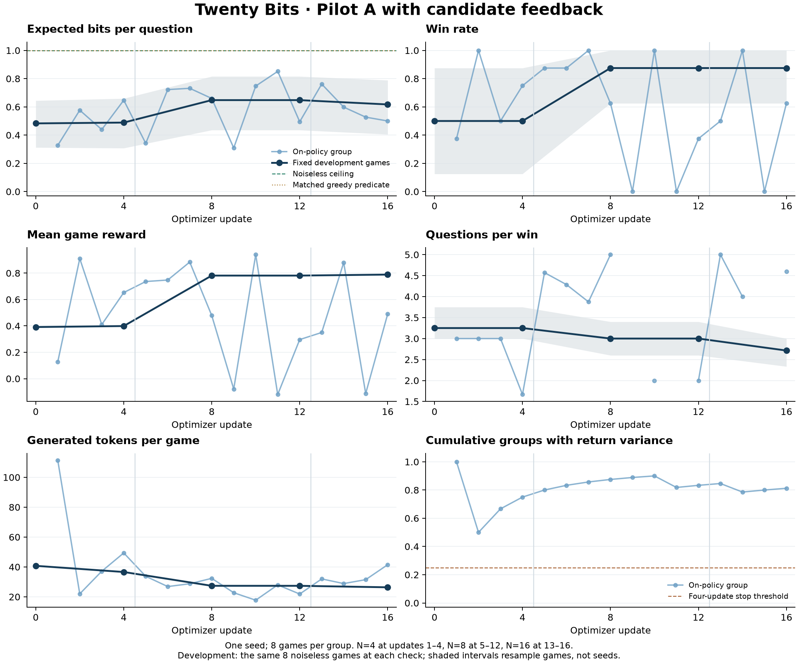
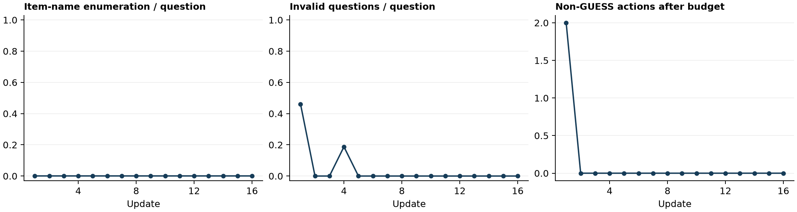

# Raw-base RL pilot gate

Completed 2026-11-18: **16 A updates, 128 training games and 40 development games**. Raw Qwen3-8B with candidate feedback improved from 4/8 to 7/8 on the fixed development cases; EIG/question rose from 0.483 to 0.617. The EIG change is +0.134 bits/question, paired 95% CI [-0.001, +0.305]. This is encouraging and inconclusive, not evidence of optimal search. Main runs have not started.

## What trained

The policy began at raw Qwen3-8B, with no SFT adapter or optimizer state loaded. Random-question SFT is removed from the main plan because it lowered pooled EIG by 0.1444 bits/question in the paired candidate-set qualification. Its historical data, charges and storage holds remain intact. Its toy-table exposure does not enter the main RL policy.

Rank-32 LoRA, seed 11, attention/MLP/output projections trainable; Adam learning rate 4e-5, beta1=0.9, beta2=0.95, epsilon=1e-8, zero weight decay and no gradient clipping. These optimizer defaults match the pinned cookbook RL-loop recipe. One importance-sampling forward/backward and optimizer step per eight-game group; no extra substeps, KL penalty, SFT loss or information reward. Total returns are centered within the group and divided by population standard deviation plus 1e-8; numerically constant returns get zero advantages. Zero-advantage batches remain in the fixed schedule; Adam may still carry momentum from previous gradients.

The reward stayed +1 for a win, -0.03 per question and -0.1 per INVALID question. Every group shares one animal table, subset and hidden target, with eight distinct requested generation seeds. The curriculum stayed 4 updates at N=4, 8 at N=8 and 4 at N=16. All worlds come from the fixed 200-row training pool through training_game. The eight separate development games never enter gradients. No noisy, transfer or frozen-test model evaluation ran.

The main observation remained candidate-set-v1 with exact attribute-code aliases, a stable full table prefix and lists after answers. Caps stayed at 2,048 generated tokens per turn and 32K context, with thinking disabled. EIG is measurement only. Only generated action tokens, including termination tokens, receive direct loss; context still influences their predictions. Cookbook rollout, renderer and training-data helpers are reused through the ledger guard. [Frozen configuration](experiments/pilot_A.json), [games and example selection](experiments/pilot_A_games.json), [preflight](research/pilot_A_preflight.json).

## Every training update

Each row describes eight on-policy games sampled **before** that update. The table and target change between groups; changes across rows are not a paired learning estimate. Invalid and enumeration rates use all counted questions, including losses. Lists means at least two distinct item equalities. G nonzero is the per-update group share followed by the cumulative share. Undefined win-conditioned values remain undefined.

| Update | N | Mean reward | Wins/8 | EIG/Q | Q/win | Item == % | Lists % | Invalid % | G nonzero / cumulative | Output tokens/game |
| ---: | ---: | ---: | ---: | ---: | ---: | ---: | ---: | ---: | --- | ---: |
| 1 | 4 | 0.128 | 3/8 | 0.328 | 3.00 | 0.0% | 0.0% | 46.2% | 100.0% / 100.0% | 111.38 |
| 2 | 4 | 0.910 | 8/8 | 0.577 | 3.00 | 0.0% | 0.0% | 0.0% | 0.0% / 50.0% | 22.00 |
| 3 | 4 | 0.410 | 4/8 | 0.439 | 3.00 | 0.0% | 0.0% | 0.0% | 100.0% / 66.7% | 37.12 |
| 4 | 4 | 0.652 | 6/8 | 0.647 | 1.67 | 0.0% | 0.0% | 18.8% | 100.0% / 75.0% | 49.38 |
| 5 | 8 | 0.736 | 7/8 | 0.342 | 4.57 | 0.0% | 0.0% | 0.0% | 100.0% / 80.0% | 33.75 |
| 6 | 8 | 0.748 | 7/8 | 0.723 | 4.29 | 0.0% | 0.0% | 0.0% | 100.0% / 83.3% | 26.88 |
| 7 | 8 | 0.884 | 8/8 | 0.732 | 3.88 | 0.0% | 0.0% | 0.0% | 100.0% / 85.7% | 28.75 |
| 8 | 8 | 0.479 | 5/8 | 0.660 | 5.00 | 0.0% | 0.0% | 0.0% | 100.0% / 87.5% | 32.38 |
| 9 | 8 | -0.079 | 0/8 | 0.309 | — | 0.0% | 0.0% | 0.0% | 100.0% / 88.9% | 22.75 |
| 10 | 8 | 0.940 | 8/8 | 0.748 | 2.00 | 0.0% | 0.0% | 0.0% | 100.0% / 90.0% | 17.75 |
| 11 | 8 | -0.120 | 0/8 | 0.851 | — | 0.0% | 0.0% | 0.0% | 0.0% / 81.8% | 28.00 |
| 12 | 8 | 0.296 | 3/8 | 0.495 | 2.00 | 0.0% | 0.0% | 0.0% | 100.0% / 83.3% | 21.88 |
| 13 | 16 | 0.350 | 4/8 | 0.762 | 5.00 | 0.0% | 0.0% | 0.0% | 100.0% / 84.6% | 32.00 |
| 14 | 16 | 0.880 | 8/8 | 0.598 | 4.00 | 0.0% | 0.0% | 0.0% | 0.0% / 78.6% | 28.88 |
| 15 | 16 | -0.112 | 0/8 | 0.527 | — | 0.0% | 0.0% | 0.0% | 100.0% / 80.0% | 31.50 |
| 16 | 16 | 0.490 | 5/8 | 0.500 | 4.60 | 0.0% | 0.0% | 0.0% | 100.0% / 81.2% | 41.50 |

The four-update stop rule passed: **3/4 groups (75%)** had nonzero return variance, above 25%. Over the whole pilot, **13/16** groups had return variance and **9/16** had win variance. Updates 9, 15 had no wins but nonzero cost-driven return variance. The stop test alone does not prove useful win signal. No extra stop rule was added.

## Fixed development curve

These are the same four N=4 and four N=8 training-pool development cases at each checkpoint, with paired generation seeds. They are not held-out items or the frozen evaluation bank. Development CIs resample complete games. The eight rollouts in each training row share a table and target; one group cannot estimate variation across start states. There is one pilot seed, so no between-seed uncertainty estimate.

| Policy update | Mean reward | Wins/8 | EIG/Q [95% bootstrap CI] | Q/win | Output tokens/game |
| ---: | ---: | ---: | --- | ---: | ---: |
| 0 | 0.391 | 4/8 | 0.483 [0.312, 0.644] | 3.25 | 40.75 |
| 4 | 0.399 | 4/8 | 0.489 [0.308, 0.659] | 3.25 | 36.62 |
| 8 | 0.781 | 7/8 | 0.648 [0.435, 0.816] | 3.00 | 27.38 |
| 12 | 0.781 | 7/8 | 0.648 [0.435, 0.816] | 3.00 | 27.38 |
| 16 | 0.789 | 7/8 | 0.617 [0.405, 0.789] | 2.71 | 26.38 |

Most observed development improvement appeared between updates 4 and 8. EIG then stayed near 0.65 and ended at 0.617; the scheduled final checkpoint is reported, not the highest intermediate score. Paired EIG permutation p=0.125; exact paired win-test p=0.250. The win bootstrap change interval is [12.5, 75.0] percentage points, but with only three discordant pairs the exact test remains weak. The small-case bootstrap interval should not be treated as conclusive evidence. No main-study claim rests on these eight cases.

## Strategy and reward-hacking audit

**No item-name enumeration occurred:** 0/459 training questions and 0/23 final-development questions. There was no item-by-item search, multi-item name list, giant half-list, or consecutive singleton-item enumeration. These actions remained legal. Accepted training questions were 341 single attributes, 5 negated single attributes and 98 Boolean attribute predicates. This is attribute-based play, not proof of balanced bisection.

There were 120 valid zero-EIG training questions and 64 repeated splits. On the paired development cases, zero-EIG questions fell from **13/29 to 7/23**, repeated splits from **8 to 5**, and exactly-one-bit questions rose from **3 to 4**. The main observed efficiency gain was removing wasted questions. The final model remains far below the one-bit ceiling and matched greedy reference.

**Risky stopping remains material.** Training had 16/128 early-guess games (11 wins), and no zero-question guess. Early means fewer questions than ceil(log2 N): 11 of these already had singleton support after an uneven split, while 5 still had multiple possibilities. In the final development check, **5/8 guesses** occurred with multiple candidates remaining and **4 of 7 wins** came from those guesses. Only three final wins followed singleton. Neither training nor final development guessed an eliminated candidate or guessed wrongly at singleton; every one of the 45 singleton-reaching training games won.

A post-hoc stopping audit replaces realized win with the posterior probability of the chosen item, assigning zero to a no-guess ending. Mean logged guess confidence rose from **0.469 to 0.656**, while realized win rate rose from 0.500 to 0.875. Part of the win gain was luck. This audit does not change any reward or primary score. Win-conditioned questions alone would overstate progress.

There were **15/459 INVALID training questions** (3.27%), all in updates 1–4, and none in the development checks. Causes: two excessive-nesting expressions, one trailing-token expression, six unknown `long_ears` attributes and six missing closing parentheses. Two extra ASK actions after budget exhaustion ended games as losses; they did not increase the question counter or win. There were no truncated sampled turns or visible reasoning tokens. Zero visible reasoning follows the disabled-thinking protocol and does not measure internal computation.

All accepted predicates were replayed through the safe AST parser against exact table rows; answers, posterior updates, EIG and rewards matched. The malformed outputs were rejected, with no parsing exploit observed. No rule, grammar limit, output cap or legal enumeration form was changed. [Full machine-readable audit](results/pilot_A/summary.json).

## Two paired games

[EXAMPLE_GAMES.md](results/pilot_A/EXAMPLE_GAMES.md) shows the two preselected development targets side by side, raw base at update 0 and the final model at update 16, with every action, answer, remaining-count and the shared public table. These are games from the final scheduled development snapshot, not cherry-picked training wins. They use existing development calls, so no extra sample was purchased. [Complete paired records](results/pilot_A/example_games.jsonl.gz).

## Cost, collection and implementation incident

Recorded pilot token usage was **$0.291204**, plus **$0.250000** held for four native checkpoints and one external export: **$0.541204 including holds**, below the approved **$2.00** ceiling. The forecast was $0.742968 for sampling/gradients plus $0.30 checkpoint holds, or $1.564452 with 1.5x margin. Fewer turns, shrinking new lists and observed sampling caches lowered recorded costs; gradient usage was priced for full input tokens despite masked prompt loss. No question-cap reduction or incomplete game exclusion produced the saving.

Project usage is **$6.626433**, total holds **$0.362813**, and **$43.010754 remains** under $50. The nine excluded old attempts still hold $0.012813; the earlier SFT storage holds remain $0.10. New pilot checkpoint holds add $0.25. Storage is unknown until billing reconciliation; completed futures are already collected. Usage charges use observed/submitted tokens and the [provider rate card](https://tinker-docs.thinkingmachines.ai/tinker/models.json), rechecked on 2026-11-18, rather than final invoices. The final adapter is downloaded under the ignored runs/pilot-A-v1/adapter directory with hashes.

An initial gradient reservation failed locally because the specialized SDK forward_backward method does not accept a per-call max_retries keyword. The local Python argument binder rejected it before creating an HTTP coroutine. That reservation was proven unsubmitted and reconciled at $0; its journal and original preflight are preserved. Both forward_backward and optim_step now rely on the SDK client’s existing max_retries=0 setting, and a regression test invokes the actual production update through native SDK resources. The 16 already sampled games were reused. No reward, prompt, seed, cap, data or evaluation setting changed. [Incident and proof](research/pilot_A_local_adapter_incident.json), [implementation amendment](research/pilot_A_preflight.json).

Network interruptions were recovered by pausing producers, draining active HTTP operations, reconnecting, and collecting saved sampling and training futures concurrently before new submissions. A retrieve_future 408 always kept its original request ID and hold. No accepted gradient or optimizer work was resubmitted. Sampling and mutation IDs were saved before dispatch and checked against receipts or recovered results. No new response-expiry replacement was needed.

Training and sampling log probabilities were not bit-identical despite matching native token sequences: per-update mean signed differences ranged from -0.0124 to 0.0045 nats, with a maximum absolute token difference of 1.250. The backend cause is unverified. The standard importance-sampling loss used recorded rollout log probabilities throughout; no correction was introduced mid-run. These diagnostics are saved per update.

## Main-run choices — not authorized

Both choices initialize every seed from raw Qwen3-8B, not SFT or the pilot adapter. A uses p=0; B uses p=0.10. Groups stay at eight and the reward, aliases, candidate feedback and 2,048 cap remain unchanged. The curricula below are new proposals, to be frozen only after the user chooses. Each seed keeps one scheduled endpoint, evaluated on all 280 frozen games (28 per cell). A new raw-base candidate-feedback control is evaluated once on the same bank. Intermediate development samplers are ephemeral; no extra retained checkpoints are selected by test scores.

| Choice | A / B seeds | Updates/seed | Training games/seed | Total training games | Forecast incl. 1.5x margin and checkpoint holds | Remaining after forecast |
| --- | --- | ---: | ---: | ---: | ---: | ---: |
| S | 3 / 2 | 12 | 96 | 480 | $42.89 | $0.12 |
| U | 2 / 1 | 30 | 240 | 720 | $42.49 | $0.53 |

| Choice | N=4 | N=8 | N=16 | N=32 | N=64 | N=128 |
| --- | ---: | ---: | ---: | ---: | ---: | ---: |
| S | 2 | 2 | 2 | 2 | 2 | 2 |
| U | 2 | 2 | 11 | 7 | 4 | 4 |

| Choice | Training | Development | Raw + endpoint frozen evals | Hard mode, 40 games | Checkpoint holds | Total before margin |
| --- | ---: | ---: | ---: | ---: | ---: | ---: |
| S | $12.37 | $0.09 | $14.26 | $1.37 | $0.50 | $28.59 |
| U | $17.00 | $0.15 | $9.51 | $1.37 | $0.30 | $28.32 |

Per-seed training forecasts (sampling plus gradients, with 1.5x margin; evaluation and checkpoint holds are in the totals above): S: $3.47 per A seed and $4.09 per B seed; U: $8.02 per A seed and $9.47 per B seed. Quoted total forecasts round upward and remaining funds downward to cents.

S uses A seeds 11, 23, 37 and B seeds 41, 53; U uses A seeds 11, 23 and B seed 41. Each seed uses the same eight development games every four updates and at its scheduled endpoint; the existing raw development control is reused. This buys a visible curve without retaining extra checkpoints. The N=4/8 development curve is descriptive; larger-size, noisy and transfer comparisons use the frozen endpoints. Both include the end-of-project hard-mode slice: raw base and predetermined final A seed 11, 20 games each, with no hard-mode training. Tools, foods and the retired large reference have no paid allocation.

**Recommend U as an exploratory continuation.** It buys more training start states and more updates at N=16/32, where the pilot still has room to learn before the untested larger sizes. The observed small-game gain appeared by update 8 but then plateaued, below one bit; more updates are not guaranteed to help. S provides more seed replication but a short learning horizon. U has only one B seed, so it cannot estimate between-seed variability of noisy training; that limitation must accompany any noise claim. Risky stopping remains an issue under the unchanged reward.

Forecasts use native token counts on random and greedy-predicate reference trajectories, calibrated upward if they underpredict measured pilot uncached sampling plus gradients. Output proxies are max(mean,p90) observed pilot lengths. Training receives no cache credit. Stable-weight evaluation receives 60% cache credit, below the minimum 75.4% observed on the trained development snapshots; both the forecast times 1.5 and a separate zero-cache reference total must fit remaining funds. Hard mode is priced with full 2,048-token outputs until context stop, rather than the short provided-state proxy. The zero-cache reference totals, before another margin, are $42.31 (S) and $37.70 (U).

No large-N or noisy model pilot was run. Legal name-list strategies and format failures could increase output/context costs. These are forecasts, not bills or guarantees of completion. The ledger refuses any call whose reservation would exceed $50; it will not silently reduce caps, cells or updates. The 50% margin is already included above. [Reproducible profiles, per-seed costs and assumptions](research/main_options_after_pilot.json).

## Verification and next decision

120 unit tests pass. Offline replay verified all **168 games and 756 sampling calls**, every group’s return/advantage arrays and all 16 gradient batches. Frozen game files, old prompt hashes, prior ledger entries and cap approval remain intact. [Final validation](results/pilot_A/validation.json), [archive-only reproduction](results/pilot_A/reproduction.json).

Reproduce at this gate commit with `python3 scripts/analyze_rl_pilot.py`, `python3 scripts/verify_rl_pilot.py`, `python3 scripts/plot_rl_pilot.py`, `python3 scripts/price_main_runs.py`, and `python3 scripts/write_pilot_gate.py`. These use saved responses and perform no Tinker operations. Native and external checkpoint TTLs are two hours; the downloaded adapter persists locally.

**Pilot complete. Stop for the user to choose S, U, or a revised experiment. No main run is authorized or started.**
