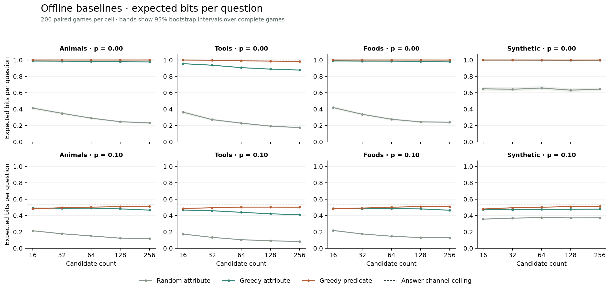

# Twenty Bits




Can an outcome-only reward teach a small LLM to search efficiently, and does it learn attribute bisection or item-name enumeration? Does the strategy transfer to relabeled tables, and does noise teach it to re-check answers?

**Phase 1 is complete. No LLM training or paid evaluation has run. Total Tinker spend: $0.00 / $30.00**, from [ledger.json](ledger.json). The chart and replay above are algorithmic baselines. Model results will replace the headline after the paid phases.

Open the [interactive replay](replays/index.html), [truthful-answer MP4](replays/baseline-noiseless.mp4), or [noisy-answer MP4](replays/baseline-noisy.mp4). The two illustrated games were selected for a visible strategy contrast. The complete sweeps supply the reported numbers.

The offline grid contains 24,000 games, with 200 paired games for each domain, candidate size, noise setting, and policy. [Every cell](results/baselines/BASELINES.md), [machine-readable metrics and 95% bootstrap CIs](results/baselines/summary.json), and [matched frozen-game references](results/baselines/frozen/summary.json) are saved. Greedy predicate's macro-average EIG is 0.9976 bits/question with truthful answers and 0.4994 with 10% noise. Its observed win rates are 100% and 81.925%. The noisy answer-channel ceiling is 0.5310 bits/question.

These are finite authored worlds. Animals has 400 named age/sex profiles across 100 types; tools and foods each have 320 profiles across 80 types. They use 90, 88, and 71 attributes to stay distinguishable without random identity bits. The synthetic world has 512 unique random 16-bit rows and is relabeled in each game. [World definitions, sample hand checks, and limitations](data/WORLDS.md) describe the construction. Animal training uses a fixed 200-row pool; paid animal evaluation uses disjoint rows, with shared underlying types disclosed.

[PAID_PLANS.md](PAID_PLANS.md) offers the $30 and $50 plans using real tokenizer measurements. [PHASE1.md](PHASE1.md) is the gate report. Work is stopped pending the user's choice. [PRIOR_WORK.md](PRIOR_WORK.md) stays as context; this is a research-style side project for GitHub and X.

## Reproduce offline

Use Python 3.11 or later. The game and tests do not need Tinker credentials or its SDK.

```bash
python3 -m venv .venv
source .venv/bin/activate
python3 -m pip install -e '.[replay]'
python3 -m unittest discover -s tests -v
python3 scripts/verify_frozen.py
python3 scripts/run_baselines.py
python3 scripts/run_frozen_baselines.py
python3 scripts/plot_baselines.py
python3 scripts/measure_tokens.py
python3 scripts/build_paid_plans.py
python3 -m twenty_bits.budget status
```

Tokenizer downloads come from Hugging Face at the recorded revisions. No weights are downloaded. The baseline runners reuse the committed per-game results when present and verify their world, tokenizer, and seed provenance. To compute another sweep independently, use `python3 scripts/run_baselines.py --output-directory /tmp/twenty-bits-reproduction`. The frozen bank is already included; `freeze_evals.py` refuses to overwrite it.

Serve the viewer with `python3 -m http.server 8765` and visit `http://localhost:8765/replays/`. Play, scrub, step, change noise mode, hide the target, or load a matched pair in the JSON schema from replays/games.json. Regenerate the local exports with `python3 scripts/export_replays.py`. This uses the pinned HyperFrames CLI and FFmpeg. To rebuild only GIFs from existing MP4s, add `--reuse-mp4`.

## Read the code

[LEARN.md](LEARN.md) explains each completed phase. Start with [worlds.py](twenty_bits/worlds.py), [predicates.py](twenty_bits/predicates.py), [information.py](twenty_bits/information.py), and [game.py](twenty_bits/game.py), then read [baselines.py](twenty_bits/baselines.py). The public observation is built in [prompts.py](twenty_bits/prompts.py), and frozen-game checks live in [evaluation.py](twenty_bits/evaluation.py).

[PROTOCOL.md](PROTOCOL.md) fixes the grammar, budget, posterior, metrics, and stopping rules. [NUMBERS.md](NUMBERS.md) records the main comparisons. EIG is measured and never rewarded. Legal name enumeration remains allowed, and the proposed output cap accommodates the measured half-candidate lists. The final RESULTS.md will tie model claims to charts, paired CIs, spend, and failed attempts after those data exist.
