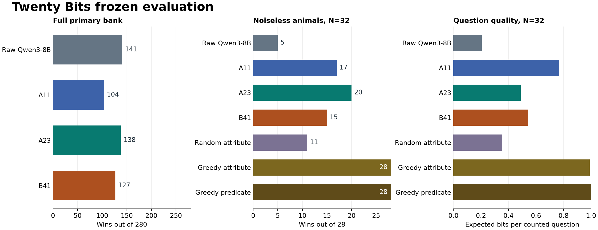

# Twenty Bits

## Overview

Twenty Bits uses Tinker to train Qwen3-8B to play table-based 20 Questions. **RL improved information per question on noiseless animals, about 4× for A11. The seeds struggled with when to guess.** Across 280 primary games per seed, A11 made **167 ambiguous wrong guesses**, A23 **ended 136 games without guessing**, and B41 made **202 ambiguous guesses with budget left**. [Illustrated write-up](https://www.mohith.xyz/blog/twenty-bits), [detailed results](RESULTS.md), [saved counts](results/submission/comparison.json).


The three counts describe different measures. An ambiguous guess with budget left can be correct, and a wrong one can count in both measures. All trained policies won fewer games than raw across the full primary bank. [Guess timing chart as SVG](figures/guess-timing.svg), [measurement definitions](PROTOCOL.md).

## Game and environment

Each game supplies a binary attribute table and hides one target row. The model emits one Boolean question such as `ASK: fur AND NOT carnivore`, or ends the game with `GUESS: <exact item name>`. Attributes, their case-sensitive codes, and item-equality expressions are legal. Compound expressions still produce one yes/no answer. The limit is `2 * ceil(log2(N))` counted questions followed by one final-guess opportunity. The script evaluates each question against the target row. No LLM answers the questions or scores the game. [Protocol](PROTOCOL.md), [game implementation](twenty_bits/game.py), [grammar](twenty_bits/predicates.py).

After each question, the prompt supplies either the exact consistent candidate set or, with noise, candidates whose posterior is strictly above `0.001` plus the most likely candidate. The full table remains visible. The primary prompt gives the maximum question count. A later budget variant adds a running counter and an explicit instruction at exhaustion. [Candidate feedback](twenty_bits/candidate_feedback.py), [budget variant](VISIBLE_BUDGET_PROTOCOL.md).

Training uses 200 authored animal profiles. The paid evaluation draws from the other 200 profiles, with 88 underlying animal types shared across the pools. The 280-game primary bank has ten cells with 28 games each. Animals use N=32 and 128. Relabeled synthetic tables use N=32, 128, and 256. Each size has truthful and independently flipped answers at probabilities `0` and `0.10`. Frozen games and synthetic tables stay outside the main gradients. Tools and foods have offline policy references. The semantic object lists are project-authored and the synthetic tables come from a seeded generator. Both are MIT-licensed with the code. Bundled third-party assets retain their licenses. [Worlds and split](data/WORLDS.md), [frozen cases](evals/frozen/manifest.json), [generator](scripts/build_worlds.py), [MIT license](LICENSE).

## Reward

The game return is **+1 for a correct guess, −0.03 per counted question, and −0.10 per invalid question**. An invalid question incurs both costs. An answer flip can change the subsequent actions and their reward. The win check always uses the hidden target. Expected information gain (EIG) is the expected reduction in posterior entropy before the answer. It accounts for both possible replies and the known flip probability. Invalid questions contribute zero bits, and losses stay in the EIG denominator. EIG and semantic repeats are evaluation metrics. [Reward and state updates](twenty_bits/game.py), [information calculation](twenty_bits/information.py).

## Method

Each seed starts from the provider Qwen3-8B weights before any Twenty Bits training. Rank-32 LoRA uses 30 grouped online RL updates. An update samples eight games from one table and target, standardizes their returns within the group, and applies the pinned cookbook importance-sampling loss to generated tokens. The animal curriculum uses N=4, 8, 16, 32, 64, and 128. A11 and A23 train on truthful answers and B41 on 10% seeded flips. Thinking is disabled and the per-turn generation cap is 2,048 tokens. Scheduled update-30 endpoints are evaluated without selection on the frozen cases. [A11](experiments/main_A11.json), [A23](experiments/main_A23.json), [B41](experiments/main_B41.json), [development curve](results/writeup/charts/development.svg), [curve data](results/writeup/numbers.json).

Prior 20 Questions work trained Vicuna with gameplay RL and showed that prompting ChatGPT to list its updated candidate space improved search. Paprika uses supervised and preference optimization across tasks with an LLM answerer and judge in 20 Questions. Mazzaccara et al. form preferences from EIG, and LMRL Gym uses an LLM oracle. Twenty Bits combines supplied candidate feedback, scripted Boolean answers, known flip probabilities, and online win-and-cost training. That makes it possible to measure question information without using it as supervision. [Zhang, Lu, and Jaitly](https://aclanthology.org/2024.acl-long.82/), [Bertolazzi et al.](https://aclanthology.org/2023.inlg-main.11/), [Paprika](https://arxiv.org/html/2502.17543), [Mazzaccara, Testoni, and Bernardi](https://aclanthology.org/2024.findings-emnlp.291/), [LMRL Gym](https://proceedings.mlr.press/v267/abdulhai25a.html), [citation checks](docs/SUBMISSION_AUDIT.md#citation-checks).

## Results vs baselines and oracle

| Policy | All primary games | Noiseless animal games | Noisy games | Expected bits per question, noiseless animals |
| --- | ---: | ---: | ---: | ---: |
| Raw Qwen3-8B | 141/280 | 7/56 | 52/140 | 0.1579259253504653 |
| A11 | 104/280 | 24/56 | 31/140 | 0.6343241095076058 |
| A23 | 138/280 | 25/56 | 29/140 | 0.3904375761005189 |
| B41 | 127/280 | 19/56 | 36/140 | 0.43684219768060206 |

The animal EIG column averages the two size-specific bits-per-question ratios equally. All three paired 95% game-bootstrap intervals for improvement exclude zero on this slice. Across the full bank, A11 made 167 ambiguous wrong guesses and A23 ended 136 games without guessing. B41 made 202 ambiguous guesses with budget left. The separate budget prompt moved A23 from 138/280 to 186/280 wins and from 136 to zero no-guess endings. It changes both the counter and the final instruction, so the data cannot isolate either element. B41 still made 188 ambiguous guesses with budget left. On the primary noisy cases, all trained endpoints won less often than raw. The B41 comparison with mean A includes zero in its paired win-rate interval. Together the logs show why information per question and win rate can move differently. They leave the role of individual reward terms open. [Primary data and intervals](results/writeup/numbers.json), [B41 comparison](results/main_B41/all_seeds.json), [budget follow-up](results/visible_budget/summary.json).

### Matched noiseless comparison at N=32

| Policy | Wins | Expected bits per question | Questions per win | Counted questions | Invalid | Repeated splits |
| --- | ---: | ---: | ---: | ---: | ---: | ---: |
| Raw Qwen3-8B | 5/28 | 0.2073134405190021 | 37/5 | 261 | 75 | 89 |
| A11 | 17/28 | 0.767254327768226 | 81/17 | 139 | 0 | 3 |
| A23 | 20/28 | 0.48937793269992536 | 140/20 | 220 | 1 | 54 |
| B41 | 15/28 | 0.5415118824887459 | 86/15 | 178 | 0 | 30 |
| Random attribute | 11/28 | 0.35513488106255026 | 81/11 | 251 | 0 | 26 |
| Greedy attribute | 28/28 | 0.9903435741026491 | 140/28 | 140 | 0 | 0 |
| Greedy predicate | 28/28 | 1.0 | 140/28 | 140 | 0 | 0 |
| Raw + halving prompt ([format failure](#halving-prompt-format-failure)) | 0/28 | 0.015255452997190418 | Undefined | 280 | 262 | 10 |

The greedy predicate reference has exact beliefs and searches questions over at most two attributes. It needed 5 questions on every noiseless N=32 case and 7 on every noiseless N=128 case, equal to `log2(N)` for these sizes. Its noisy confirmation rule is a heuristic. The random policy samples attributes uniformly with replacement. Questions per win show the exact winning-question count divided by wins. Early guesses can win before the target is uniquely identified. A repeat is a question with the same truth vector as a previous question, or its complement. The data include counted-question denominators, paired greedy gaps within each cell, and flip counts and mean returns by noise condition. [All matched metrics and paired intervals](results/submission/comparison.json), [reference implementation](twenty_bits/baselines.py).



[Comparison chart as SVG](figures/submission-baselines.svg).

### Halving prompt format failure

The tested halving prompt produced **262/280 invalid questions and no final guesses**. All 28 games spent the final slot asking again. Parser errors include unclosed expressions and unknown attributes. The format failures invalidate this run as a test of prompted halving. [Prompt and preflight](results/submission/halving/preflight.json), [completion and costs](results/submission/halving/completion.json), [full halving games](results/submission/halving/games.jsonl.gz).

## LR sweep

The RL pilot and the three main seeds use the pinned cookbook learning rate of `4e-5`. The pilot checked whether the reward supplied enough variation to train. The rate was carried into the main study without an LR comparison. [Pilot](PILOT_GATE.md), [optimizer config](experiments/main_A11.json).

## Example games (wins and losses)

[Read 16 full transcripts](examples/README.md). Four matched cases show the raw model and all three trained endpoints with the same target, opening table, every decoded action and reply, and the recorded result. The selection rule covers a win and a loss for each policy at both noise levels. It deliberately selects disagreement cases. Reader annotations mark the target and answer flips. [Existing study replays](replays/study/README.md), [interactive replay viewer](replays/study/viewer/index.html).

## Limitations

- Single learning rate, no sweep. The data cannot rank learning rates or explain how much the rate contributed to the behavior.
- A working prompted-halving baseline remains untested. The single tested wording failed to produce usable play on the 28 noiseless N=32 games.
- Held-out profiles share underlying animal types with training. The relabeled synthetic results are mixed, and the largest synthetic cell also changes candidate-set size beyond the training maximum.
- Candidate state is supplied and the grammar is Boolean. The results concern question selection given that state. Thinking is disabled, so visible reasoning does not measure internal computation.
- Two seeds train with truthful answers and one with noisy answers. Game-bootstrap intervals are conditional on the fitted policies. B41 supplies one noisy-training seed. Each training group shares one start state.
- The exact scripted answerer and independent flips simplify noise. They do not measure an LLM answerer's reliability. Realized flips depend on the questions and turns a policy reaches.
- Repeated splits, compounds, legal enumeration, malformed name attempts and early guesses are audited. Ambiguous guesses can be rational under a question cost, and the study has no reward ablation.
- The A11 hosted endpoint was unavailable for the later prompt and parser checks. Saved traces still support offline replay. A requested generation seed does not guarantee identical resampling across hosted sessions. [Experimental limits and failure cases](RESULTS.md), [session comparison](results/A23_suffix/session_variation.json).

## Reproduce

Use Python 3.11 or later. Clone the repo and install the pinned packages. Dependency installation needs internet access. Saved-result analysis uses no credentials.

```bash
git clone https://github.com/mohi-devhub/twenty-bits.git
cd twenty-bits
python3 -m venv .venv
source .venv/bin/activate
python3 -m pip install -e '.[paid,replay]'
```

Rebuild the submission comparison, chart, and transcripts from the archives without downloading tokenizer files.

```bash
HF_HUB_OFFLINE=1 TRANSFORMERS_OFFLINE=1 python3 scripts/build_submission.py
```

Run the archive commands below in an isolated checkout when inspecting a historical result. The step uses the listed source revision and no Tinker credentials. Commands marked **Tokenizer** need the pinned tokenizer assets. Download those once with `python3 scripts/download_test_tokenizers.py`, which uses public assets without authentication. Set `HF_HUB_OFFLINE=1` and `TRANSFORMERS_OFFLINE=1` for analysis. Run the current download helper before checking out older revisions that lack it.

| Experiment or artifact | Offline command | Revision and prerequisites |
| --- | --- | --- |
| Frozen bank and matched scripted references | `python3 scripts/verify_frozen.py && python3 scripts/run_frozen_baselines.py` | Current. Existing baseline rows require no tokenizer downloads. |
| Full scripted baseline grid | `python3 scripts/run_baselines.py` | Current, Tokenizer |
| Initial base evaluations | `python3 scripts/summarize_phase2.py` | `ca69b47` |
| Grammar prompt probe | `python3 scripts/summarize_learnability_probe.py` | `b65aff5`, Tokenizer |
| Alias probe and format warm start | `python3 scripts/summarize_alias_probe.py && python3 scripts/summarize_format_sft.py && python3 scripts/audit_qualification.py` | `624926d`, Tokenizer |
| Candidate feedback qualification | `python3 scripts/summarize_candidate_qualification.py` | `0e99c72`, Tokenizer |
| RL pilot | `python3 scripts/analyze_rl_pilot.py` | `9fff44c`, Tokenizer |
| Main A11 | `python3 scripts/analyze_main_seed.py` | `6227be3`, Tokenizer |
| Main A23, suffix and hard-mode diagnostics | `python3 scripts/analyze_main_A23.py && python3 scripts/analyze_A23_replication.py` | `ea02327`, Tokenizer |
| Main B41 and all-seed comparison | `python3 scripts/analyze_main_B41.py && python3 scripts/analyze_all_main_seeds.py` | `e3bfac1`, Tokenizer |
| Visible-budget prompt | `python3 scripts/analyze_visible_budget.py` | `2a25ee8`, Tokenizer |
| Halving-prompt baseline | `python3 scripts/run_halving_baseline.py verify` | Current, Tokenizer |
| Original write-up figures and replay verification | `python3 scripts/build_writeup_data.py && python3 scripts/plot_writeup.py && python3 scripts/build_study_replays.py && python3 scripts/verify_writeup.py` | Current, FFmpeg's `ffprobe` |

The historical paid-run commands and caps are in the individual gate notes. The commands above replay saved output and scores. Provider-side reruns need credentials, available weights, and a new budget approval. The full unit suite runs with `python3 -m unittest discover -s tests -v`. Without tokenizer assets, five integration tests give missing-file and download instructions. [Package pins](pyproject.toml), [tokenizer pins](research/tokenizers.json), [release checks](research/publication_checks.json), [submission costs](COSTS.md).
