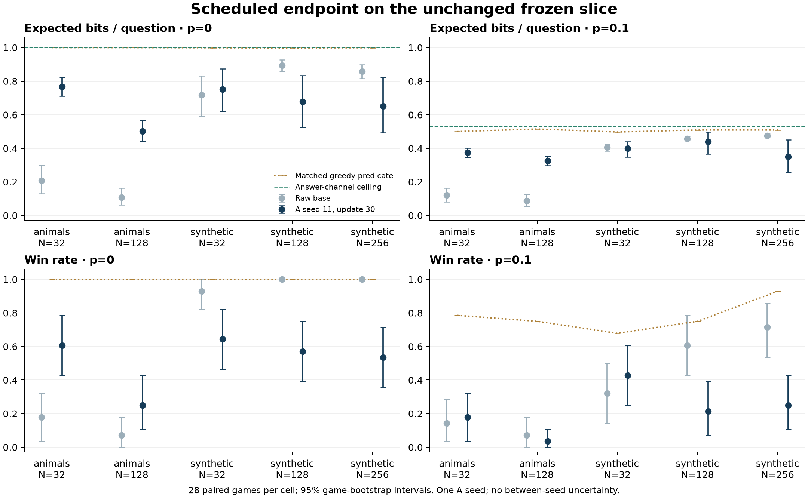

# Twenty Bits




**Main A seed 11 gate: better animal questions, weaker transfer.** Thirty outcome-only RL updates improved noiseless animal EIG/question from **0.158 → 0.634**, an equal-size paired change of **+0.476 [95% CI +0.413, +0.539]**. Relabeled synthetic EIG fell **0.823 → 0.693**, with wins **82/84 → 49/84**. Across all ten cells, wins fell **141/280 → 104/280** despite higher average EIG. This is one training seed, with no estimate of training-seed uncertainty.

The task is question selection given the environment's candidate set after each answer. It does not test learned state tracking. The reward contains only wins, question cost and invalid penalties; EIG is measured, never rewarded. Questions remain attribute predicates: no legal item-name enumeration appeared in training or the frozen comparisons. Large-set guessing remains weak: **27/28** noiseless animal N=128 games guessed with multiple candidates remaining. Synthetic identifier errors and early stopping limit transfer.

The [full gate](MAIN_A11_GATE.md) contains every update, [the fixed development curve](results/main_A11/charts/main-learning.png), all ten paired frozen cells, guess-with-k counts, CIs, the behavior audit and [two preselected paired games](results/main_A11/EXAMPLE_GAMES.md). Development EIG rose 0.483 → 0.684; progress was concentrated early and later checks fluctuated. [The pilot](PILOT_GATE.md) and earlier gates remain historical. SFT is excluded because random-question SFT lowered EIG on qualification.

**Recorded project usage: $11.015850 / $50.00, with $0.467534 held and $38.516616 available**, from [ledger.json](ledger.json). A11 used $4.389417 plus $0.104721 holds, versus a $15.368560 forecast with margin. These are token-usage charges at the saved provider rates; invoice reconciliation is pending. The two unavailable pre-pause originals remain excluded and held after their exact replacements completed.

**Stopped at the A11 gate.** A23, B41 and hard mode have not started. The remaining U schedule forecasts **$26.46 including 1.5x margin**, within current available funds; it waits for the user's decision. [Forecast and assumptions](research/main_A11_remaining_forecast.json), [budget](BUDGET.md), [resume audit](research/main_A11_resume_audit.json) and [historical pause](PAUSED.md) are saved.

The headline chart uses the same 28 games in each of ten cells for raw base and the scheduled update-30 endpoint. The GIF is an offline baseline illustration; the final model replay and multi-seed report remain later deliverables. [Phase 2](PHASE2.md), [diagnosis](DIAGNOSIS.md), [alias/SFT gate](ALIAS_GATE.md) and [candidate qualification](CANDIDATE_GATE.md) preserve the earlier failed configurations. The gpt-oss-120b reference is removed from future plans.

Open the [interactive replay](replays/index.html), [truthful-answer MP4](replays/baseline-noiseless.mp4), or [noisy-answer MP4](replays/baseline-noisy.mp4). The two illustrated games were selected for a visible strategy contrast. The complete sweeps supply the reported numbers.

The offline grid contains 24,000 games, with 200 paired games for each domain, candidate size, noise setting, and policy. [Every cell](results/baselines/BASELINES.md), [machine-readable metrics and 95% bootstrap CIs](results/baselines/summary.json), and [matched frozen-game references](results/baselines/frozen/summary.json) are saved. Greedy predicate's macro-average EIG is 0.9976 bits/question with truthful answers and 0.4994 with 10% noise. Its observed win rates are 100% and 81.925%. The noisy answer-channel ceiling is 0.5310 bits/question.

These are finite authored worlds. Animals has 400 named age/sex profiles across 100 types; tools and foods each have 320 profiles across 80 types. They use 90, 88, and 71 attributes to stay distinguishable without random identity bits. The synthetic world has 512 unique random 16-bit rows and is relabeled in each game. [World definitions, sample hand checks, and limitations](data/WORLDS.md) describe the construction. Animal training uses a fixed 200-row pool; paid animal evaluation uses disjoint rows, with shared underlying types disclosed.

[PAID_PLANS.md](PAID_PLANS.md) records the approved $50 cap and selected U plan. [MAIN_A11_GATE.md](MAIN_A11_GATE.md) is the current stop; [PAUSED.md](PAUSED.md) preserves the earlier pause and resume point. [PRIOR_WORK.md](PRIOR_WORK.md) stays as context; this is a side project for GitHub and X.

## Reproduce offline

Use Python 3.11 or later. The game and core tests do not need Tinker credentials or its SDK. Paid-adapter tests require the paid extra and use mocked requests.

```bash
python3 -m venv .venv
source .venv/bin/activate
python3 -m pip install -e '.[replay]'
python3 -m unittest discover -s tests -v
python3 scripts/verify_frozen.py
python3 scripts/run_baselines.py
python3 scripts/run_frozen_baselines.py
python3 scripts/plot_baselines.py
python3 scripts/measure_tokens.py
python3 scripts/build_paid_plans.py
python3 -m twenty_bits.budget status
```

Tokenizer downloads come from Hugging Face at the recorded revisions. No weights are downloaded. The baseline runners reuse the committed per-game results when present and verify their world, tokenizer, and seed provenance. To compute another sweep independently, use `python3 scripts/run_baselines.py --output-directory /tmp/twenty-bits-reproduction`. The frozen bank is already included; `freeze_evals.py` refuses to overwrite it.

Serve the viewer with `python3 -m http.server 8765` and visit `http://localhost:8765/replays/`. Play, scrub, step, change noise mode, hide the target, or load a matched pair in the JSON schema from replays/games.json. Regenerate the local exports with `python3 scripts/export_replays.py`. This uses the pinned HyperFrames CLI and FFmpeg. To rebuild only GIFs from existing MP4s, add `--reuse-mp4`.

## Reproduce the current paid analysis offline

```bash
python3 -m pip install -e '.[paid]'
python3 scripts/analyze_main_seed.py
python3 scripts/verify_main_seed.py
python3 scripts/plot_main_seed.py
python3 scripts/reprice_remaining_main.py
python3 scripts/write_main_seed_gate.py
```

These commands use committed compressed traces and request metadata, without service calls, credentials, raw run caches or adapter weights. [Archive-only verification and hashes](results/main_A11/reproduction.json) record that check. The compressed case file restores the identical data manifest. Tokenizers use pinned local files or download those files from Hugging Face. The unit tests use mocked requests and never need Tinker access.

Historical gate files contain their own reproduction commands. Run those checks at their corresponding commits because later source hashes and ledger totals have changed. `build_paid_plans.py` rebuilds historical Phase 1 proposals; it is not the current forecast. Completed paid runners return before service access. `.env`, raw run caches and adapter binaries are ignored and untracked.

## Read the code

[LEARN.md](LEARN.md) explains each completed phase. Start with [worlds.py](twenty_bits/worlds.py), [predicates.py](twenty_bits/predicates.py), [information.py](twenty_bits/information.py), and [game.py](twenty_bits/game.py), then read [baselines.py](twenty_bits/baselines.py). The public observation is built in [prompts.py](twenty_bits/prompts.py), and frozen-game checks live in [evaluation.py](twenty_bits/evaluation.py).

[PROTOCOL.md](PROTOCOL.md) fixes the grammar, budget, posterior, metrics, and stopping rules. [NUMBERS.md](NUMBERS.md) records the main comparisons. EIG is measured and never rewarded. Legal name enumeration remains allowed, and the approved output cap accommodates the measured half-candidate lists. The final RESULTS.md will tie model claims to charts, paired CIs, spend, and failed attempts after those data exist.

The paid bridge lives in [model_player.py](twenty_bits/model_player.py), [tinker_rendering.py](twenty_bits/tinker_rendering.py), and [tinker_transport.py](twenty_bits/tinker_transport.py). [candidate_feedback.py](twenty_bits/candidate_feedback.py) supplies the versioned main observation without changing historical prompts. [The candidate-set reproduction check](results/candidate_set/reproduction.json) verifies saved-archive analysis. The transport persists IDs before sampling, reserves the full declared cost, and handles pending retrieval without repeating sampling.

[rl_pilot.py](twenty_bits/rl_pilot.py) builds group-standardized advantages and guarded SDK training operations. [run_rl_pilot.py](scripts/run_rl_pilot.py) joins cookbook rollouts, training and scheduled development checks. [analyze_rl_pilot.py](scripts/analyze_rl_pilot.py) replays actions, verifies exact rewards and training masks, and builds the audit. The pilot starts from raw base and never loads the historical SFT adapter.

[run_main_seed.py](scripts/run_main_seed.py) adds the full matched control, the 30-update curriculum and mandatory A11 gate. [guess_metrics.py](twenty_bits/guess_metrics.py) measures stopping with k candidates; it changes no reward or observation. [recovery.py](twenty_bits/recovery.py) enforces one exact replacement per lost logical sample, retained original holds and permanent output exclusion. [analyze_main_seed.py](scripts/analyze_main_seed.py) replays the run and audits transfer identifiers; [verify_main_seed.py](scripts/verify_main_seed.py) verifies the archived analysis and completed-run guard. The historical pause verifier belongs at its pause commit.
