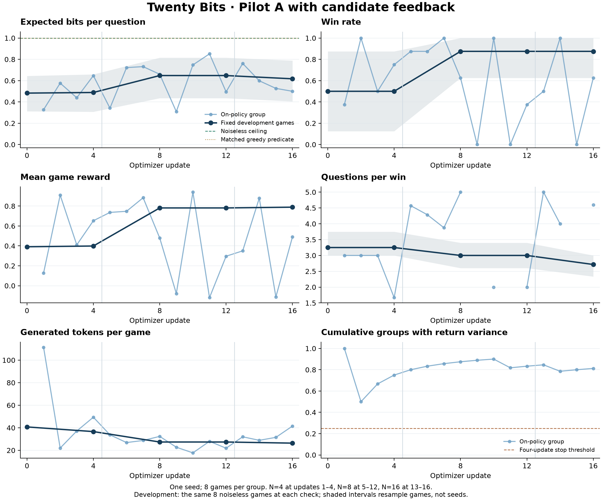

# Twenty Bits




Given the candidate set after each answer, can an outcome-only reward teach a small LLM to select efficient questions? Does it learn attribute bisection or item-name enumeration, transfer to relabeled tables, and re-check noisy answers? The main condition supplies state tracking; no-list play is evaluation-only hard mode.

**Raw-base RL pilot complete: 16 updates, 128 training games.** On eight fixed development cases, EIG/question rose **0.483 → 0.617**, wins **4/8 → 7/8**, and questions/win **3.25 → 2.71**. The paired EIG change has a 95% CI of **[-0.001, +0.305]**: encouraging but inconclusive. No name enumeration occurred; risky guessing remains, with four final wins while multiple candidates were still possible. [The current gate](PILOT_GATE.md) reports every update, costs, audit and [two preselected paired games](results/pilot_A/EXAMPLE_GAMES.md). Random-question SFT is excluded because it lowered EIG.

**Recorded usage: $6.626433 / $50.00, with $0.362813 held; $43.010754 available**, from [ledger.json](ledger.json). The pilot used $0.291204 plus $0.250000 holds, below its $2.00 ceiling. Main option S proposes A:3/B:2 seeds, 12 updates each, for $42.89 including margin; U proposes A:2/B:1, 30 updates each, for $42.49. Both include development checks every four updates. Work stops for the user's choice. Invoice reconciliation remains pending.

The chart shows the pilot; the GIF illustrates offline random versus greedy search. [Phase 2](PHASE2.md), [diagnosis](DIAGNOSIS.md), [alias/SFT gate](ALIAS_GATE.md) and [candidate qualification](CANDIDATE_GATE.md) preserve the earlier results. Pilot development uses one seed and eight N=4/8 training-pool cases, outside gradients. No noisy, transfer or frozen-test model evaluation has run under the new main condition. The gpt-oss-120b reference is removed from future plans.

Open the [interactive replay](replays/index.html), [truthful-answer MP4](replays/baseline-noiseless.mp4), or [noisy-answer MP4](replays/baseline-noisy.mp4). The two illustrated games were selected for a visible strategy contrast. The complete sweeps supply the reported numbers.

The offline grid contains 24,000 games, with 200 paired games for each domain, candidate size, noise setting, and policy. [Every cell](results/baselines/BASELINES.md), [machine-readable metrics and 95% bootstrap CIs](results/baselines/summary.json), and [matched frozen-game references](results/baselines/frozen/summary.json) are saved. Greedy predicate's macro-average EIG is 0.9976 bits/question with truthful answers and 0.4994 with 10% noise. Its observed win rates are 100% and 81.925%. The noisy answer-channel ceiling is 0.5310 bits/question.

These are finite authored worlds. Animals has 400 named age/sex profiles across 100 types; tools and foods each have 320 profiles across 80 types. They use 90, 88, and 71 attributes to stay distinguishable without random identity bits. The synthetic world has 512 unique random 16-bit rows and is relabeled in each game. [World definitions, sample hand checks, and limitations](data/WORLDS.md) describe the construction. Animal training uses a fixed 200-row pool; paid animal evaluation uses disjoint rows, with shared underlying types disclosed.

[PAID_PLANS.md](PAID_PLANS.md) records the approved $50 cap and proposed main choices. [PILOT_GATE.md](PILOT_GATE.md) is the current gate report. No main run is authorized. [PRIOR_WORK.md](PRIOR_WORK.md) stays as context; this is a side project for GitHub and X.

## Reproduce offline

Use Python 3.11 or later. The game and core tests do not need Tinker credentials or its SDK. Paid-adapter tests require the paid extra and use mocked requests.

```bash
python3 -m venv .venv
source .venv/bin/activate
python3 -m pip install -e '.[replay]'
python3 -m unittest discover -s tests -v
python3 scripts/verify_frozen.py
python3 scripts/run_baselines.py
python3 scripts/run_frozen_baselines.py
python3 scripts/plot_baselines.py
python3 scripts/measure_tokens.py
python3 scripts/build_paid_plans.py
python3 -m twenty_bits.budget status
```

Tokenizer downloads come from Hugging Face at the recorded revisions. No weights are downloaded. The baseline runners reuse the committed per-game results when present and verify their world, tokenizer, and seed provenance. To compute another sweep independently, use `python3 scripts/run_baselines.py --output-directory /tmp/twenty-bits-reproduction`. The frozen bank is already included; `freeze_evals.py` refuses to overwrite it.

Serve the viewer with `python3 -m http.server 8765` and visit `http://localhost:8765/replays/`. Play, scrub, step, change noise mode, hide the target, or load a matched pair in the JSON schema from replays/games.json. Regenerate the local exports with `python3 scripts/export_replays.py`. This uses the pinned HyperFrames CLI and FFmpeg. To rebuild only GIFs from existing MP4s, add `--reuse-mp4`.

## Reproduce the paid analysis offline

```bash
python3 -m pip install -e '.[paid]'
python3 scripts/verify_rendering.py
python3 scripts/summarize_phase2.py
python3 scripts/verify_phase2.py
python3 scripts/plot_phase2.py
python3 scripts/diagnose_phase2.py
python3 scripts/measure_random_learnability.py
python3 scripts/price_format_warmstart.py
python3 scripts/summarize_learnability_probe.py
python3 scripts/reprice_learnability.py
python3 scripts/write_learnability_report.py
python3 scripts/break_down_zero_eig.py
python3 scripts/summarize_alias_probe.py
python3 scripts/summarize_format_sft.py
python3 scripts/audit_qualification.py
python3 scripts/write_alias_gate.py
python3 scripts/summarize_candidate_qualification.py
python3 scripts/price_candidate_pilot.py
python3 scripts/write_candidate_gate.py
python3 scripts/analyze_rl_pilot.py
python3 scripts/verify_rl_pilot.py
python3 scripts/plot_rl_pilot.py
python3 scripts/price_main_runs.py
python3 scripts/write_pilot_gate.py
```

These commands use saved traces and request metadata, without service calls or credentials. Run historical gate verification at its corresponding commit: later source hashes and project ledger totals have changed. The current pilot analysis reproduces from the committed compressed archives without local run caches or adapter weights; [verification and hashes](results/pilot_A/reproduction.json) record that check. Tokenizers use pinned local files or download those files from Hugging Face. `build_paid_plans.py` rebuilds historical Phase 1 proposals; `build_approved_plan.py` reprices the historical group-size changes. Completed runners return without service access, and saved request IDs prevent resubmission. No main run is authorized. `.env`, raw run caches and adapter binaries are ignored and untracked.

## Read the code

[LEARN.md](LEARN.md) explains each completed phase. Start with [worlds.py](twenty_bits/worlds.py), [predicates.py](twenty_bits/predicates.py), [information.py](twenty_bits/information.py), and [game.py](twenty_bits/game.py), then read [baselines.py](twenty_bits/baselines.py). The public observation is built in [prompts.py](twenty_bits/prompts.py), and frozen-game checks live in [evaluation.py](twenty_bits/evaluation.py).

[PROTOCOL.md](PROTOCOL.md) fixes the grammar, budget, posterior, metrics, and stopping rules. [NUMBERS.md](NUMBERS.md) records the main comparisons. EIG is measured and never rewarded. Legal name enumeration remains allowed, and the approved output cap accommodates the measured half-candidate lists. The final RESULTS.md will tie model claims to charts, paired CIs, spend, and failed attempts after those data exist.

The paid bridge lives in [model_player.py](twenty_bits/model_player.py), [tinker_rendering.py](twenty_bits/tinker_rendering.py), and [tinker_transport.py](twenty_bits/tinker_transport.py). [candidate_feedback.py](twenty_bits/candidate_feedback.py) supplies the versioned main observation without changing historical prompts. [The candidate-set reproduction check](results/candidate_set/reproduction.json) verifies saved-archive analysis. The transport persists IDs before sampling, reserves the full declared cost, and handles pending retrieval without repeating sampling.

[rl_pilot.py](twenty_bits/rl_pilot.py) builds group-standardized advantages and guarded SDK training operations. [run_rl_pilot.py](scripts/run_rl_pilot.py) joins cookbook rollouts, training and scheduled development checks. [analyze_rl_pilot.py](scripts/analyze_rl_pilot.py) replays actions, verifies exact rewards and training masks, and builds the audit. The pilot starts from raw base and never loads the historical SFT adapter.
