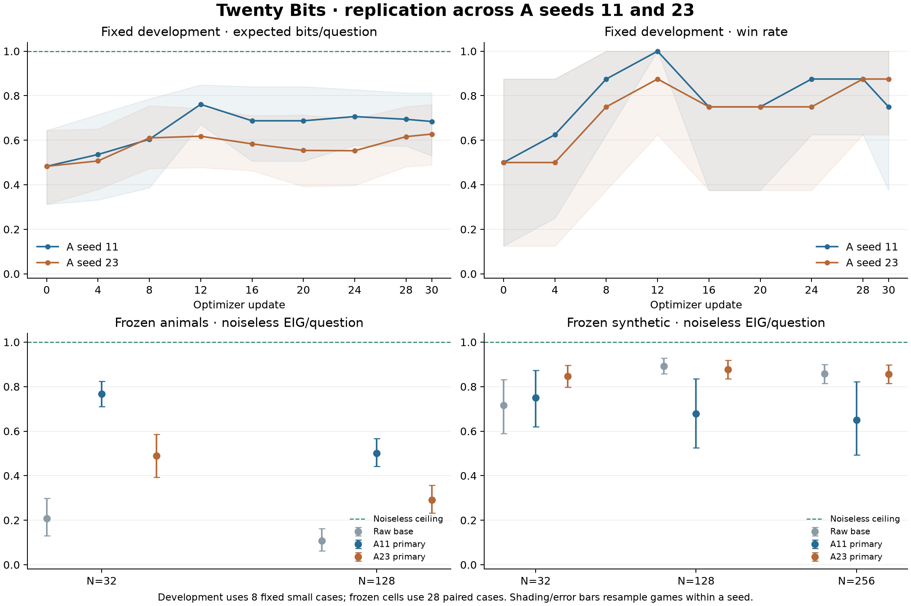
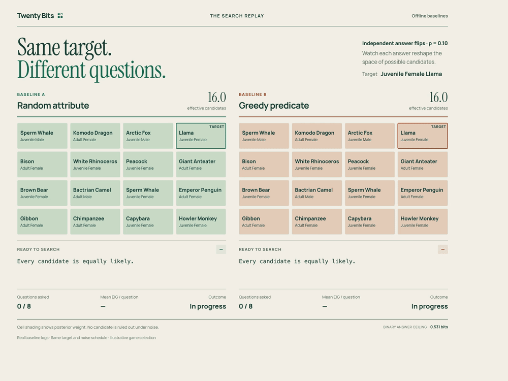

# Twenty Bits





**Outcome-only RL improves animal question selection, with substantial variation between training seeds.** Across the same noiseless N=32/128 games, expected bits per question rise from raw base **0.158** to **0.634 (A11)** and **0.390 (A23)**. A23's paired change is **+0.233 [95% CI +0.165, +0.302]**; its animal wins rise **7/56 → 25/56**, versus A11's 24/56. The one-bit ceiling remains distant on animals. The paired intervals condition on the fitted endpoints; two seeds give limited information about training variability.

Synthetic transfer differs sharply by seed. Raw base already wins **82/84** noiseless relabeled-table games; A23 wins **84/84**, while A11 falls to **49/84** with identifier-copying errors. Synthetic EIG is **0.823 → 0.860** for A23, with a paired change interval **[-0.001, +0.083]**. These observations show preservation of an existing search ability in A23, rather than establishing that RL created it.

The main task supplies remaining candidates after every answer. It measures question selection given state. Reward is **+1 win, -0.03/question, -0.1/INVALID**; EIG is measured, never rewarded. Both A seeds start from provider Qwen3-8B without project SFT. Legal item-name enumeration is absent, but A23's raw training outputs contain malformed name-query attempts that the parser rejects. Stopping remains weak: at animal N=128, A23 has no ambiguous guesses but **23/28 games end without guessing**. Noisy primary wins fall **52/140 → 29/140**; no-list hard mode yields **0/20 wins for both base and A23**. B41, the noisy-trained condition, has not run.

[MAIN_A23_GATE.md](MAIN_A23_GATE.md) contains all 30 updates, both fixed development curves, ten paired frozen cells, guess-with-k counts, bootstrap intervals, identifier errors, the auxiliary suffix diagnostic and [two preselected paired games](results/main_A23/EXAMPLE_GAMES.md). [A11's gate](MAIN_A11_GATE.md) and earlier failed configurations remain historical. The suffix-tolerant parser never enters a primary result or training run. Its fresh-session outputs show some variation despite matched seeds and prompt tokens; the gate discloses that limitation.

**Recorded project usage: $16.125774 / $50.00, with $1.640132 held and $32.234094 available**, from [ledger.json](ledger.json). Invoice reconciliation is pending. A23 added $5.109912 in usage and $0.508896 in holds. Both endpoint file types are saved natively without expiry and successfully sampled from a fresh session. Smoke-test files were API-verified, confirmed by the user and deleted; their unresolved storage holds remain. Pixel Miser checkpoints were untouched. [Budget](BUDGET.md), [persistence evidence](research/native_persistence_deletion.json).

**A23 gate accepted; B41 is authorized after the offline ledger migration.** Its unchanged 30-update forecast is **$13.64 including 1.5x margin**, within the remaining cap. Only unchanged B41 and its scheduled endpoint are authorized; stop at MAIN_B41_GATE.md. The ledger now uses transactional SQLite for live guards; all 216 tests pass and migration preserved every total. [Storage and performance proof](LEDGER.md), [exact question-budget visibility](research/BUDGET_VISIBILITY.md). The final RESULTS.md, model replay and noisy-training comparisons remain later deliverables. The GIF above illustrates offline baselines, not a trained model.

Open the [interactive baseline replay](replays/index.html), [truthful-answer MP4](replays/baseline-noiseless.mp4), or [noisy-answer MP4](replays/baseline-noisy.mp4). The two illustrated games were selected for visible strategy contrast; complete sweeps supply the reported baseline numbers.

The offline grid contains 24,000 games, with 200 paired games for each domain, candidate size, noise setting, and policy. [Every cell](results/baselines/BASELINES.md), [machine-readable metrics and 95% bootstrap CIs](results/baselines/summary.json), and [matched frozen-game references](results/baselines/frozen/summary.json) are saved. Greedy predicate's macro-average EIG is 0.9976 bits/question with truthful answers and 0.4994 with 10% noise. Its observed win rates are 100% and 81.925%. The noisy answer-channel ceiling is 0.5310 bits/question.

These are finite authored worlds. Animals has 400 named age/sex profiles across 100 types; tools and foods each have 320 profiles across 80 types. They use 90, 88, and 71 attributes to stay distinguishable without random identity bits. The synthetic world has 512 unique random 16-bit rows and is relabeled in each game. [World definitions, sample hand checks, and limitations](data/WORLDS.md) describe the construction. Animal training uses a fixed 200-row pool; paid animal evaluation uses disjoint rows, with shared underlying types disclosed.

[PAID_PLANS.md](PAID_PLANS.md) records the approved $50 cap and selected U plan. [MAIN_A23_GATE.md](MAIN_A23_GATE.md) is the current stop; [PAUSED.md](PAUSED.md) preserves the earlier pause and resume point. [PRIOR_WORK.md](PRIOR_WORK.md) stays as context; this is a side project for GitHub and X.

## Reproduce offline

Use Python 3.11 or later. The game and core tests do not need Tinker credentials or its SDK. Paid-adapter tests require the paid extra and use mocked requests.

```bash
python3 -m venv .venv
source .venv/bin/activate
python3 -m pip install -e '.[replay]'
python3 -m unittest discover -s tests -v
python3 scripts/verify_frozen.py
python3 scripts/run_baselines.py
python3 scripts/run_frozen_baselines.py
python3 scripts/plot_baselines.py
python3 scripts/measure_tokens.py
python3 scripts/build_paid_plans.py
python3 -m twenty_bits.budget status
```

Tokenizer downloads come from Hugging Face at the recorded revisions. No weights are downloaded. The baseline runners reuse the committed per-game results when present and verify their world, tokenizer, and seed provenance. To compute another sweep independently, use `python3 scripts/run_baselines.py --output-directory /tmp/twenty-bits-reproduction`. The frozen bank is already included; `freeze_evals.py` refuses to overwrite it.

Serve the viewer with `python3 -m http.server 8765` and visit `http://localhost:8765/replays/`. Play, scrub, step, change noise mode, hide the target, or load a matched pair in the JSON schema from replays/games.json. Regenerate the local exports with `python3 scripts/export_replays.py`. This uses the pinned HyperFrames CLI and FFmpeg. To rebuild only GIFs from existing MP4s, add `--reuse-mp4`.

## Reproduce the current paid analysis offline

```bash
python3 -m pip install -e '.[paid,replay]'
python3 scripts/analyze_main_A23.py
python3 scripts/analyze_A23_replication.py
python3 scripts/verify_main_A23.py
python3 scripts/plot_main_A23.py
python3 scripts/plot_A_replication.py
python3 scripts/price_B41_after_A23.py
python3 scripts/write_main_A23_gate.py
```

These commands use committed compressed traces, finished-session metadata and request journals without service calls, credentials, raw run caches or adapter weights. [Archive-only verification and hashes](results/main_A23/reproduction.json) record that check. Verification was also run in a separate checkout containing only Git files, without `.env` or `runs/`. Tokenizers use pinned cached files or download those files from Hugging Face. Unit tests mock service operations.

Historical gate checks belong at their corresponding commits because ledger totals and source hashes have since changed. In particular, do not rebuild A11 summaries against today's ledger. `build_paid_plans.py` rebuilds historical Phase 1 proposals, not the current forecast. Completed paid runners return before service access. `.env`, raw run caches and adapter binaries remain ignored and untracked.

## Read the code

[LEARN.md](LEARN.md) explains each completed phase. Start with [worlds.py](twenty_bits/worlds.py), [predicates.py](twenty_bits/predicates.py), [information.py](twenty_bits/information.py), and [game.py](twenty_bits/game.py), then read [baselines.py](twenty_bits/baselines.py). The public observation is built in [prompts.py](twenty_bits/prompts.py), and frozen-game checks live in [evaluation.py](twenty_bits/evaluation.py).

[PROTOCOL.md](PROTOCOL.md) fixes the grammar, budget, posterior, metrics, and stopping rules. [NUMBERS.md](NUMBERS.md) records the main comparisons. EIG is measured and never rewarded. Legal name enumeration remains allowed, and the approved output cap accommodates the measured half-candidate lists. The final RESULTS.md will tie model claims to charts, paired CIs, spend, and failed attempts after those data exist.

The paid bridge lives in [model_player.py](twenty_bits/model_player.py), [tinker_rendering.py](twenty_bits/tinker_rendering.py), and [tinker_transport.py](twenty_bits/tinker_transport.py). [candidate_feedback.py](twenty_bits/candidate_feedback.py) supplies the versioned main observation without changing historical prompts. [The candidate-set reproduction check](results/candidate_set/reproduction.json) verifies saved-archive analysis. The transport persists IDs before sampling, reserves the full declared cost, and handles pending retrieval without repeating sampling.

[rl_pilot.py](twenty_bits/rl_pilot.py) builds group-standardized advantages and guarded SDK training operations. [run_rl_pilot.py](scripts/run_rl_pilot.py) joins cookbook rollouts, training and scheduled development checks. [analyze_rl_pilot.py](scripts/analyze_rl_pilot.py) replays actions, verifies exact rewards and training masks, and builds the audit. The pilot starts from raw base and never loads the historical SFT adapter.

[run_main_seed.py](scripts/run_main_seed.py) adds the full matched control, the 30-update curriculum and mandatory A11 gate. [guess_metrics.py](twenty_bits/guess_metrics.py) measures stopping with k candidates; it changes no reward or observation. [recovery.py](twenty_bits/recovery.py) enforces one exact replacement per lost logical sample, retained original holds and permanent output exclusion. [analyze_main_seed.py](scripts/analyze_main_seed.py) replays the run and audits transfer identifiers; [verify_main_seed.py](scripts/verify_main_seed.py) verifies the archived analysis and completed-run guard. The historical pause verifier belongs at its pause commit.

[run_main_A23.py](scripts/run_main_A23.py) preserves the second A seed's schedule and native permanent endpoint saves. [run_A23_endpoint_aux.py](scripts/run_A23_endpoint_aux.py) keeps the suffix diagnostic and hard mode separate. [analyze_main_A23.py](scripts/analyze_main_A23.py), [analyze_A23_replication.py](scripts/analyze_A23_replication.py) and [verify_main_A23.py](scripts/verify_main_A23.py) replay accepted outputs, reconstruct all gradient batches and reproduce comparisons from committed archives. [name_reference_audit.py](twenty_bits/name_reference_audit.py) detects malformed name queries without accepting or rewarding them.
