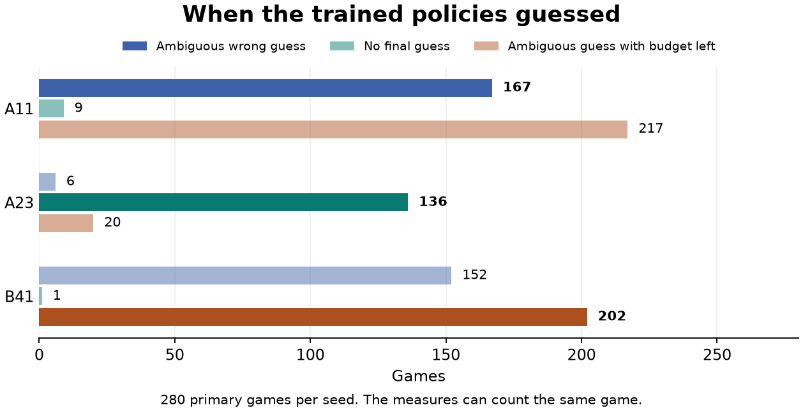
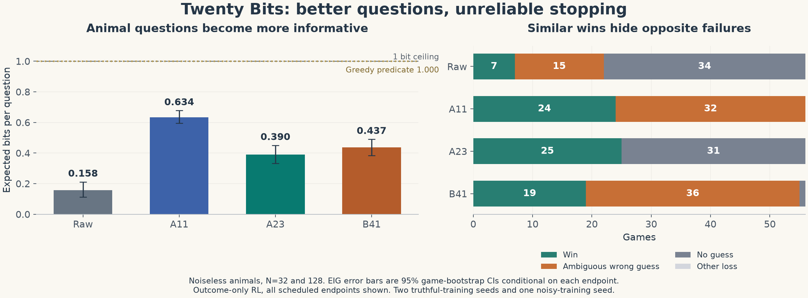
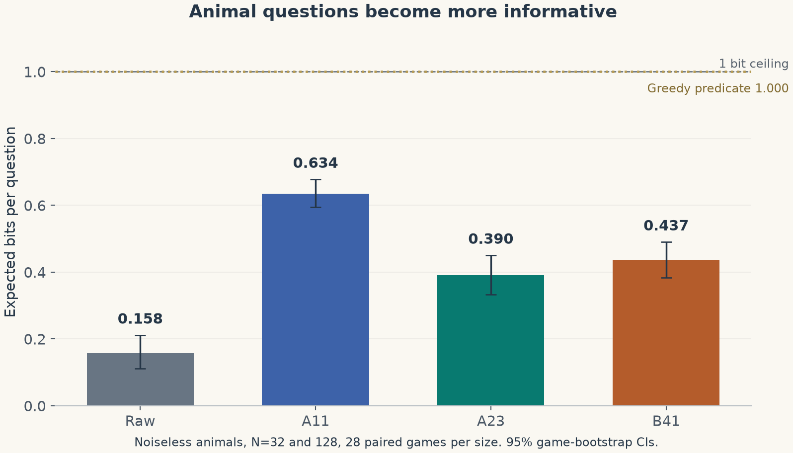
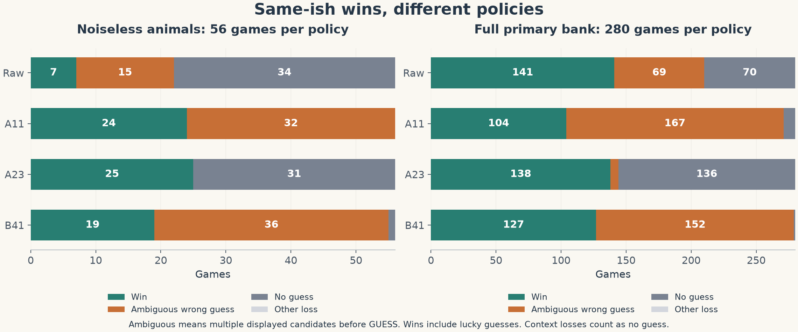
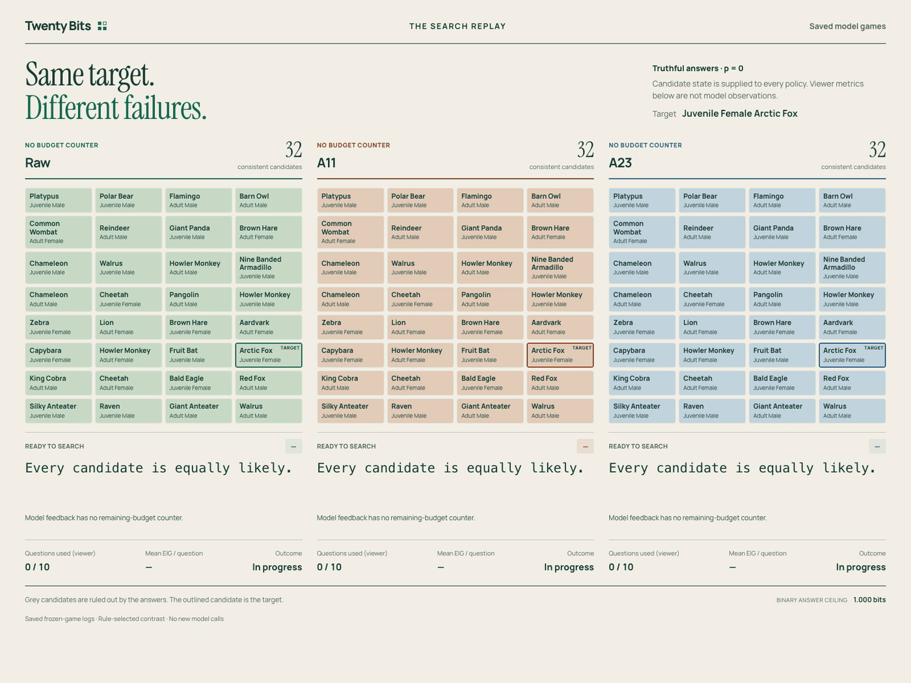
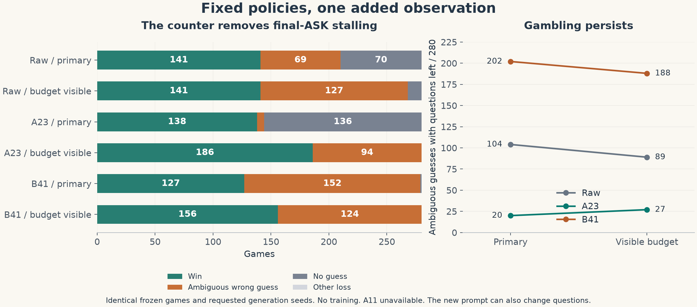
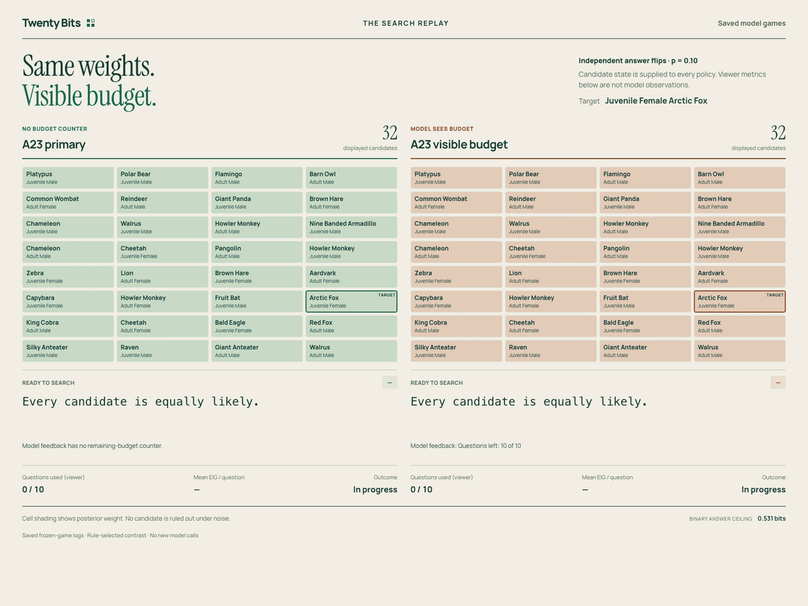
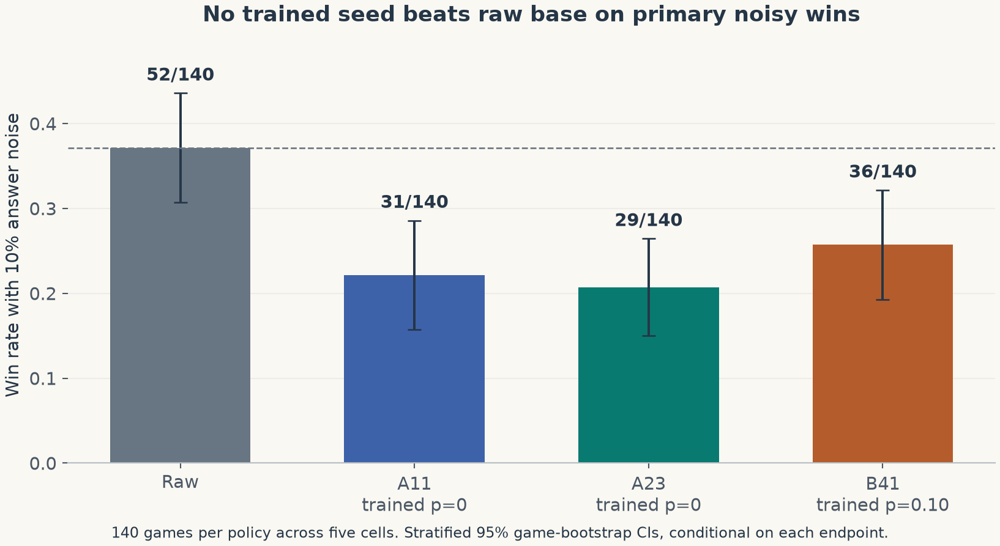
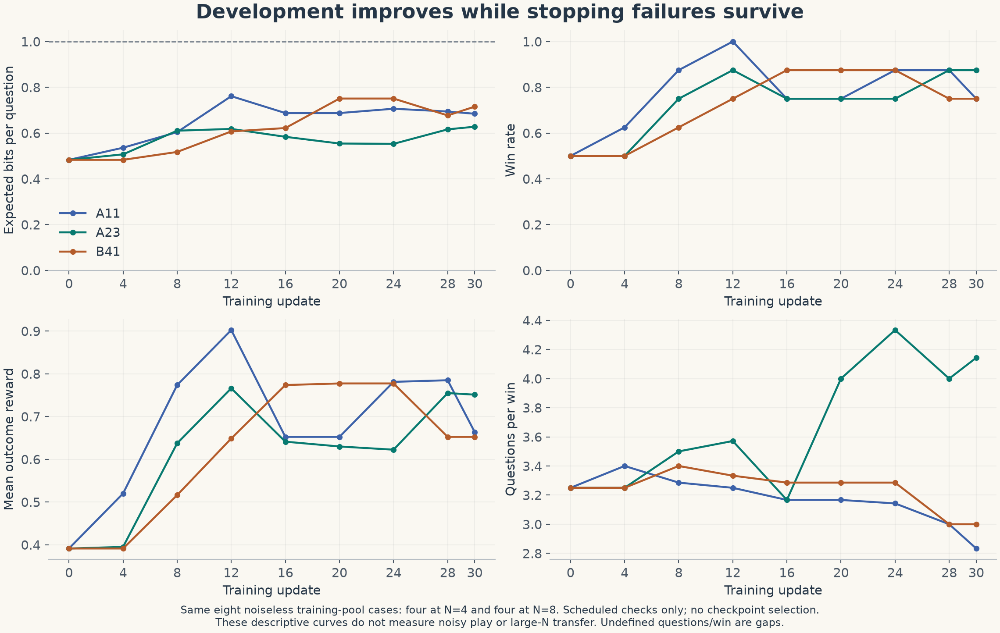

# Twenty Bits: better questions, unreliable stopping

RL improved expected information per question on noiseless animals for all three seeds, about 4× for A11. The policies struggled with when to guess. Across the 280 primary games per seed, A11 made 167 ambiguous wrong guesses, A23 ended 136 games without guessing, and B41 made 202 ambiguous guesses with budget left. The last count includes wins as well as losses. [Primary measurements](results/writeup/numbers.json), [guess timing chart](figures/guess-timing.svg).

The information gain did not reliably translate into more wins outside noiseless animal games. All three trained policies won fewer games than raw across the full primary bank.

| Policy | Wins across all primary games | Wins on noiseless animal games | Wins on noisy games |
| --- | ---: | ---: | ---: |
| Raw Qwen3-8B | 141/280 | 7/56 | 52/140 |
| A11 | 104/280 | 24/56 | 31/140 |
| A23 | 138/280 | 25/56 | 29/140 |
| B41 | 127/280 | 19/56 | 36/140 |

On those same 56 noiseless animal cases, random questions won 16/56 and the greedy predicate reference won 56/56. The reference used exactly 5 questions at N=32 and 7 at N=128. [Matched baseline table](README.md#matched-noiseless-comparison-at-n32), [paired reference gaps](results/submission/comparison.json).

## The experiment in brief

The model sees a candidate table and asks exact Boolean questions such as `ASK: fur AND NOT carnivore`. Table column codes are exact, case-sensitive aliases for attribute names. `AND`, `OR`, `NOT`, parentheses and `item == <literal name>` form the grammar. Arbitrary name lists are legal when written as item equalities. A script answers from the target's row, so no judge model is involved. A final `GUESS: <name>` wins or ends the game. The question budget is twice `ceil(log2 N)`, followed by one final-guess opportunity. Malformed questions consume budget. [Game and grammar](PROTOCOL.md), [parser](twenty_bits/predicates.py).

The environment supplies candidate state after every counted question. In noiseless games it lists exactly consistent candidates. With 10% independent answer noise, it lists candidates with posterior probability above 0.001 plus the maximum-posterior candidate. Noisy candidates can re-enter the list. The model never receives numeric posterior probabilities. The full table and history remain available. The primary prompt states the maximum budget but never displays a running remaining count. This is a study of question selection given supplied candidate state, with budget tracking still left to the model. [Observation contract](twenty_bits/candidate_feedback.py), [budget audit](research/BUDGET_VISIBILITY.md).

All main runs start from raw Qwen3-8B. A11 and A23 train with truthful answers. B41 trains with 10% answer noise. Each receives 30 updates, with eight sampled games from one start state per update. The curriculum reaches N=128. The reward is **+1 for winning, -0.03 per question, -0.1 per invalid question**. Group advantages use population-standardized game returns. Information gain receives no reward. Thinking is disabled, with a 2,048-token output cap. [A11 configuration](experiments/main_A11.json), [A23 configuration](experiments/main_A23.json), [B41 configuration](experiments/main_B41.json), [training code](twenty_bits/rl_pilot.py).

The fixed paid bank contains 28 games in each of ten cells: animals at N=32 and 128, relabeled synthetic tables at N=32, 128 and 256, each with truthful or noisy answers. Every policy uses the same cases and requested generation seeds. Training uses only the fixed animal training pool. Frozen cases and synthetic tables never enter main gradients. [Frozen manifest](evals/frozen/manifest.json), [declared comparisons](NUMBERS.md), [archived endpoint verification](results/main_B41/validation.json).

The raw frozen control is shared across the three trained endpoints. It is not three independent base-model evaluations. [Source cohorts](results/writeup/numbers.json).

Expected information gain, or EIG, measures how much a question is expected to reduce posterior entropy before its answer is observed. It includes both possible answers and the known noise channel. INVALID contributes zero. The ceiling is 1 bit per noiseless question and about 0.531 bits with 10% noise. EIG includes losing games, unlike questions per win. [Exact calculations](twenty_bits/information.py), [measurement rules](PROTOCOL.md).

## Finding 1: RL improves animal question quality in every seed

The noiseless animal headline gives equal weight to N=32 and N=128. Within each size, EIG is total expected bits divided by total questions, including invalids and losses. Every trained endpoint improves over raw base, while remaining below the 1-bit ceiling. [Headline data and bootstrap settings](results/writeup/numbers.json).

| Policy | Animal EIG per question, 95% CI | Paired increase over raw, 95% CI | Wins out of 56 |
| --- | ---: | ---: | ---: |
| Raw | 0.158 [0.112, 0.211] | Reference | 7 |
| A11, truthful training | 0.634 [0.594, 0.677] | +0.476 [0.413, 0.539] | 24 |
| A23, truthful training | 0.390 [0.333, 0.450] | +0.233 [0.165, 0.302] | 25 |
| B41, noisy training | 0.437 [0.384, 0.490] | +0.279 [0.207, 0.348] | 19 |

The paired increase intervals come from the declared endpoint analyses. Absolute intervals resample the saved games for this write-up. Both use 10,000 bootstrap draws. These intervals condition on each fitted endpoint. They do not treat the games as independent training seeds. A separate seed-then-game bootstrap for the mean of the two A endpoints gives an animal EIG increase interval of [0.187, 0.518]. With two A seeds and one B seed, training-seed uncertainty remains poorly estimated. [Per-seed paired analyses](results/main_B41/summary.json), [A-seed bootstrap](results/main_A23/replication_summary.json), [write-up intervals](results/writeup/numbers.json).

The accepted endpoint questions use attributes rather than legal item-name enumeration. Legal enumeration occurs zero times in all four primary frozen-policy cohorts. That describes accepted actions, not every attempted strategy: the name-reference audit below catches malformed identity queries. The result supports improved attribute-based question selection, rather than optimal bisection or reliable stopping. [Accepted-action counts](results/writeup/numbers.json), [post-hoc name audit](results/main_A23/replication_summary.json).

## Finding 2: win rate hides different policies

A11 and A23 win 24 and 25 of the same 56 noiseless animal games. Their paired win-rate difference is about 1.8 percentage points, with a 95% interval from -10.7 to +14.3 points. Their ways of losing are opposite. [Paired A comparison](results/main_A23/replication_summary.json).

| Policy | Wins | Ambiguous wrong guesses | No guess | Other losses |
| --- | ---: | ---: | ---: | ---: |
| Raw | 7 | 15 | 34 | 0 |
| A11 | 24 | 32 | 0 | 0 |
| A23 | 25 | 0 | 31 | 0 |
| B41 | 19 | 36 | 1 | 0 |

These are mutually exclusive outcomes on noiseless animals. An ambiguous wrong guess has more than one candidate remaining before the guess. Wins include lucky ambiguous guesses. No-guess includes context exhaustion where present. The full-bank panel below keeps every domain and noise cell visible, rather than using the animal subset as the overall win rate. [Outcome definitions and counts](results/writeup/numbers.json).

At noiseless animal N=128, A11 guesses ambiguously in 27 of 28 games. A23 makes no ambiguous guesses but never guesses in 23 of 28. B41 guesses ambiguously in 25 of 28 despite improved animal EIG. The curriculum gives N=128 only four start states and 32 sampled games per seed. Limited exposure is a possible explanation, not a tested cause. [Cell-level stopping counts](results/main_B41/all_seeds.json), [curriculum](experiments/main_B41.json).

When a group contains no wins, its relative advantages can come only from penalties. A cheaper losing rollout can then receive a positive advantage relative to longer losing rollouts. That gives a plausible route to early guessing, but no reward ablation tests the explanation. Ambiguity itself is also descriptive: some uncertain guesses are rational under a question cost, especially with noise. It is not a count of proven decision errors. [Group-signal audit and objective](results/main_B41/summary.json), [reward configuration](experiments/main_B41.json).

The replay below uses the earliest eligible frozen animal case under a disclosed numeric ordering. Base wins after seven questions. A11 asks informative questions but makes a wrong guess with two candidates and budget left. A23 keeps asking after ten questions and loses without guessing. The selected case therefore favors the base model on winning. It was chosen for the failure contrast. [Selection rule and eligible cases](results/writeup/numbers.json), [verbatim saved traces](replays/study/games.json).

[MP4](replays/study/gamble-stall.mp4) · [interactive viewer](replays/study/viewer/index.html)

## Finding 3: budget tracking and gambling are different failures

The visible-budget follow-up changes only the public prompt. Each turn adds `Questions left: k of K`. At zero it also says `No questions left. You must GUESS now.` Raw base, A23 and B41 each replay the same 280 frozen cases from fixed weights. A11 cannot be included because its hosted checkpoint was not persisted. This is an evaluation-only prompt intervention, with separately stored hashes. [Follow-up protocol](VISIBLE_BUDGET_PROTOCOL.md), [prompt hashes](evals/visible_budget/prompt_hashes.json).

| Policy | Primary wins | Visible-budget wins | No-guess endings | Ambiguous guesses with budget left |
| --- | ---: | ---: | ---: | ---: |
| Raw | 141/280 | 141/280 | 70 to 12 | 104 to 89 |
| A23 | 138/280 | 186/280 | 136 to 0 | 20 to 27 |
| B41 | 127/280 | 156/280 | 1 to 0 | 202 to 188 |

All extra ASK actions at the final opportunity disappear. Raw's remaining 12 no-guess endings exhaust context. The combined counter and final-guess instruction changed A23's stopping behavior. The experiment does not isolate the contribution of either prompt element. B41 still makes an ambiguous guess with questions left in every noisy animal N=128 game under this variant. The data leave the mechanism and the role of any individual reward term open. [Every paired cell and CI](VISIBLE_BUDGET_GATE.md), [complete counts](results/visible_budget/summary.json).

The improvement is mainly in A23's noisy wins, which rise from 29 to 74 out of 140. Its pooled noisy EIG stays near 0.354 bits per question. Pooled EIG falls for every available policy under the amended prompt. Showing budget therefore improves termination and winning without improving the overall information score. Because the counter appears from the opening turn, it can change question choices too. The intervention does not isolate the final instruction alone. [Pooled paired measurements](results/visible_budget/summary.json).

[MP4](replays/study/budget-fix.mp4) · [selection rule and full transcript](replays/study/games.json)

## Finding 4: noisy training does not clearly help noisy winning

In the primary observation format, every trained seed has fewer noisy wins than raw base. B41 improves over both A endpoints, but its comparison with their mean is uncertain. [Noise counts and conditional intervals](results/writeup/numbers.json), [seed-and-game comparison](results/main_B41/all_seeds.json).

| Primary policy | Noisy wins out of 140 |
| --- | ---: |
| Raw | 52 |
| A11 | 31 |
| A23 | 29 |
| B41 | 36 |

B41 minus mean A is +4.3 percentage points in noisy win rate, with a 95% paired game and A-seed interval of [-1.8, +10.7] points. Noisy EIG increases by 0.031 [0.001, 0.053] bits per question in that comparison. Higher EIG does not establish error correction. There is only one B endpoint. Re-ask opportunities also differ across policies, so raw re-ask counts cannot establish a general learned checking strategy. [Full comparison and opportunity denominators](results/main_B41/all_seeds.json).

On noisy animals, next-action re-asks after unlikely replies are raw 22/45, A11 1/14, A23 18/45 and B41 6/20. An unlikely reply has predictive probability below 0.20. A re-ask repeats a previous truth vector or its complement. This narrow metric misses other cross-checking strategies, and its denominator depends on the questions a policy chooses. [Metric and cell counts](PROTOCOL.md), [saved cell measurements](results/main_B41/all_seeds.json).

The statement about trained policies losing more noisy games is specific to the primary prompt. Under visible budget, raw wins 57, A23 wins 74 and B41 wins 55 of 140. A23's improvement changes the conclusion about that endpoint's noisy winning once budget state is supplied. It does not show a benefit from B41's noisy training. [Follow-up noisy results](results/visible_budget/summary.json).

## Development curves improve without resolving the endpoint failures

The fixed development slice has eight noiseless animal cases, four at N=4 and four at N=8. Scheduled checks reuse them and never select a checkpoint. All endpoints are the scheduled update-30 weights. B41's development EIG rises from 0.483 to 0.716 while its four N=128 training groups all have zero wins. The small development slice misses large-N and noisy failure modes. [Development and training logs](results/main_B41/summary.json), [all plotted points](results/writeup/numbers.json).

## Side findings that change the interpretation

**Identifier errors depend strongly on the seed.** A11 makes 276 invalid synthetic questions, compared with four for A23 and 28 for B41. A11's code-plus-suffix mistakes do not reproduce at the same scale in A23. Noiseless synthetic wins are raw 82/84, A11 49/84, A23 84/84 and B41 72/84. Raw base is already strong on these relabeled random tables. The data do not support a general claim of improved synthetic transfer after RL. [Identifier audit](results/main_A23/replication_summary.json), [B41 cell and identifier counts](results/main_B41/all_seeds.json).

The copying error blends an attribute code with a suffix from a full attribute name. The resulting identifier is neither an exact code nor a real name. Primary scoring rejects it. [Identifier forms](results/main_A23/replication_summary.json).

The N=256 synthetic cell changes both domain and candidate-set size relative to training. It cannot separate pure domain transfer from size transfer. [Frozen cases](evals/frozen/manifest.json).

**Legal-enumeration counts miss malformed name search.** A post-hoc exact-name audit finds 142 invalid A23 training questions containing candidate-name references, including 78 bare-name queries and 25 lists. The grammar rejects these forms because names require explicit `item ==` syntax. Correctly written item-equality lists remain legal. This is consistent with attempted name search, rather than evidence that A23 never considered it. A raw name reference alone cannot prove intent. The audit changes no score or reward. [Audit definitions and examples](results/main_A23/replication_summary.json), [audit code](twenty_bits/name_reference_audit.py).

**One update collapses.** A23's update 23, at N=64, has zero wins, 67 invalid questions out of 96, 24 truncated turns and 6,312.75 generated tokens per game. Mean reward is -1.1975. The protocol does not change, and later behavior partly recovers. The data do not establish why this happens. [Update-23 record](results/main_A23/summary.json).

**Sampler and trainer probabilities differ.** Maximum absolute generated-token logprob gaps are 2.704 nats for A11, 1.621 for A23 and 3.803 for B41. Native token sequences match, and the declared importance-sampling objective uses saved rollout probabilities. The backend cause and behavioral effect are unknown. These discrepancies limit how cleanly the training implementation can be interpreted. [A11 diagnostic](results/main_A11/summary.json), [A23 diagnostic](results/main_A23/summary.json), [B41 diagnostic](results/main_B41/summary.json).

**The requested seed does not guarantee identical actions across sessions.** The A23 suffix-parser diagnostic has 13 of 168 pairs that diverge before any identifier mapping, despite identical native prompt tokens and supplied sampling parameters. Complete action sequences match in 152 pairs. This variation limits attribution of small diagnostic differences to the parser. It also means the replay pairs are observed samples, not guarantees of exact resampling from a checkpoint. [Saved-response session audit](results/A23_suffix/session_variation.json).

## Limits of the result

- Candidate state is supplied. The model does not have to maintain the full posterior from history. The tiny hard-mode comparison without candidate feedback has zero wins out of 20 for both raw base and A23. It does not establish learned state tracking. A11's hosted checkpoint was unavailable for the deferred hard-mode and suffix comparisons. [Hard-mode and missing-data record](results/main_A23/replication_summary.json).
- The semantic tables are authored profiles, not independent real-world species. Animals has 400 age-and-sex profiles from 100 underlying types, with a fixed 200-row training pool. The paid cases draw from held-out profiles. The training and evaluation pools share 88 underlying animal types. The synthetic domain tests relabeled binary-table search. Tools and foods have offline baselines but no main paid model evaluation. [World construction](data/WORLDS.md), [training boundary](PROTOCOL.md).
- The exact Boolean grammar removes free-form interpretation. It admits balanced item-name lists but rejects malformed shortcuts. Improvements need not transfer to natural language question answering. [Grammar](PROTOCOL.md).
- A working prompted-halving baseline remains untested. The tested wording produced 262 invalid questions out of 280 and no final guesses. It was a format failure on the 28 noiseless N=32 animal cases. [Prompt](results/submission/halving/preflight.json), [full rollouts](results/submission/halving/games.jsonl.gz).
- Single learning rate, no sweep. The pilot and all main seeds use the cookbook default `4e-5`. [Optimizer settings](experiments/main_A11.json).
- Thinking is disabled. Visible reasoning tokens are zero by design and do not measure internal computation. [Sampling settings](experiments/main_B41.json), [token measurements](results/visible_budget/summary.json).
- There are two A seeds, one B seed and 28 games per frozen cell. Game-bootstrap CIs describe the fitted endpoints. Seed-bootstrap intervals based on two A endpoints remain unstable, and B training-seed uncertainty cannot be estimated. Multiple exploratory comparisons are not corrected as a family. [Statistical plan](NUMBERS.md), [write-up settings](results/writeup/numbers.json).
- Each training update samples eight rollouts from one table and target. The noisy group also shares a seeded noise schedule. The apparent number of games overstates the number of independent search worlds. [Training configuration and audit](results/main_B41/summary.json).
- The examples are selected by behavior-based rules to make the failures visible. They illustrate mechanisms and are not a performance sample. Aggregate charts include every declared game. [Selection rules](results/writeup/numbers.json).

## Cost and reproduction

Recorded project usage is **$23.681223**, with **$2.083181 held** and **$24.235596 available** under the $50 cap. Charges use observed tokens at pinned prices, pending invoice reconciliation. Holds include unresolved lost originals and checkpoint storage. The original write-up, archived analysis, figures and replays added zero Tinker spend. The submission's halving baseline adds $0.271615 in recorded usage and $0.000000 in new holds. [Submission ledger](COSTS.md). [Ledger export](ledger.json), [hold breakdown](BUDGET.md), [write-up source hashes](results/writeup/numbers.json).

Run `python3 scripts/build_writeup_data.py`, `python3 scripts/plot_writeup.py` and `python3 scripts/build_study_replays.py` to rebuild the derived data, charts and HTML from the saved artifacts. Local export commands and their version are recorded in [the replay guide](replays/study/README.md). The final [verification record](results/writeup/validation.json) checks the numbers, source hashes, example rule, chart pairs and exported media. Historical main-run gate checks remain tied to their commits because their ledger snapshots precede the follow-up.
